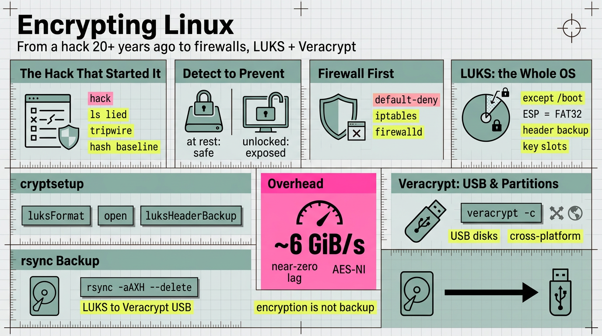

# 加密 Linux：從 20 多年前的一次入侵到防火牆、LUKS 與 Veracrypt

> 簡體版：[加密 Linux：從 20 多年前的一次入侵到防火牆、LUKS 與 Veracrypt](https://github.com/j3ffyang/ai-thoughts/blob/main/docs/261002-encrypt-linux-zh-hans.md)

**原文：** [261002-encrypt-linux.md](https://github.com/j3ffyang/ai-thoughts/blob/main/docs/261002-encrypt-linux.md)

*Arch Linux。`firewalld` (nftables) 負責網路，然後是 LUKS 加密的根分割槽、未加密的 `/boot`，以及一個 Veracrypt USB 卷。*

我的 Linux 經歷可以追溯到 20 多年前。這是一份個人記述：一次入侵如何把我從*檢測*篡改推向了*預防*它——先是用防火牆鎖住網路，再加密自己擁有的每一塊磁碟。



## 1. 起因：那次入侵 (the hack that started it)

- 我的經歷：20 多年前通過貓 (modem) 撥號安裝系統時被入侵了好幾次。破綻是 `ls`——列出的檔案與我確信本該在那裡的檔案對不上，說明二進位制檔案已被替換。（這段故事在 Linux 生日那篇裡也講過：[`260828-happy-birthday-linux-from-aix-to-arch.md`](https://github.com/j3ffyang/ai-thoughts/blob/main/docs/260828-happy-birthday-linux-from-aix-to-arch.md)。）
- 應對方式是 `tripwire`：它為已安裝的二進位制檔案（如 `/bin/ls`）建立雜湊 (hash) 資料庫，然後保護這個資料庫，使入侵者無法悄悄改寫它——最初的 Tripwire 把資料庫儲存為人類可讀的文本，靠檔案許可權和離線/只讀副本來守護；而如今的 Open Source Tripwire 用由口令派生的 site 和 local 金鑰對它**簽名 (signs)**。檢查時把當前的二進位制檔案與基線 (baseline) 比對；若有二進位制被升級或被篡改，就會顯現出來，然後你重新計算雜湊並更新基線。
- 當年的背景：包管理 (package management) 很弱，所以安裝一個獨立驅動有時意味著重新編譯核心 (compile the kernel)。
- 注：`tripwire` 如今基本是一個歷史工具。現代的檔案完整性監控 (file-integrity monitoring)：AIDE，或自建的 `sha256sum` 基線。（`pacman -Qk` 只檢查包內檔案是否*存在*；`-Qkk` 再加上許可權、大小與 mtime——兩者都不對內容做雜湊，所以一個大小不變、被調包的 `/bin/ls` 能矇混過關。）

## 2. 轉變：從檢測到預防 (detection to prevention)

- “在那之後，我對資料庫隱私 (database privacy) 與安全變得相當敏感”——並花了大量時間琢磨資料如何在磁碟上被保護、以及筆記本被盜會怎樣。
- 用**威脅模型 (threat model)** 來框定：加密能防什麼、不能防什麼。
  - 能防：**靜態 (at rest)** 資料——已關機或被盜的磁碟。
  - 不能防：正在執行、已解鎖的機器；作業系統已經開啟時的惡意軟體 (malware)；而且它的強度僅取決於口令。

## 3. 防火牆優先：先網路後磁碟 (firewall first)

- 先解決網路：那次入侵是從線纜進來的——撥號貓 (modem)、沒有路由器、沒有 NAT，主機本身就是邊界——所以先鎖網路，再管磁碟。先關門，再操心保險箱。
- 血統 (lineage)：`ipchains`（核心 2.2）→ `iptables`（核心 2.4+）→ `nftables`（核心 3.13+，現代引擎）。在當代系統上，`iptables` 通常只是 `nf_tables` 的相容前端（用 `iptables --version` 檢視——它一般會顯示 `(nf_tables)`）。
- 裸 `iptables`，預設拒絕 (default-deny)：
  ```bash
  iptables -A INPUT -i lo -j ACCEPT
  iptables -A INPUT -m conntrack --ctstate ESTABLISHED,RELATED -j ACCEPT
  iptables -A INPUT -p tcp --dport 22 -j ACCEPT
  iptables -P INPUT DROP     # set the default last, so you don't drop your own session
  ```
  **注意：** 通過 SSH 應用 `DROP` 會切斷你自己的會話——先放行 `ESTABLISHED,RELATED` 與你的 SSH 埠，並在測試時保持第二條連線開啟。而且如果不做 `iptables-save`（或 `netfilter-persistent`），這些規則在重啟後就會消失。
- 只選一個管理器：`iptables`、`ufw`、`firewalld` 都作用於核心裡同一套 netfilter——在 `firewalld` 執行時手動改 `iptables`，只會被覆蓋。
- 我早年 Debian 上用的是 `ufw`，後來換成了 `firewalld`，因為它更標準、在各大發行版上更通用——用 zone 和具名 service 取代裸鏈：
  ```bash
  sudo firewall-cmd --permanent --add-service=ssh
  sudo firewall-cmd --reload
  firewall-cmd --list-all
  ```
  不加 `--permanent` 新增的規則只在執行時生效；`--reload` 應用的是 `--permanent` 寫入的內容。
- 邊界：防火牆守護的是*正在執行、聯網*的機器——對一臺已關機、被盜的磁碟毫無作用。這正是接下來要加密的原因。

## 4. LUKS：加密整個作業系統

- 我的原則：LUKS 加密整個作業系統，**唯獨 `/boot` 除外**——它必須在輸入任何口令*之前*就可被讀取。
- 時機：LUKS 是在**安裝作業系統期間**啟用的——在建立根檔案系統 (root filesystem) 之前就設定好加密分割槽。它並不適合事後加裝到正在使用的根磁碟上，除非重灌，或做一次有風險的原地重新加密 (in-place re-encryption)。
- 典型配置中，`/boot` 是 EFI 系統分割槽 (`vfat`)，LUKS 分割槽 (`crypto_LUKS`) 可以直接承載根檔案系統（無需 LVM），而 `/etc/crypttab` 記錄開機時要解鎖的卷。
- 為什麼 `/boot` 保持明文 (cleartext)：韌體 (firmware) 與引導載入程式 (bootloader) 必須在磁碟解鎖之前讀取它；UEFI 的 **ESP** 按規範就是 FAT32。（嚴謹地說：“`/boot` 必須是 fat32” 實際描述的是 ESP——在非 UEFI 環境下，獨立的 `/boot` 也可以是 ext4。）
- 涉及的 `cryptsetup` 命令：`luksFormat`、`luksOpen`、`luksAddKey` / `luksChangeKey`、`luksDump`、`luksHeaderBackup`，以及用於開機解鎖的 `/etc/crypttab`。
- 實踐中，安裝時以及備份頭部 (header) 時：
  ```bash
  cryptsetup luksFormat <partition>
  cryptsetup open <partition> root          # 解鎖，然後 mkfs + mount
  cryptsetup luksHeaderBackup <partition> --header-backup-file luks-header.img
  ```
  **注意：** `luksFormat` 會**摧毀**目標分割槽——執行前請確認裝置。
- 最要命的坑：**備份 LUKS 頭部**——弄丟它，資料就不可恢復。多個 **key slot** 允許設定多個口令。
- 效能：有了硬體 AES（AES-NI，或 ARMv8 加密擴充套件），開銷很小。`cryptsetup benchmark` 通常能讓 `aes-xts` 512b 跑到數 GiB/s——比常見 NVMe 的吞吐還快，所以瓶頸是磁碟而非加密。順序 (sequential) I/O 上預計**幾乎沒有**延遲，隨機 4K 上是低個位數百分比；沒有 AES 加速時，代價會跳到 2–3 倍甚至更多。
- TRIM/discard：SSD 支援 discard，但讓 `/etc/crypttab` 不寫 `discard` 選項、並啟用 `fstrim.timer`，得到的是**週期性批次 TRIM**，而非持續 discard——既保持磁碟健康，又不會即時洩露哪些塊正在被使用。

## 5. Veracrypt：加密分割槽與 USB 磁碟

- 我的原則：Veracrypt（源自 TrueCrypt）加密**分割槽**，用來加密我**所有**的 USB 磁碟。
- 時機：與 LUKS 不同，Veracrypt 可以**隨時、事後**再應用——在磁碟、分割槽或容器檔案 (container file) 上建立卷 (volume)，無需重灌。
- Veracrypt 卷像任何其他塊裝置一樣掛載——例如掛在 `/mnt/usb`。
- 可移動介質 (removable media) 為什麼用 Veracrypt 而非 LUKS：跨平臺容器 (Linux/Windows/macOS)，以及支援隱藏卷 (hidden volumes)。
- 建立卷是互動式的：`veracrypt -c` 會逐步詢問卷型別（分割槽 vs 容器檔案）、大小與演算法。**注意：** `veracrypt -c` 會**覆蓋**目標——開始前請確認裝置或路徑。
- 分工：LUKS 用於固定的系統盤；Veracrypt 用於在多臺機器之間攜帶的可移動介質。

## 6. 如果筆記本被盜會怎樣

- 靜態下，沒有口令，LUKS 磁碟毫無用處——這正是全部意義所在，也是採用預啟動認證 (pre-boot authentication) 的原因。
- 但未加密的 `/boot` 仍會暴露核心/initramfs，且可能被篡改（**evil-maid**）；一臺處於掛起（而非關機）狀態的機器會面臨冷啟動/記憶體 (cold-boot/RAM) 攻擊。這些就是老實的邊界。
- 我不為此失眠的地方：`/boot` 本就公開，而有了 `zram` swap（在記憶體裡），敏感資料不會落到磁碟上——真正要緊的資料都在 LUKS 裡的 `/` 下。要徹底堵住 evil-maid 這條路，需要 **Secure Boot** 加 **TPM**；我接受這點殘餘風險。
- 加密不等於備份：磁碟損壞或頭部丟失都意味著徹底丟失。唯一的保護是別處有一份加密副本。

## 7. 每日備份：從 LUKS 磁碟 rsync 到 Veracrypt USB

- 例行做法：掛載 Veracrypt 卷，然後用 `rsync` 把 LUKS 加密的家目錄 (home) 映象過去。兩端都是在核心中解密的本地塊裝置 (block device)，所以沒有任何東西交給第三方——LUKS 保護源，Veracrypt 保護副本，都是靜態保護。
- 在 Veracrypt 卷掛載後（例如掛在 `/mnt/usb`），每日命令是：
  ```bash
  rsync -aAXH --delete --info=progress2 \
    --exclude='.cache/' \
    --exclude='.local/share/Trash/' \
    $HOME/ /mnt/usb/backup/
  ```
- 引數說明：`-a` 歸檔 (archive)（它已經隱含了 `-r` / `--recursive`——遞迴對任何目錄都必不可少，所以實用的 rsync 應當始終覆蓋它）；`-A`/`-X` 保留 ACL 與擴充套件屬性 (extended attributes)；`-H` 硬連結 (hard links)；`--delete` 映象刪除（使副本保持真正的映象）；`--info=progress2` 顯示總體進度。源路徑末尾的斜槓表示“目錄的內容”。
- 首次執行：加上 `-n` / `--dry-run` 預覽究竟會改動什麼，然後再去掉。
- 要讓它真正每日執行，就把它排進計劃 (systemd timer 或 cron)，並守護 USB 是否已插入且已掛載。

## 8. 習慣 (habits)

- 安全成了**預設**，而非補救：網路上用 `firewalld`（`ipchains` → `iptables` → `nftables` 一路演進），每一塊磁碟上都用 `luks` + `veracrypt`，沒有 `openssh` 就不開遠端會話。
- 從那時延續至今的主線：安全是一種習慣，而不是一次性的修復（見 [`260828-happy-birthday-linux-from-aix-to-arch.md`](https://github.com/j3ffyang/ai-thoughts/blob/main/docs/260828-happy-birthday-linux-from-aix-to-arch.md) 與 [`260706-brave-post.md`](https://github.com/j3ffyang/ai-thoughts/blob/main/docs/260706-brave-post.md)）。

## 待解決的問題 (open questions)

- LUKS1 還是 LUKS2？分離頭部 (detached header) 還是隨附的 (attached)？
- LUKS 頭部備份究竟存在哪裡、如何測試？
- 是否有完整性工具 (integrity tool) 取代了 `tripwire`？
- 每日 rsync 是手工執行，還是排進了計劃 (systemd timer / cron)？
- 防火牆是預設拒絕 (default-deny) 嗎？在哪個 zone？（即時規則需要 root 才能列出。）

## 驗證命令 (verification commands)

```bash
lsblk -o NAME,FSTYPE,MOUNTPOINT
findmnt -no FSTYPE /
findmnt -no FSTYPE /boot
command -v cryptsetup veracrypt
# firewall
iptables --version; nft --version
command -v firewall-cmd nft
# requires root; inspect key slots and header info
sudo cryptsetup luksDump <luks-device>
```

## 術語表 (glossary)

- **LUKS** —— Linux Unified Key Setup；Linux 磁碟加密的標準盤上格式 (on-disk format)，是 dm-crypt 之上的前端 (front-end)。
- **dm-crypt** —— 執行實際磁碟加密的核心 device-mapper 目標。
- **AES-NI** —— 加速 AES 加密的 CPU 指令；沒有它，LUKS 吞吐會急劇下降。
- **Veracrypt** —— 開源、跨平臺的卷加密，從 TrueCrypt 分叉而來。
- **tripwire** —— 檔案完整性監控器；記錄基線雜湊，資料庫受簽名保護（早期版本則是靠檔案許可權守護的人類可讀檔案）。
- **ESP** —— EFI 系統分割槽；UEFI 系統上存放引導載入程式的 FAT32 分割槽。
- **initramfs** —— 早期啟動檔案系統映象，在真正的根掛載之前解鎖加密根。
- **threat model** —— 明確說明你在防什麼、不防什麼。
- **evil-maid** —— 短暫獲得物理訪問許可權、篡改啟動路徑的攻擊者。
- **firewall** —— 決定哪些網路資料包可以到達執行中機器的規則；主機自身的防線。
- **ipchains / iptables / nftables** —— Linux 資料包過濾的血統；`nftables` 是現代核心內引擎，而 `iptables` 是遺留介面（如今通常是 `nf_tables` 相容層）。
- **ufw** —— Uncomplicated Firewall；Debian/Ubuntu 上同一套 netfilter 規則的平白語言前端。
- **firewalld** —— 跨發行版的防火牆守護程序；把規則組織成 **zone** 和具名 **service**，而非裸鏈。
- **TRIM / discard** —— SSD 維護操作，同時會洩露哪些塊正在被使用。

## 參考來源 (sources)

- `cryptsetup` 文件與 man 手冊（`luksFormat`、`luksHeaderBackup`、`luksDump`）。
- Veracrypt 文件（卷型別、隱藏卷、跨平臺支援）。
- Open Source Tripwire 上游 README —— 關於簽名資料庫的行為：[`Tripwire/tripwire-open-source`](https://github.com/Tripwire/tripwire-open-source)。
- `firewalld` 文件（zone、service）、Arch Wiki 上 `nftables` 與 `iptables` 的頁面，以及 `ufw` man 手冊。
- 交叉連結：[`260828-happy-birthday-linux-from-aix-to-arch.md`](https://github.com/j3ffyang/ai-thoughts/blob/main/docs/260828-happy-birthday-linux-from-aix-to-arch.md)、[`260706-brave-post.md`](https://github.com/j3ffyang/ai-thoughts/blob/main/docs/260706-brave-post.md)。

btw, i use arch
