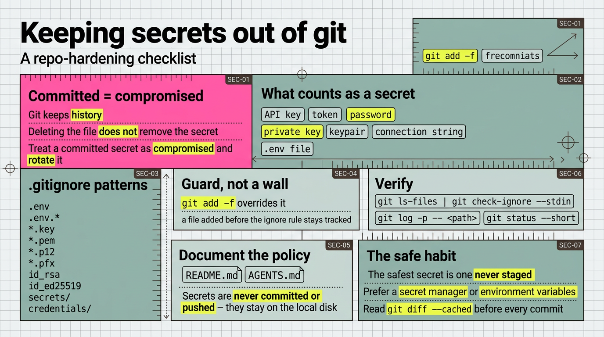

# 把機密擋在 Git 之外 (keeping secrets out of Git)

> 簡體版：[把機密擋在 Git 之外 (keeping secrets out of Git)](https://github.com/j3ffyang/ai-thoughts/blob/main/docs/261009-secret-handling-zh-hans.md)

**原文：** [261009-secret-handling.md](https://github.com/j3ffyang/ai-thoughts/blob/main/docs/261009-secret-handling.md)

機密 (secret)、憑據 (credential) 與金鑰 (key) 只應留在本地磁碟上，別處一概不留——不進提交 (commit)、不進推送 (push)、不進分支 (branch)、不進拉取請求 (pull request)。一旦某個機密到達遠端 (remote)，它就已經暴露，哪怕之後的提交把它刪掉也無濟於事，因為 git 會保留歷史。本筆記列出在一個倉庫裡應當考慮什麼、改動什麼，好讓機密無從溜入。



## 應當考慮什麼

- 機密 (secret) 是任何能授予訪問權的值：API 金鑰 (API key)、令牌 (token)、口令 (password)、私鑰 (private key)、金鑰對 (keypair)、連線字串 (connection string)、`.env` 檔案。
- git 會保留歷史。刪掉檔案並不會移除機密；把已提交的機密視為已洩露，並輪換 (rotate) 它。
- `.gitignore` 是護欄，不是牆：`git add -f` 能覆蓋它，而在忽略規則之前就已加入的檔案會一直處於被跟蹤 (tracked) 狀態。
- 最安全的機密是從未進入暫存區 (staged) 的那一個。從第一次提交起，就把機密放在被忽略的路徑裡。
- 優先使用機密管理器 (secret manager) 或環境變數 (environment variable)，而不是工作區 (working tree) 裡的檔案。
- 每次提交前讀一遍 `git diff --cached`；掃一眼就能抓住混進來的金鑰。

## 該在 .gitignore 裡改什麼

列出機密通常以哪些模式出現，讓 git 無法跟蹤它們：

```gitignore
# Secrets, credentials, keys — never commit or push
.env
.env.*
*.key
*.pem
*.p12
*.pfx
id_rsa
id_ed25519
secrets/
credentials/
```

當有新工具引入新的機密檔案時，就補上對應的模式。

## 該往 README.md 裡加什麼

把政策寫在讀者看得到的地方：

> 機密、憑據與金鑰永不提交、永不推送；它們留在本地磁碟上，`.gitignore` 排除了它們的常見模式。

如果 README 是生成的——就像本倉庫，由 `articles.yaml` 生成——就把這一行加進模板或生成它的源頭，絕不要手工編輯 README。

## 該往 AGENTS.md 裡加什麼

給智慧體 (agent) 同樣的規則，讓它不會暫存或提交機密：

> 永不提交或推送機密、憑據或金鑰；它們留在本地磁碟上。`.gitignore` 排除了它們的常見模式。

## 驗證

- `git ls-files | git check-ignore --stdin` 會列出任何會被新規則隱藏的已跟蹤檔案；它應當為空。
- `git log -p -- <path>` 顯示某個機密是否曾被提交過。
- `git status --short` 顯示沒有意外的機密檔案。

btw, i use arch
