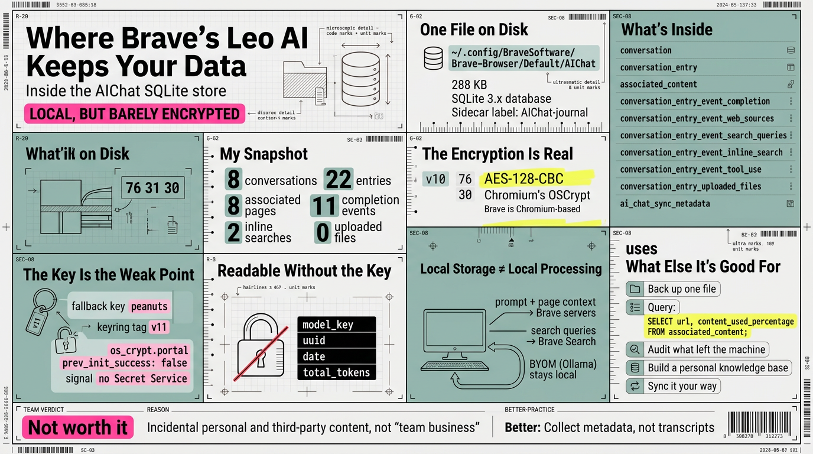

# Brave 的 Leo AI 把你的数据存放在哪里？

> 繁体版：[Brave 的 Leo AI 把你的数据存放在哪里？](https://github.com/j3ffyang/ai-thoughts/blob/main/docs/261013-brave-leo-local-data-zh-hant.md)

**原文：** [261013-brave-leo-local-data.md](https://github.com/j3ffyang/ai-thoughts/blob/main/docs/261013-brave-leo-local-data.md)

*Arch Linux。打开 `AIChat` —— Brave 的 Leo 侧边栏 (sidebar) 背后那一个 SQLite 文件 —— 看看这些对话、它读过的页面，以及搜索结果到底存放在哪里。*

有时候我用 Brave 的 Leo AI，只是为了读眼前这个页面：选中文字，让 Leo 总结一下，关掉侧边栏，然后继续干别的。这是最懒的一种 AI 用法 —— 没有账号，没有想保存的对话，也没有提示词工程 (prompt engineering)。正是这种随意让我好奇。如果我从来不“保存”任何东西，它到底去了哪里？我那一小堆问题、页面和答案，是放在 Brave 的服务器上，还是在我自己的磁盘上？于是我去自己的配置文件 (profile) 里找了一遍，没有克隆、也没有安装任何东西。



## 一个文件，就在我自己的磁盘上

答案就在我自己的磁盘上，而且几乎平淡得让人失望。Leo 关于你的对话保留的一切，都放在浏览器配置文件里的一个 SQLite 数据库里：

```text
~/.config/BraveSoftware/Brave-Browser/Default/AIChat
~/.config/BraveSoftware/Brave-Browser/Default/AIChat-journal
```

我看的时候，`AIChat` 刚过 300 KB，`file` 判定它是 "SQLite 3.x database"。那个 `-journal` 文件是回滚日志 (rollback journal)：浏览器空闲时它保持 0 字节，只有在写入进行中才会增长。这里没有 `leo/` 目录，没有按对话拆分的 JSON，也没有同步的文档。就是一个数据库。

这个单独的事实就是整篇文章的缩影：你的 AI 历史和一个普通浏览器文件一样本地化，也一样可移植。

有一处例外值得知道：Leo 被要求跨对话记住的那些事实，根本不在这个文件里。它们以纯字符串的形式追加到配置文件 `Preferences` 里的 `brave.ai_chat.user_memories` —— 未加密的 JSON，没有 `v10`，也不需要任何密钥。在我的配置文件里那个列表是空的，但这个设置在出厂时默认是开启的。对话存在数据库里；记忆存在一个偏好设置里。

## 里面到底有什么

Brave 锁住了这个文件，所以我打开的是副本。数据库模式 (schema) 读起来就像是对那个侧边栏功能的白话描述：

| 表 (table) | 存放的内容 |
| --- | --- |
| `conversation` | 每一个聊天会话 —— uuid、标题、模型、token 数 |
| `conversation_entry` | 每一轮 (turn) —— 你的提示词 (prompt)、你选中的文本、日期、模型 |
| `associated_content` | 你正在读的那个页面 —— url、标题、Leo 最后一次拉取的内容，以及 `content_used_percentage` |
| `conversation_entry_event_completion` | Leo 的回答，每个完成事件 (completion event) 一行 |
| `conversation_entry_event_search_queries` | Leo 发出的搜索查询 (query) |
| `conversation_entry_event_web_sources` | 某次搜索背后的网页来源，序列化 (serialized) 后存放 |
| `conversation_entry_event_inline_search` | 内联搜索 (inline search) 事件 |
| `conversation_entry_event_tool_use` | 工具调用 (tool call) |
| `conversation_entry_uploaded_files` | 你拖进去的文件，以及从里面提取出的文本 |
| `ai_chat_sync_metadata` | 同步 (sync) 的记账信息 |

在我这台机器上，我当时看到的：十来个对话、几十轮对话、十二个关联页面、若干次搜索与内联搜索事件，以及零个上传文件。

所以“搜索结果”并不是一样东西。Leo 跑过的查询在 `search_queries` 里；它找到的来源在 `web_sources` 里；它替我总结的那个页面在 `associated_content` 里，紧挨着 `content_used_percentage` —— 也就是模型实际读到了这个页面的多少。最后一列悄悄地有用：它告诉你这次摘要是看到了整页，还是只看到了一部分。在我的页面上，这一列清一色是 100 —— 没有一个撞到上限；只有当 Leo 为了塞进模型的上下文 (context) 而截断一个长页面时，它才会降到 100 以下。

## 本地存储 (local storage) 不等于本地处理 (local processing)

在我开始对隐私抒情之前，先说一个前提：存在本地，不等于在本地处理。历史、页面和答案都在磁盘上 —— 但提示词和页面文本仍然会发到 Brave 的服务器，并且继续交给为你所选模型提供服务的第三方模型供应商 (model provider)（Mixtral、Anthropic 的 Claude、Meta 的 Llama），而搜索查询则发往 Brave Search。Brave 自己的页面写得很明确：浏览器会分享“你最新的提示词、当前对话的上下文，以及——当用例需要时——你正在查看的页面中的必要上下文。”

如果这让你不舒服 —— 而且如果数据安全和隐私是你的优先项，它就该让你不舒服 —— Leo 可以改用本地模型，通过 BYOM（Bring Your Own Model，自带模型）：比如在你自己机器上跑 Ollama。那才是把整段对话留在本地磁盘、什么都不发出去的方式 —— 提示词不离开，页面上下文不离开，答案在你自己的硬件上生成。本地数据库是你做过什么的回执；本地模型才让这张回执成为完整的故事。

## “加密” (encryption) 是真的 —— 里面的保护未必

每一条消息和页面相关的列 —— 标题、提示词、选中的文本、回答、页面 URL 与内容、搜索查询与来源 —— 都是开头为 `v10` 字节的 BLOB：

```text
76 31 30 ...   # "v10" + AES-128-CBC ciphertext
```

结构性列是例外：uuid、日期（Windows FILETIME —— 100 纳秒的计时单位，不是 Unix 时间）、token 数，以及——值得知道的——`model_key` 都以明文 (cleartext) 存储，所以你的历史长什么样、到底哪个模型在回答，不用任何密钥就能读懂。

那个 `v10` 是 Chromium 的 OSCrypt —— 而 Brave 基于 Chromium，自然继承了下来。它用的是 AES-128-CBC，和保护已保存的 cookie 与密码的是同一套机制。正常情况下密钥来自系统密钥环 (keyring，即存放应用密钥的系统服务)（libsecret、GNOME Keyring、KWallet）。但看看我这台机器：

- `Local State` 里的 `os_crypt.portal` 报出 `prev_init_success: false`。
- `secret-tool` 报告没有可通信的 Secret Service。

当密钥环不可用时，Chromium 会退回一个硬编码的密钥：`v10` 前缀就是那个回退 (fallback) 提供者，它的密钥由字符串 `peanuts` 派生，而 `v11` 才标记由密钥环支撑的提供者。在没有 Secret Service 的机器上，比如我这台，你拿到的就是回退方案 —— 所以 Leo 数据库的“加密”，意思只是文本编辑器里显示乱码，而不是它是安全的：任何拿到这个文件副本的人都能读，不需要登录、不需要密钥环、也不需要密钥。写这篇文章时，我用那把公开密钥解密了自己的存储；标题、页面 URL，以及 Leo 跑过的每一次搜索查询，都以明文回来了。它是披着 *encrypted* 这个词的混淆 (obfuscation)。

这个教训我已经反复重新学过：*加密* 这个词，不知道密钥在哪就毫无意义。在密钥环正常工作的桌面上，Leo 的历史能防住另一个操作系统用户，也能防住磁盘被偷 —— 不过任何已经以你的身份运行的东西，仍然可以问密钥环、或者驱动浏览器去解密它。在像我这样的机器上，它向任何复制这个文件的人敞开。

有两个控制项能让上面大半问题失去意义，而且它们都在设置里：临时对话 (temporary chat) 根本不会写进 `AIChat` —— 代码拒绝持久化它们 —— 而本地聊天存储可以整个关掉。在你往那个侧边栏里打字之前，这些值得知道。

## 这些数据还能用来做什么

就是这一部分，把一次好奇变成了一个小项目。一个本地 SQLite 数据库不只是数据的堆积处；它是一份等着被使用的资源。

- **备份它。** 只有一个文件要复制 —— 但要复制得干净：浏览器开着时用 `sqlite3 AIChat ".backup leo.db"`，或者干脆先关掉浏览器，这样你永远不会撞上写到一半的状态。在像我这样的环境里，副本到哪都能读；而在由密钥环支撑的配置文件里，密钥留在密钥环里，所以在没有旧密钥环的情况下重装，会让备份变成一堆不透明的字节。把密钥也导出，否则备份就不算备份。
- **读懂自己的注意力。** 因为它是 SQL，这就成了一个关于“你让 AI 读什么、模型消化了多少”的查询 —— 只有一个坑：`url` 本身就是 `v10` 的 blob，所以直接跑 SQL 拿回来的是密文。诚实的版本是查那些明文列：

  ```sql
  SELECT content_type, content_used_percentage FROM associated_content;
  ```

  要把 URL 拿回来，得先解密那一列 —— 在 `peanuts` 环境里，用同一把公开密钥写几行 Python 就够了。
- **审计什么离开了这台机器。** 查询和来源都被记录下来了。如果你在意自己问过什么、它去了哪里，这张回执已经写好了。
- **搭建个人知识库。** 对话加上它们碰过的页面，就是一份阅读日志 —— 结构化、带时间戳、可查询。可以喂给本地模型，也可以压缩成笔记。
- **按自己的方式同步。** `ai_chat_sync_metadata` 这张表存在，是因为 Leo 能同步；但一条同步链本身也会搬动数据。既然它就是一个数据库，你可以按自己的方式同步 —— 一个加密目录、一个被 git 忽略的目录 —— 而不只是通过 Brave。
- **让整个循环离线。** 有了本地模型，同一个数据库就变成一个完全离线的循环：提示词、页面、答案，全在磁盘上，什么都不出去。

这些都不需要 Brave 开发新功能。它需要的是数据留在本地并且结构化 —— 而这一点已经成立了。

## 整套搬到团队里可行吗？我认为不可行

上面的一切都是一个用户、一台机器。下一个显而易见的问题是公司层面：如果整个团队都在用 Brave 和 Leo，是否值得把每一次对话都收集起来，用于商业和业务用途 —— 先把隐私放一边，假定这些全都是团队业务？

**我的答案是：看过这个文件之后，不行 —— 那个假定就是整个论证本身，而它站不住。** Leo 会存下提示词和任何选中的文本、它在 `associated_content` 里总结过的完整页面内容，以及任何上传的文件和其中提取的文本。人们会往那个侧边栏里粘贴凭据、客户数据、人力与法务事务，还有私人问题。你收集到的并不是“团队业务” —— 而是被提升成公司记录的、附带产生的个人内容与第三方内容，此后它就成了你要留存、按要求提供、并在泄露后为之辩护的受监管数据。

还有一道实际的高墙：数据并不集中。它住在每个用户自己的配置文件里，Brave 既不保留也不分享它，所以根本没有一个开关可以打开。要收集，你要么扫遍每台机器（依靠管理策略或 MDM），要么把 Leo 路由到公司自建的 BYOM 网关 (gateway) —— 一个自托管的、兼容 OpenAI 的端点 —— 并在那里记录。网关是唯一站得住脚的收集点，而这是一个工程项目，不是一个设置项。

就算你把它建起来，法律和文化的账单也是真的：员工监控需要披露，在很多地方还需要合法依据，以及一次 DPIA（数据保护影响评估）或一份工作委员会 (works council) 协议；收集客户或合作方的内容，可能违反这些内容当初到来时依据的那份 NDA；而存下来的答案只是模型输出 —— 幻觉 —— 把它们当作权威业务记录是个错误。然后是信任成本：人们会自我审查，或者换到私人设备上，你最终看到的更少，而不是更多。

价值真正所在的地方是派生出来、经过最小化的那一层 —— 不是原始对话记录：元数据与花费、少数自愿贡献的提示词与答案、泄露凭据或不安全上传之类的风险信号，以及可复用的模板。收集那一层，在披露的前提下，最小化地，带着一个保留期限 —— 而不是每个人的 `AIChat`。

所以：在本地，这是一份值得保留的个人记录。而作为全公司范围的收割 —— 把一切都当作团队业务、把隐私挥挥手抹掉 —— **我认为它不值得。** 收集对象是错的，假定是错的，而最便宜的那部分，也就是存储，是所有成本里最小的。

## 收尾

一件始于懒散问题的事 —— *这些东西去哪了？* —— 结束于我的终端好奇心通常结束的地方：一个我能打开的文件、一份我能读懂的模式，和一个被磨利了的习惯。Leo 对我来说不再是黑箱了。它就是一个 SQLite 文件、几张表，和一套我现在能衡量其强弱的“加密”。这个侧边栏给我的，比 *encrypted* 这个词暗示的要少，比我预期的要多 —— 因为整件事不过就是数据，就在我自己的磁盘上。

## 资料来源

- Brave，*Brave Leo AI* —— 功能、本地聊天历史、BYOM，以及究竟哪些数据会发送到 Leo 的服务器 —— <https://brave.com/leo/>
- Chromium，`components/os_crypt` —— OSCrypt 的实现，它加密已保存的 cookie、密码，以及这个数据库 —— <https://chromium.googlesource.com/chromium/src/+/refs/heads/main/components/os_crypt/>
- Chromium，`posix_key_provider.cc` —— `v10` 回退提供者及硬编码的 `peanuts` 密钥 —— <https://chromium.googlesource.com/chromium/src/+/refs/heads/main/components/os_crypt/async/browser/posix_key_provider.cc>
- Chromium，`freedesktop_secret_key_provider.cc` —— `v11` 由密钥环支撑的提供者 —— <https://chromium.googlesource.com/chromium/src/+/refs/heads/main/components/os_crypt/async/browser/freedesktop_secret_key_provider.cc>

btw, i use arch
