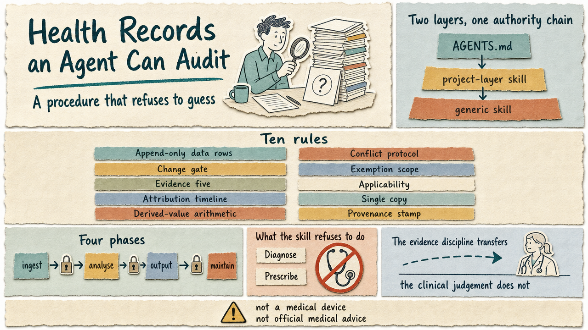

# 智能体可以审计的健康档案

> 繁体版：[智能体可以审计的健康档案](https://github.com/j3ffyang/ai-thoughts/blob/main/docs/261021-medical-record-review-zh-hant.md)

**原文：** [261021-medical-record-review.md](https://github.com/j3ffyang/ai-thoughts/blob/main/docs/261021-medical-record-review.md)

*一套两层技能 (skill)，用于让 AI 辅助复阅 (review) 个人与家庭的病历 (medical record)：通用流程加项目本地事实，不宣称任何临床权威。*

**来源：** [`medical-record-review`](https://github.com/j3ffyang/ai-thoughts/blob/main/.opencode/skills/medical-record-review/SKILL.md) 技能，于 2026 年 10 月 21 日从一个私有档案集 (record set) 中抽出。该档案集积累了数年的化验 (lab)、处方 (prescription)、影像 (imaging) 和冲突 (conflict)。技能是「怎么做」，本文是「为什么」。

**论点：** 智能体 (agent) 在这个领域里的价值，不是更聪明的分析，而是一套**拒绝猜测 (refuse to guess)** 的流程 (procedure)——遇到冲突就停下，引用所用的来源，把记录与推断分开，并且无法悄悄改写任何一行数据。

**结论：** 证据纪律 (evidence discipline) 可以迁移，临床判断 (clinical judgement) 不能。把流程发出去，把事实留在本地，并把输出标注得足够响，没人会把它当成医生。

> ⚠️ **免责声明。** 这是 AI × 医疗结合的实践 (practice)，不是医疗器械 (medical device)，也不是官方医疗建议、诊断、处方或治疗决定。作者不对使用或误用的后果承担任何责任。采用之前，请先读技能顶部的完整声明。



## 为什么是流程，而不是提示词

病历不会以干净的数据集 (dataset) 形式到手。它们是一堆来自多家机构、跨越多年、许多还是扫描件的 PDF，同一个指标印着三种缩写和两种单位。真正有意思的失败不是「模型不知道 LDL 重要」，而是：模型读错了行，把两家机构参考范围 (reference range) 不同的值平均了，或者悄悄「修正」了一个看起来不对的数字。

每一种失败模式都有对应的解法，而这些解法没有一个是更好的提示词 (prompt)。它们是冲突协议 (conflict protocol)、只追加规则 (append-only rule)、变更闸门 (change gate) 和证据分级 (evidence grading)。这就是这套技能。

还有第二个约束。这些记录是一个人拥有的最敏感的文件，而托管模型 (hosted model) 意味着每读一个文件，就是把那个文件传出去——不可撤回。所以技能从外传预检 (egress pre-check) 开始，而不是从分析技巧开始：第一个决定是「要不要开工」。所谓外传 (egress)，就是把本机数据送进模型提供方的上下文；一旦送出去，就收回不来。

## 两层，一条权威链

技能之所以拆开，是因为两半的寿命不同。

```
AGENTS.md (AUTHORITY)         ← project constitution: privacy, egress, evidence standard
  └─ project-layer skill      ← configuration, precedent table, family rules
       └─ generic skill       ← procedure only, no patient data, no paths
```

- **通用层 (generic layer)** 持有工作流：入库 (intake)、画像 (profile)、注册表 (registry)、比较、冲突协议、证据分级、输出骨架、合并与改名、压缩，以及一个中医 (Traditional Chinese Medicine, TCM) 子流程。它不携带任何数值、路径或姓名——这正是它能被公开的原因。
- **项目层 (project layer)** 只持有一个档案集才成立的东西：九个配置键 (config key)、语言约定，以及一张记录真实错误及其裁定的**判例表 (precedent table)**。
- **`AGENTS.md` 高于这两者。** 它是 `AUTHORITY` 指名的那个规则文件——通常是采用者自己的 `AGENTS.md`，绝不是本流程附带的文件。技能旁边附带了一个不含病人数据的起点模板 [`references/AGENTS.example.md`](https://github.com/j3ffyang/ai-thoughts/blob/main/.opencode/skills/medical-record-review/references/AGENTS.example.md)：复制它，或者把 `AUTHORITY` 指向智能体已经在加载的规则文件。通用层把隐私和外传交给它，而不是自己重述一遍，因为重述的规则会偏离源头。

这次拆分不是装饰。拆之前，派生出来的技能把病人人口学信息 (demographics) 硬编码进了一条分析规则——违反了它自己的「不含病人数据」条款。把一条规则通用化，逼着这个锚点从流程里移出去、落到配置里，而它本来就该在那里。

## 撑着分量的规则

十条规则承担了大部分工作。每一条都来自真实事故，而不是品味。其中三条是在复阅这套技能时定下的——那时一条旧的分析语句已经追溯不回写它的模型了。

| 规则 (rule) | 它禁止什么 |
|---|---|
| **只追加的数据行 (append-only data rows)** | 就地修改历史值。错误的行走冲突协议 |
| **冲突协议 (conflict protocol)** | 在两个版本里悄悄挑一个。停下，点名两者，分类，交给用户 |
| **变更闸门 (change gate)** | 任何没有「旧值 → 新值 + 依据」和人类确认的数据改动 |
| **豁免范围 (exemption scope)** | 一个覆盖数据行的用户豁免。它只覆盖过程笔记和分析语句 |
| **证据五项 (evidence five)** | 在安全性、事实性、可验证性、特异性 (specificity) 或可信度 (credibility) 任一项上失败的论断。它们降级为 `low-confidence`，转交临床复阅 |
| **适用性 (applicability)** | 把一般人群的参考范围当作久病患者的目标 |
| **归因时间线 (attribution timeline)** | 把症状归咎于一种新药，而症状开始于停药的空档期 |
| **单一副本 (single copy)** | 派生视图的第二份拷贝。拷贝会漂移，而漂移正是同一天两个值进入记录的方式 |
| **派生值算术 (derived-value arithmetic)** | 一个算出来的 eGFR 或指数，没给出公式、输入和单位——悄悄算错比测错更难发现 |
| **出处戳 (provenance stamp)** | 一个没有 `model · date · skill version` 行的分析块，多年之后就无法重新判断 |

其中两条特殊到值得展开。**豁免范围**存在，是因为「让我整理一下」和「让我改掉这个数字」会出现在同一句话里，却该得到不同答案。**归因时间线**存在，是因为整份档案里最有说服力的错误结论，是一个被归因于新疗法的症状——而那个疗法开始于病人已经停掉上一个方案之后好几周。

工作流本身被画成四个阶段——摄取 (ingest)、分析 (analyse)、输出 (output)、维护 (maintain)——旁边还有一张快路径表。三十秒的回答可以跳过 ASCII 趋势图和可选模块。它绝不能跳过外传检查、冲突闸门或证据分级。

## 技能拒绝做的事

- 诊断、指定疾病亚型 (subtype)、开处方，或调整剂量 (dose)。
- 用推断填补空缺。缺失就是缺失，并且会被点名。
- 跨机构相减，或把它们的趋势合并。
- 批量替换文件名。一次批量替换曾改写了历史日志行，而日志存在的意义正是防止这件事。
- 用行号作为定位。只写小节标题加条目名；行号会漂移。
- 声称分析是官方的。每份输出都是草稿 (draft)，都可能自信地出错。

## 采用它

你需要两样东西才能开始：一个能从目录加载技能、并能读取本机文件的智能体，以及一个让它读取的规则文件。这套流程不假定任何其他条件。

**从一个只放这一件事的文件夹开始。** 不放代码，不放无关笔记，不放第二个项目。把规则文件放在根目录，把记录放在它下面。混杂的文件夹会以三种方式失败：智能体读到它本不该看到的文件，注册表把不是记录的文件吸收进来，另一个项目的指令和你刚写下的隐私规则打架。让这个文件夹远离任何会推送的仓库，或者在 git 里忽略记录目录。

1. **原样复制通用技能**到你的智能体加载技能的目录——OpenCode 是 `<project>/.opencode/skills/medical-record-review/SKILL.md`。不要为迁就你的记录去改流程；那是项目层的职责。
2. **从规则模板开始。** 把 [`references/AGENTS.example.md`](https://github.com/j3ffyang/ai-thoughts/blob/main/.opencode/skills/medical-record-review/references/AGENTS.example.md)（与 `SKILL.md` 放在一起随技能附带）复制为 `<project>/AGENTS.md`。按这个顺序填写：
   - **先设九个键。** `AUTHORITY` 指向这个文件。`PROFILE` 指明画像文件。`DOCS_DIR` 和 `IMGS_DIR` 指明记录目录和扫描件目录。`REGISTRY` 指明趋势注册表，首次运行时创建。`INDEX` / `INDEX_CMD` 指明索引和它的生成器；没有生成器时，把索引标为 `hand-maintained: true`。`LANG` 设定写作语言。`MODULES` 启用分析模块；先只开 `western`。`UNWRAP_CMD` 是可选项。未解析的键意味着停下，而不是取默认值。
   - **把画像放到规则之外。** 模板只装规则。年龄、性别、诊断及病程、带服药时间的用药、测量条件，写进 `PROFILE` 指名的文件。
   - **保留四个规则小节不动。** 隐私、外传、证据、数据变更，是这套技能能跑起来的原因。不要为了省篇幅删减它们。
   - **跑一遍完整度检查。** 模板末尾有五项。在读取第一份记录之前修好任何失败项。
   - **绝不要建第二个规则文件。** 如果项目里已经有 `AGENTS.md` 或等效的 `CLAUDE.md`，把 `AUTHORITY` 指向它，补上缺的小节。两个规则文件会漂移，而漂移正是这套技能存在的理由。
3. **写一份画像。** 年龄、性别、诊断及病程、带服药时间的用药、体重的测量条件，以及这个人真正在意的两三件事。不要写姓名。
4. **建一张判例表。** 三列：发生了什么、下次怎么做、来自哪里。这是会复利的部分。
5. **跑一次，然后让它停下。** 第一个真实冲突就是测试：如果智能体报告它而不是自行解决，技能就算工作正常。

对家庭来说，规则是一人一个文件夹。配置和画像按文件夹注入，文件夹之间从不互相引用。跨人比较在临床上没有意义，而且会泄露。

## 这次复阅改了什么，还有什么仍然吃紧

第一版技能按它自己的标准被复阅过。四个缺口 (gap) 合上了。三个成了上表里的规则；第四个成了注册表小节里的字段结构 (schema)：

- **索引 (index) 原本可以手工维护**，这又把技能在别处禁止的「第二份拷贝」风险放了回来。现在手工维护的索引必须声明 `hand-maintained: true`，读者要把每个字段对着文件重新核实。
- **非指标序列 (non-metric series) 原本没有字段结构。** 症状、方剂和影像现在有了最小列集——起病时间、归因状态；药味数、剂量；检查方式、随访——而不是随便落在上一个编辑者留下的地方。
- **派生分数 (derived score) 原本可能被悄悄算错。** 公式、输入和单位现在是必需的，缺一项就降级为 `low-confidence`。
- **模型漂移 (model drift) 原本没有记录。** 现在每个分析块都以 `provenance: model · date · skill version` 结尾。

还有两件事仍然吃紧，而且大概永远会：

- **免责声明不是法律意见。** 缺少针对具体司法辖区 (jurisdiction) 的条款，也没有律师读过责任措辞 (liability language)。
- **规则是文字，不是代码检查器 (linter)。** 没有任何东西强制执行出处戳或派生值三件套（公式、输入、单位）；两者都依赖智能体记得住——而这恰恰是技能本该解决的问题。

## 什么会证伪这套做法

三种结构性条件会证伪它。

如果记录太稀疏 (sparse)，证据纪律就没有立足点，诚实的输出是「数据不足」——而用户会把它读成工具失败。如果托管模型不可接受，整个工作流只能本地跑，质量下降。如果临床医生 (clinician) 始终看不到输出，技能对「记录」与「推断」的仔细区分就白费了。

只有当有人在专业人员的参与下依据它的输出行动时，这套流程才值得保留。

## 文件

- [`medical-record-review/SKILL.md`](https://github.com/j3ffyang/ai-thoughts/blob/main/.opencode/skills/medical-record-review/SKILL.md) — 通用流程：配置键、工作流、证据分级、趋势图、frontmatter、判例、边界和地区配置 (locale profile) 的附录。文章讲为什么，技能定义怎么做。
- [`references/AGENTS.example.md`](https://github.com/j3ffyang/ai-thoughts/blob/main/.opencode/skills/medical-record-review/references/AGENTS.example.md) — 不含病人数据的 `AUTHORITY` 起点模板：隐私红线、外传政策、证据标准、数据变更规则、测量条件，以及九个键，全部是占位符。
- 项目层——不公开。它是一个小技能，提供九个键、语言约定、判例表，以及每人一份画像。
- [`LICENSE`](https://github.com/j3ffyang/ai-thoughts/blob/main/LICENSE) — MIT。复制这套流程，保留版权声明。

btw, i use arch
