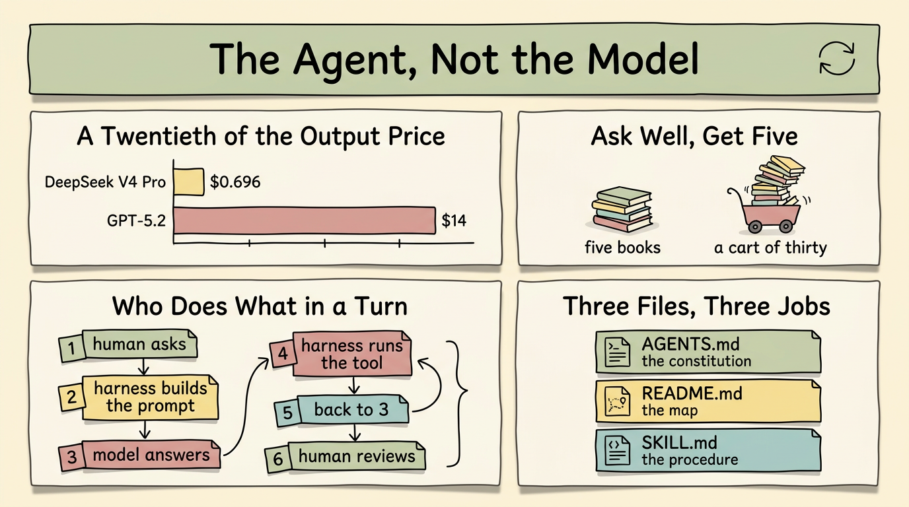

# 智能体，而非模型 (The Agent, Not the Model)

> 繁体版：[智能体，而非模型 (The Agent, Not the Model)](https://github.com/j3ffyang/ai-thoughts/blob/main/docs/261022-agent-not-model-zh-hant.md)

**原文：** [261022-agent-not-model.md](https://github.com/j3ffyang/ai-thoughts/blob/main/docs/261022-agent-not-model.md)

*2026-10-22*

**论点：** 模型是整条技术栈里最不有趣的部分。一次会话产出什么，主要由智能体 (agent) 在模型外面跑的那套循环决定——而这套循环的质量，取决于你给它的指令。真正的技能不是技术性的，而是把你要什么说清楚。

这不是一份综述。这是我重度使用 AI 智能体大约一年之后，一个人的经验；文中唯一的测量数据也来自我自己。



## 瓶颈不在模型 (The bottleneck isn't the model)

如今目录里躺着成百上千、甚至可能上千个模型：免费的、收费的、让人困惑的。Claude、OpenAI 和 Google 大概仍然是前三……大概吧。新玩家不断带着一张「我赢了」的图表进场。

那张图表和我的工作关系不大。我写文章、写代码、审阅和分析代码、维持仓库的秩序。这些事都不算复杂，但全都需要逻辑和精确。所以：**基准测试 (benchmark) 的表现主要是营销**——一种吸引注意力和投资的方式。这不是说基准什么都测不出来。它们确实测出了一些东西，只是那不是有人付钱让我做的事。

实用版本是这样的：**换一个更便宜的模型，产出并不会有太大退化**，至少对我这类工作而言。DeepSeek V4 Pro 的价格是每百万输入 / 输出 token \$0.348 / \$0.696；GPT-5.2 是 \$1.75 / \$14。输出价格只有二十分之一，而它仍然是前沿水平的模型。数字和方法都在[我的模型选择笔记](https://github.com/j3ffyang/ai-thoughts/blob/main/docs/260927-opencode-openrouter-model-selection.md)里。

这并不是说所有模型一样好。我想说的是：**模型之间的差距，比它们价格之间的差距更小**；而我的工作很少落在「必须用最强模型才能决定结果」的那条窄缝里。如果你的工作落在那里，这篇文章就不适合你，这也没关系。

### 另一半：人 (The other half: the human)

人的这一半，用图书管理员来解释，比用一张基准测试表更清楚。

向一位好的图书管理员要一份书单，你会得到一份。说清楚你已经知道什么、为什么想要、有多少时间——你会拿到五本你真正读得完的书。只说「来点历史的」，你会拿到一车三十本。每一本都很好。你一本也不会读。

问题不在管理员，也不在书架——而是没人说过你能扛多少，而且没有哪个管理员能替你读书。

更大的上下文窗口 (context window) 就是一车更大的书。它长到 10M token 对我也没有帮助：我依然拿不住、查不完、也没法据此做决定。瓶颈恰好出现在机器的输出与我的注意力相接的那一点。有一个诚实的例外：当输出交给另一台机器——一个脚本、一个摘要器、下一个模型——这一车书没问题，因为没有人需要读它。那是另一个故事。

所以工作不是败在模型的边缘，而是败在读者这一端。

## 智能体到底做了什么 (What the agent actually does)

变聪明的是智能体，不是模型——是模型外面那一层：跑循环的运行框架 (harness)，加上你交给它的指令。

一轮对话大致是这样的：

```
┌──────────────────────────────────────────────┐
│ 1  human asks                                │
│ 2  harness builds the prompt                 │
│    system + AGENTS.md + history + tools      │
│ 3  model answers: text, or a tool call       │
│ 4  harness runs the tool, appends the result │
│ 5  back to 3, until the model stops asking   │
│ 6  human reviews, and decides the next step  │
└──────────────────────────────────────────────┘
```

每一轮都从零重建那个提示词 (prompt)：运行框架不保留任何模型能看见的状态，只有它这一轮重新发过去的东西。

有一点值得说清楚，因为它是整篇文章的核心：**智能体去搜网页，不是因为模型「知道自己不知道」。** 模型不会内省自己的知识，发现缺口就派一个子智能体出去。它只是发出一次工具调用；运行框架照办；结果成为新的上下文。搜索、改文件、跑测试、开子进程——这些都属于循环里运行框架那一侧，而不是模型的聪明。

于是产出质量由这些决定：

- 智能体如何消化、有时改写你的问题
- 它有哪些工具，以及是否在正确的时机伸手去用
- 它如何理解搜索结果或文件返回的内容
- 它如何组织收集到的东西，以及是否真的回答了你问的问题
- 它是否跟进未完成的部分，还是悄悄宣布胜利

这些都不是模型上的设置项。它们是行为，而行为总被写在某个地方——写在指令里。

## 你唯一的接口是指令 (The only interface you have is the instruction)

和智能体配合得好，归结为一种技能：把你脑子里的东西，变成对面能读懂的东西。**精确。准确。清楚。** 留给它自己填补的空隙越少越好。

这是一场没有对谈者的对话：你只写一次你想要什么，而之后的会话只会重新发送文件里存在的东西。

实际操作中，你通过三个文件来做这件事：

| 文件 | 它是什么 | 里面放什么 |
|---|---|---|
| `AGENTS.md` | 宪法 | 每一次会话都成立的规则：审批关卡、绝不单独交出去的事、审阅要求 |
| `README.md` | 地图 | 这个项目是什么、如何组织、它不做什么 |
| `SKILL.md` | 流程 | 一件任务，一步一步，外加能证明它做对了的检查 |

三种不同的职责：什么必须永远成立、东西放在哪里、一件活怎么干完。当它们互相重叠或彼此矛盾时，智能体会挑一种读法并照着做——而你要到后来才知道它挑了哪一种。（它们是否该写得像维修手册，是[另一个问题](https://github.com/j3ffyang/ai-thoughts/blob/main/docs/261019-ste100-agent-instructions.md)。）

证据不用去远处找。这篇文章所在的仓库本身就是论据：三个层级的 `AGENTS.md`、用于流程的 `.opencode/skills/`、由 YAML 清单生成的 README，以及智能体自己会跑的那些脚本——它们让产出保持诚实。指令含糊时，产出就含糊。当我把约束写下来——未经允许不要提交、不要硬换行、方框必须方正——行为就变了，而且一直没变回去。

## 是循环，不是直线 (A loop, not an arrow)

所以工作流不是一条线，而是一个循环：

```
instruction ──▶ agent loop ──▶ artifact
      ▲                            │
      └──────── you review ────────┘
```

指令喂给智能体，智能体产出作品，然后**你**去看它、决定下一步。审阅这一步，正是最强模型也决定不了你结果的原因：作品无论如何都会回到一个人手里，而那一刻的判断是你的。

审阅也是下一条指令的来源。我 `AGENTS.md` 里的每一条规则，都始于我在某次产出里看到不想再看到的东西。

## 结语 (Closing)

这里的每一条，说的都是人与机器之间沟通的质量——这居然成了那个技能，但事情就是这样。提示词就是程序，智能体是解释器。想了解与这个论点配套的实践——该懂什么、什么绝不单独交出去、如何让智能体留在循环里——见[前一篇](https://github.com/j3ffyang/ai-thoughts/blob/main/docs/260922-what-to-know-work-with-ai.md)。那一篇讲怎么做，这一篇讲为什么。

我真正要求自己团队遵守的，是[一页规则](https://github.com/j3ffyang/ai-thoughts/blob/main/docs/261104-what-i-tell-my-team-about-ai.md)。

模型会一直变。循环不会。

btw, i use arch
