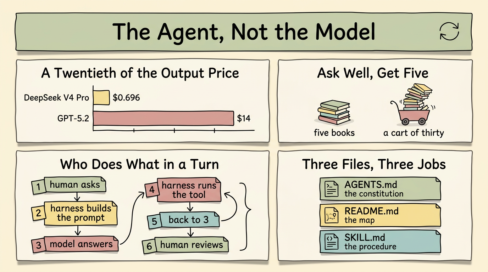

# 智慧體，而非模型 (The Agent, Not the Model)

> 簡體版：[智慧體，而非模型 (The Agent, Not the Model)](https://github.com/j3ffyang/ai-thoughts/blob/main/docs/261022-agent-not-model-zh-hans.md)

**原文：** [261022-agent-not-model.md](https://github.com/j3ffyang/ai-thoughts/blob/main/docs/261022-agent-not-model.md)

*2026-10-22*

**論點：** 模型是整條技術棧裡最不有趣的部分。一次會話產出什麼，主要由智慧體 (agent) 在模型外面跑的那套迴圈決定——而這套迴圈的質量，取決於你給它的指令。真正的技能不是技術性的，而是把你要什麼說清楚。

這不是一份綜述。這是我重度使用 AI 智慧體大約一年之後，一個人的經驗；文中唯一的測量資料也來自我自己。



## 瓶頸不在模型 (The bottleneck isn't the model)

如今目錄裡躺著成百上千、甚至可能上千個模型：免費的、收費的、讓人困惑的。Claude、OpenAI 和 Google 大概仍然是前三……大概吧。新玩家不斷帶著一張「我贏了」的圖表進場。

那張圖表和我的工作關係不大。我寫文章、寫程式碼、審閱和分析程式碼、維持倉庫的秩序。這些事都不算複雜，但全都需要邏輯和精確。所以：**基準測試 (benchmark) 的表現主要是營銷**——一種吸引注意力和投資的方式。這不是說基準什麼都測不出來。它們確實測出了一些東西，只是那不是有人付錢讓我做的事。

實用版本是這樣的：**換一個更便宜的模型，產出並不會有太大退化**，至少對我這類工作而言。DeepSeek V4 Pro 的價格是每百萬輸入 / 輸出 token \$0.348 / \$0.696；GPT-5.2 是 \$1.75 / \$14。輸出價格只有二十分之一，而它仍然是前沿水平的模型。數字和方法都在[我的模型選擇筆記](https://github.com/j3ffyang/ai-thoughts/blob/main/docs/260927-opencode-openrouter-model-selection.md)裡。

這並不是說所有模型一樣好。我想說的是：**模型之間的差距，比它們價格之間的差距更小**；而我的工作很少落在「必須用最強模型才能決定結果」的那條窄縫裡。如果你的工作落在那裡，這篇文章就不適合你，這也沒關係。

### 另一半：人 (The other half: the human)

人的這一半，用圖書管理員來解釋，比用一張基準測試表更清楚。

向一位好的圖書管理員要一份書單，你會得到一份。說清楚你已經知道什麼、為什麼想要、有多少時間——你會拿到五本你真正讀得完的書。只說「來點歷史的」，你會拿到一車三十本。每一本都很好。你一本也不會讀。

問題不在管理員，也不在書架——而是沒人說過你能扛多少，而且沒有哪個管理員能替你讀書。

更大的上下文視窗 (context window) 就是一車更大的書。它長到 10M token 對我也沒有幫助：我依然拿不住、查不完、也沒法據此做決定。瓶頸恰好出現在機器的輸出與我的注意力相接的那一點。有一個誠實的例外：當輸出交給另一臺機器——一個指令碼、一個摘要器、下一個模型——這一車書沒問題，因為沒有人需要讀它。那是另一個故事。

所以工作不是敗在模型的邊緣，而是敗在讀者這一端。

## 智慧體到底做了什麼 (What the agent actually does)

變聰明的是智慧體，不是模型——是模型外面那一層：跑迴圈的執行框架 (harness)，加上你交給它的指令。

一輪對話大致是這樣的：

```
┌──────────────────────────────────────────────┐
│ 1  human asks                                │
│ 2  harness builds the prompt                 │
│    system + AGENTS.md + history + tools      │
│ 3  model answers: text, or a tool call       │
│ 4  harness runs the tool, appends the result │
│ 5  back to 3, until the model stops asking   │
│ 6  human reviews, and decides the next step  │
└──────────────────────────────────────────────┘
```

每一輪都從零重建那個提示詞 (prompt)：執行框架不保留任何模型能看見的狀態，只有它這一輪重新發過去的東西。

有一點值得說清楚，因為它是整篇文章的核心：**智慧體去搜網頁，不是因為模型「知道自己不知道」。** 模型不會內省自己的知識，發現缺口就派一個子智慧體出去。它只是發出一次工具呼叫；執行框架照辦；結果成為新的上下文。搜尋、改檔案、跑測試、開子程序——這些都屬於迴圈裡執行框架那一側，而不是模型的聰明。

於是產出質量由這些決定：

- 智慧體如何消化、有時改寫你的問題
- 它有哪些工具，以及是否在正確的時機伸手去用
- 它如何理解搜尋結果或檔案返回的內容
- 它如何組織收集到的東西，以及是否真的回答了你問的問題
- 它是否跟進未完成的部分，還是悄悄宣佈勝利

這些都不是模型上的設定項。它們是行為，而行為總被寫在某個地方——寫在指令裡。

## 你唯一的介面是指令 (The only interface you have is the instruction)

和智慧體配合得好，歸結為一種技能：把你腦子裡的東西，變成對面能讀懂的東西。**精確。準確。清楚。** 留給它自己填補的空隙越少越好。

這是一場沒有對談者的對話：你只寫一次你想要什麼，而之後的會話只會重新發送檔案裡存在的東西。

實際操作中，你通過三個檔案來做這件事：

| 檔案 | 它是什麼 | 裡面放什麼 |
|---|---|---|
| `AGENTS.md` | 憲法 | 每一次會話都成立的規則：審批關卡、絕不單獨交出去的事、審閱要求 |
| `README.md` | 地圖 | 這個專案是什麼、如何組織、它不做什麼 |
| `SKILL.md` | 流程 | 一件任務，一步一步，外加能證明它做對了的檢查 |

三種不同的職責：什麼必須永遠成立、東西放在哪裡、一件活怎麼幹完。當它們互相重疊或彼此矛盾時，智慧體會挑一種讀法並照著做——而你要到後來才知道它挑了哪一種。（它們是否該寫得像維修手冊，是[另一個問題](https://github.com/j3ffyang/ai-thoughts/blob/main/docs/261019-ste100-agent-instructions.md)。）

證據不用去遠處找。這篇文章所在的倉庫本身就是論據：三個層級的 `AGENTS.md`、用於流程的 `.opencode/skills/`、由 YAML 清單生成的 README，以及智慧體自己會跑的那些指令碼——它們讓產出保持誠實。指令含糊時，產出就含糊。當我把約束寫下來——未經允許不要提交、不要硬換行、方框必須方正——行為就變了，而且一直沒變回去。

## 是迴圈，不是直線 (A loop, not an arrow)

所以工作流不是一條線，而是一個迴圈：

```
instruction ──▶ agent loop ──▶ artifact
      ▲                            │
      └──────── you review ────────┘
```

指令餵給智慧體，智慧體產出作品，然後**你**去看它、決定下一步。審閱這一步，正是最強模型也決定不了你結果的原因：作品無論如何都會回到一個人手裡，而那一刻的判斷是你的。

審閱也是下一條指令的來源。我 `AGENTS.md` 裡的每一條規則，都始於我在某次產出裡看到不想再看到的東西。

## 結語 (Closing)

這裡的每一條，說的都是人與機器之間溝通的質量——這居然成了那個技能，但事情就是這樣。提示詞就是程式，智慧體是直譯器。想了解與這個論點配套的實踐——該懂什麼、什麼絕不單獨交出去、如何讓智慧體留在迴圈裡——見[前一篇](https://github.com/j3ffyang/ai-thoughts/blob/main/docs/260922-what-to-know-work-with-ai.md)。那一篇講怎麼做，這一篇講為什麼。

我真正要求自己團隊遵守的，是[一頁規則](https://github.com/j3ffyang/ai-thoughts/blob/main/docs/261104-what-i-tell-my-team-about-ai.md)。

模型會一直變。迴圈不會。

btw, i use arch
