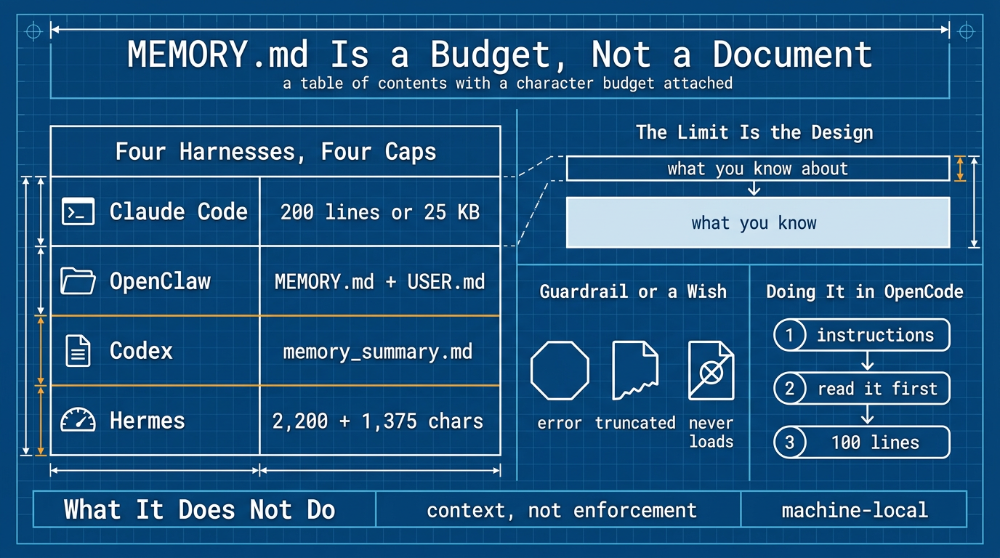

# MEMORY.md 是预算，不是文档 (MEMORY.md Is a Budget, Not a Document)

> 繁体版：[MEMORY.md 是预算，不是文档 (MEMORY.md Is a Budget, Not a Document)](https://github.com/j3ffyang/ai-thoughts/blob/main/docs/261101-memory-md-zh-hant.md)

**原文：** [261101-memory-md.md](https://github.com/j3ffyang/ai-thoughts/blob/main/docs/261101-memory-md.md)

*OpenCode v2.2.5，2026 年 11 月。*

每个想让智能体 (agent) 拥有记忆的人，第一件事都是造同一个东西：一个很长的文件，让智能体把学到的东西全写进去，每次会话开始时加载。这看起来很自然，可没有哪个运行框架 (harness) 是这么做的。



## 背景 (Background)

我不是读文档读来的，是照着抄一个文件抄来的。

在 Hermes 和 OpenClaw 里，`MEMORY.md` 都是我自己手写的。条目我写，过时了我改，文件长了我就删，因为文档就是这么说的：智能体工作区 (workspace) 里有个文件，它在会话开始时读一遍。

然后我去 OpenCode 里找对应的东西，什么也没找到——没有记忆文件，文档里也没有任何关于记忆的内容。我把一个 `MEMORY.md` 放在我以为该放的位置，智能体从来没看见过它。这是第一个提示：所谓「记忆文件」不是这一类产品的功能，而是某些产品内部的约定 (convention)。

Claude Code 则让我在另一个方向上困惑。它本来就有一个记忆文件，不是我写的，是它自己维护的，而且完全不是我以为的那种文档。那是一份一行一行的指针 (pointer) 清单，指向一个存着主题文件的目录。我一直把记忆当成「写东西的地方」，而这是一个目录 (table of contents)。

于是我去读了这四家到底怎么做的，并写了下来，因为我找不到有哪里把这件事讲全。

四家最终都有一个名字恰好叫 `MEMORY.md` 的文件——Claude Code、OpenClaw、Codex、Hermes。没有一个是文档。每一个都是一小层，在会话开始时加载，主体放在别处，需要时才去取。

| 位置 | 会话开始时加载什么 | 什么在等着 |
|---|---|---|
| Claude Code | `MEMORY.md` 的前 200 行或 25 KB | 主题文件，按需读取 |
| OpenClaw | `MEMORY.md` + `USER.md`（可选） | `memory/YYYY-MM-DD.md`，建了索引、可搜索（今天和昨天的会在会话开始时加载） |
| Codex | `memory_summary.md`，前提是 `memories` 功能已开启 | `MEMORY.md` 以及生成库 (store) 的其余部分，按需搜索 |
| Hermes | `MEMORY.md` + `USER.md`，冻结快照（2,200 + 1,375 字符） | 过去的会话，通过 `session_search` 检索 |

Claude Code 的文件是真正的索引——它自动记忆目录 (auto-memory directory) 的索引，不是它的指令文件，那个叫 `CLAUDE.md`。一条记忆一行，通常以指向某个主题文件的指针结尾。OpenClaw 的是一份供你读的摘要——把长期有效的事实和决定直接写出来。Codex 沿着同一个思路走得最远：它只注入 `memory_summary.md`，一份紧凑的概览，任务看起来相关时，由智能体自己去搜 `MEMORY.md` 和配套文件。风味不同，约束相同：保持小，否则它就不再被读了。

把那张表照字面读，就是一个上限 (ceiling)。三家限制的是记忆文件本身，Codex 限制的是摘要。无论哪种，被计量的是提示词空间 (prompt space)——行数、千字节、字符、token——而不是文件本身。所以 `MEMORY.md` 不是记忆存放的地方，它是被一个磁盘文件承载着的提示词预算 (budget)。

结论就是那句值得带走的定义：`MEMORY.md` 不是日志 (log)，不是日记 (journal)，也不是数据库。它是一份附带字符预算的目录——会话开始时注入的东西，只能是这样两样。

## 限制就是设计 (The limit is the design)

Claude Code 的上限有一道锋利的边：写入是成功的。文件原封不动留在磁盘上，而它返回的错误会告诉智能体去重写这份索引，因为超出上限的部分会在下次加载时被丢掉。

这不是需要绕开的限制。它逼出唯一要紧的切分：小文件说明你都知道些什么 (what you know about)，细节文件装着你知道的内容 (what you know)。一份文档做不出这种切分，于是它会一路长到 400 行，每一轮都被整份注入，然后被以读一份 400 行文件的方式草草扫过。

OpenClaw 把同一条规则当作建议而不是错误来说：如果 `MEMORY.md` 超出了它的预算，被注入的那份副本会被截断，而这就是让你把细节挪进 `memory/*.md` 的信号。

Hermes 用字符把同一个想法预算化：`MEMORY.md` 2,200 字符，`USER.md` 1,375 字符，大约 800 和 500 token，容得下记忆文件里 8–15 条、用户画像 (profile) 里 5–10 条。两者都以*冻结快照* (frozen snapshot) 的形式，在会话开始时取一次就定下来；会话中途的保存立刻写到磁盘，但要到下一个会话才进提示词。

当一次写入会溢出时，它的 `memory` 工具返回一个错误，告诉智能体腾出所缺的字符数——先合并或删除，再重试——所以不会有东西被悄悄丢掉。放不下的也不必丢：每个会话都存在 SQLite 里，可以按需全文搜索 (full-text search)，那是 `MEMORY.md` 这份精编 (curated) 层底下的一层工作层。

这就是护栏 (guardrail) 和愿望 (wish) 的差别。Claude Code 和 Hermes 用错误回应越界；OpenClaw 截断，并在 `/context` 里让你看见损失；Codex 根本不加载 `MEMORY.md`，只加载摘要。当框架不会拦住你时，预算就得你自己守着，而且不会有任何东西告诉你：这个文件已经悄悄不再被读了。

## 它为什么存在 (Why it exists at all)

因为上下文窗口 (context window) 会从你手里被拿走。Anthropic 的记忆工具会自动把下面这句话追加到系统提示词 (system prompt) 里：

> ASSUME INTERRUPTION: Your context window might be reset at any moment, so you risk losing any progress that is not recorded in your memory directory.

这就是全部理由。不是「能记住挺好」——窗口注定会关，你没写下来的东西都活不过它。

## 在 OpenCode 里怎么做 (Doing it in OpenCode)

OpenCode 没有记忆文件。它会自动发现 `AGENTS.md`，没有才回退到 Claude Code 的 `CLAUDE.md`，除此之外没有任何记忆相关的东西。所以这个位置得你自己搭。

先是规则，放在 `AGENTS.md`。然后是小文件，在项目的 `opencode.json` 里用一行配置注入：

```jsonc
{
  "$schema": "https://opencode.ai/config.json",
  "instructions": ["MEMORY.md"]
}
```

如果放在全局的 `~/.config/opencode/opencode.jsonc`，就要改用绝对路径：文档没有说明相对路径是相对哪里解析的。

第三是细节，放在普通文件里，只在有东西指向它们时才读——这正是 OpenCode 加载技能 (skill) 的方式。每个技能的一行描述在上下文里，正文只在描述匹配时才加载。同一套机制，用在流程 (procedure) 而不是事实 (fact) 上。Hermes 的文档从另一个方向得到同样的结论：凡是会跟那 2,200 字符预算争位置的内容，推荐用技能，而不是记忆条目。

文件名随意。`MEMORY.md`、`memory.md`、`notes.md`——OpenCode 不在乎，而没有那行配置，哪一个都不会被加载。Claude Code 的迁移恰恰在这里悄悄坏掉：`MEMORY.md` 跟着过来了，然后什么也不做。

把文件保持成索引：

```md
# Project memory — index only

One line per entry: `- (YYYY-MM-DD) <fact>. See detail/<file>.md`
Delete entries older than six months, or contradicted by the code. Do not archive.

## project
- (2026-11-01) Deploys go to eu-west-1; forced by a 2025-11 data-residency contract. See detail/deploy.md
- (2026-10-14) `make test` needs Docker running. Without it the suite exits 0 and tests nothing.

## feedback
- (2026-10-20) Do not reformat YAML I did not ask you to touch. It happened twice.
```

这个数字由你定。100 行足够，而且远低于 Claude Code 的 200——用 `wc -l` 数一下。越过它就是该把细节挪进文件的信号。

如果只做一半，那就做「读」的那一半。常见的失败是：规则里写着「把你的发现追加到 `MEMORY.md`」，却没有任何一处写着「先读它」，结果就是一本没人打开的日记。

而让它真正生效的那条规则，同样写在 `AGENTS.md` 里，因为不会有任何东西替你执行它：

```md
Before answering a question about project state, deployment, or a past decision,
read `MEMORY.md` and open the detail file it points to before stating a fact.
Never answer from an index line alone.
```

我在 v2.2.5 上建了个一次性的来做测试。文件确实加载了。问它某个项目为什么用 eu-west-1——一个索引回答不了的问题——它读了细节文件，并引用了里面的内容。它还重新读了一遍已经在上下文里的 `MEMORY.md` 本身，这是个小代价，值得知道。

## 要不要建 (Whether to build it)

支持它的理由前面已经给过了：会话总会结束。反对它的理由更小，也更实际。

`instructions` 文件每个会话都整份注入。一份 100 行的索引，在你还没开口之前就占掉大约一千个 token——不贵，但它每次都加载，而在答案本来就在代码里的日子里，它什么也没换来。

更大的成本是维护。记忆文件是第二个需要修剪的面，而且它过期的节奏和你的规则不一样。把一条每周都在变的事实放进 `AGENTS.md`，你就等于每周都在改宪法。

所以判断的标准不是「这是不是好实践」，而是「你有没有在丢事实」。当新会话反复重新推导你已经定下来的事时，就建它。在那之前，它是一项你没在用的能力，不是你配置里的缺陷——我的配置就停在这里：规则在 `AGENTS.md`，按需的那一半交给技能，没有事实索引，也没丢东西。

### 放哪里也是决定的一部分 (Where it lives is part of the decision)

如果你要建，先给它选好位置，再写第一条。记忆文件收集的正是代码告诉不了你的东西：项目名、部署区域、文件路径、决定，有时还有客户的约束。这些内容，是你不会贴进公开 issue 的。

我的配置是符号链接 (symlink) 到一个会发布的仓库里的，所以放在它旁边的 `MEMORY.md` 会跟着下一次推送一起出去。在公开仓库里，「纳入版本管理 (track)」和「对外公开 (publish)」这两件事分不开。如果你既想要 git 历史又想要隐私，这个文件就得放在一个私有仓库里，或者干脆不进仓库——而那个仓库，也是唯一能把它带到新机器上的东西。

而失败是无声的，这才是问题所在：它躺在磁盘上，看起来很权威，每个会话却都无视它——和本文开头那个空操作 (no-op) 一模一样。

## 它做不到什么 (What it does not do)

给每条都标上日期。智能体记下的事实没有审计者 (auditor)；六周之后它错得和当初对的时候一样自信，而且因为「有人写下来了」，它比代码更有权威。Claude Code 至少会自己盖上写入时间，作为记忆文件 frontmatter 里的 `modified` 字段，所以一条事实有多旧，读回去的人看得见。

很多人归到「记忆」名下的东西，其实是一条还没想清楚的规则，或者一个该放进配置文件的环境事实。部署区域是记忆。「用制表符，不要用空格」是 `AGENTS.md` 的规则。Docker 装没装，是 `docker --version` 的问题——如果机器自己能回答，它就不属于记忆。

记忆是上下文，不是执行 (Memory is context, not enforcement)。Claude Code 说得很直接：需要拦住一个动作时，它指向的是 hook，而不是一条记忆。一条记忆能告诉智能体你决定了什么，它拦不住智能体反着来。

剩下的就是那个诚实的边界。记忆买不来容量：一个装得下一切的会话照样会结束，下一个仍然从空开始。它也不会自己旅行：自动记忆是本机的 (machine-local)，所以新笔记本上从空开始，除非你把文件带过去。记忆真正买到的，是一份能活过重置的目录。

## 来源 (Sources)

- Claude Code, [How Claude remembers your project](https://code.claude.com/docs/en/memory)
- OpenClaw, [Memory overview](https://docs.openclaw.ai/concepts/memory)
- Codex, [Memories](https://developers.openai.com/codex/memories)
- Anthropic, [Memory tool](https://platform.claude.com/docs/en/agents-and-tools/tool-use/memory-tool)
- Hermes, [Persistent Memory](https://hermes-agent.nousresearch.com/docs/user-guide/features/memory)

btw, i use arch
