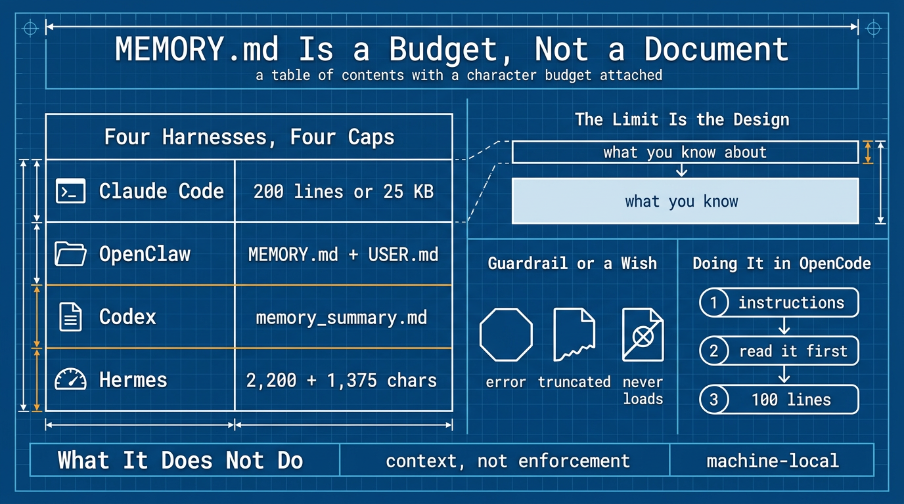

# MEMORY.md 是預算，不是文件 (MEMORY.md Is a Budget, Not a Document)

> 簡體版：[MEMORY.md 是預算，不是文件 (MEMORY.md Is a Budget, Not a Document)](https://github.com/j3ffyang/ai-thoughts/blob/main/docs/261101-memory-md-zh-hans.md)

**原文：** [261101-memory-md.md](https://github.com/j3ffyang/ai-thoughts/blob/main/docs/261101-memory-md.md)

*OpenCode v2.2.5，2026 年 11 月。*

每個想讓智慧體 (agent) 擁有記憶的人，第一件事都是造同一個東西：一個很長的檔案，讓智慧體把學到的東西全寫進去，每次會話開始時載入。這看起來很自然，可沒有哪個執行框架 (harness) 是這麼做的。



## 背景 (Background)

我不是讀文件讀來的，是照著抄一個檔案抄來的。

在 Hermes 和 OpenClaw 裡，`MEMORY.md` 都是我自己手寫的。條目我寫，過時了我改，檔案長了我就刪，因為文件就是這麼說的：智慧體工作區 (workspace) 裡有個檔案，它在會話開始時讀一遍。

然後我去 OpenCode 裡找對應的東西，什麼也沒找到——沒有記憶檔案，文件裡也沒有任何關於記憶的內容。我把一個 `MEMORY.md` 放在我以為該放的位置，智慧體從來沒看見過它。這是第一個提示：所謂「記憶檔案」不是這一類產品的功能，而是某些產品內部的約定 (convention)。

Claude Code 則讓我在另一個方向上困惑。它本來就有一個記憶檔案，不是我寫的，是它自己維護的，而且完全不是我以為的那種文件。那是一份一行一行的指標 (pointer) 清單，指向一個存著主題檔案的目錄。我一直把記憶當成「寫東西的地方」，而這是一個目錄 (table of contents)。

於是我去讀了這四家到底怎麼做的，並寫了下來，因為我找不到有哪裡把這件事講全。

四家最終都有一個名字恰好叫 `MEMORY.md` 的檔案——Claude Code、OpenClaw、Codex、Hermes。沒有一個是文件。每一個都是一小層，在會話開始時載入，主體放在別處，需要時才去取。

| 位置 | 會話開始時載入什麼 | 什麼在等著 |
|---|---|---|
| Claude Code | `MEMORY.md` 的前 200 行或 25 KB | 主題檔案，按需讀取 |
| OpenClaw | `MEMORY.md` + `USER.md`（可選） | `memory/YYYY-MM-DD.md`，建了索引、可搜尋（今天和昨天的會在會話開始時載入） |
| Codex | `memory_summary.md`，前提是 `memories` 功能已開啟 | `MEMORY.md` 以及生成庫 (store) 的其餘部分，按需搜尋 |
| Hermes | `MEMORY.md` + `USER.md`，凍結快照（2,200 + 1,375 字元） | 過去的會話，通過 `session_search` 檢索 |

Claude Code 的檔案是真正的索引——它自動記憶目錄 (auto-memory directory) 的索引，不是它的指令檔案，那個叫 `CLAUDE.md`。一條記憶一行，通常以指向某個主題檔案的指標結尾。OpenClaw 的是一份供你讀的摘要——把長期有效的事實和決定直接寫出來。Codex 沿著同一個思路走得最遠：它只注入 `memory_summary.md`，一份緊湊的概覽，任務看起來相關時，由智慧體自己去搜 `MEMORY.md` 和配套檔案。風味不同，約束相同：保持小，否則它就不再被讀了。

把那張表照字面讀，就是一個上限 (ceiling)。三家限制的是記憶檔案本身，Codex 限制的是摘要。無論哪種，被計量的是提示詞空間 (prompt space)——行數、千位元組、字元、token——而不是檔案本身。所以 `MEMORY.md` 不是記憶存放的地方，它是被一個磁碟檔案承載著的提示詞預算 (budget)。

結論就是那句值得帶走的定義：`MEMORY.md` 不是日誌 (log)，不是日記 (journal)，也不是資料庫。它是一份附帶字元預算的目錄——會話開始時注入的東西，只能是這樣兩樣。

## 限制就是設計 (The limit is the design)

Claude Code 的上限有一道鋒利的邊：寫入是成功的。檔案原封不動留在磁碟上，而它返回的錯誤會告訴智慧體去重寫這份索引，因為超出上限的部分會在下次載入時被丟掉。

這不是需要繞開的限制。它逼出唯一要緊的切分：小檔案說明你都知道些什麼 (what you know about)，細節檔案裝著你知道的內容 (what you know)。一份文件做不出這種切分，於是它會一路長到 400 行，每一輪都被整份注入，然後被以讀一份 400 行檔案的方式草草掃過。

OpenClaw 把同一條規則當作建議而不是錯誤來說：如果 `MEMORY.md` 超出了它的預算，被注入的那份副本會被截斷，而這就是讓你把細節挪進 `memory/*.md` 的訊號。

Hermes 用字元把同一個想法預算化：`MEMORY.md` 2,200 字元，`USER.md` 1,375 字元，大約 800 和 500 token，容得下記憶檔案裡 8–15 條、使用者畫像 (profile) 裡 5–10 條。兩者都以*凍結快照* (frozen snapshot) 的形式，在會話開始時取一次就定下來；會話中途的儲存立刻寫到磁碟，但要到下一個會話才進提示詞。

當一次寫入會溢位時，它的 `memory` 工具返回一個錯誤，告訴智慧體騰出所缺的字元數——先合併或刪除，再重試——所以不會有東西被悄悄丟掉。放不下的也不必丟：每個會話都存在 SQLite 裡，可以按需全文搜尋 (full-text search)，那是 `MEMORY.md` 這份精編 (curated) 層底下的一層工作層。

這就是護欄 (guardrail) 和願望 (wish) 的差別。Claude Code 和 Hermes 用錯誤回應越界；OpenClaw 截斷，並在 `/context` 裡讓你看見損失；Codex 根本不載入 `MEMORY.md`，只加載摘要。當框架不會攔住你時，預算就得你自己守著，而且不會有任何東西告訴你：這個檔案已經悄悄不再被讀了。

## 它為什麼存在 (Why it exists at all)

因為上下文視窗 (context window) 會從你手裡被拿走。Anthropic 的記憶工具會自動把下面這句話追加到系統提示詞 (system prompt) 裡：

> ASSUME INTERRUPTION: Your context window might be reset at any moment, so you risk losing any progress that is not recorded in your memory directory.

這就是全部理由。不是「能記住挺好」——視窗註定會關，你沒寫下來的東西都活不過它。

## 在 OpenCode 裡怎麼做 (Doing it in OpenCode)

OpenCode 沒有記憶檔案。它會自動發現 `AGENTS.md`，沒有才回退到 Claude Code 的 `CLAUDE.md`，除此之外沒有任何記憶相關的東西。所以這個位置得你自己搭。

先是規則，放在 `AGENTS.md`。然後是小檔案，在專案的 `opencode.json` 裡用一行配置注入：

```jsonc
{
  "$schema": "https://opencode.ai/config.json",
  "instructions": ["MEMORY.md"]
}
```

如果放在全域性的 `~/.config/opencode/opencode.jsonc`，就要改用絕對路徑：文件沒有說明相對路徑是相對哪裡解析的。

第三是細節，放在普通檔案裡，只在有東西指向它們時才讀——這正是 OpenCode 載入技能 (skill) 的方式。每個技能的一行描述在上下文裡，正文只在描述匹配時才載入。同一套機制，用在流程 (procedure) 而不是事實 (fact) 上。Hermes 的文件從另一個方向得到同樣的結論：凡是會跟那 2,200 字元預算爭位置的內容，推薦用技能，而不是記憶條目。

檔名隨意。`MEMORY.md`、`memory.md`、`notes.md`——OpenCode 不在乎，而沒有那行配置，哪一個都不會被載入。Claude Code 的遷移恰恰在這裡悄悄壞掉：`MEMORY.md` 跟著過來了，然後什麼也不做。

把檔案保持成索引：

```md
# Project memory — index only

One line per entry: `- (YYYY-MM-DD) <fact>. See detail/<file>.md`
Delete entries older than six months, or contradicted by the code. Do not archive.

## project
- (2026-11-01) Deploys go to eu-west-1; forced by a 2025-11 data-residency contract. See detail/deploy.md
- (2026-10-14) `make test` needs Docker running. Without it the suite exits 0 and tests nothing.

## feedback
- (2026-10-20) Do not reformat YAML I did not ask you to touch. It happened twice.
```

這個數字由你定。100 行足夠，而且遠低於 Claude Code 的 200——用 `wc -l` 數一下。越過它就是該把細節挪進檔案的訊號。

如果只做一半，那就做「讀」的那一半。常見的失敗是：規則裡寫著「把你的發現追加到 `MEMORY.md`」，卻沒有任何一處寫著「先讀它」，結果就是一本沒人開啟的日記。

而讓它真正生效的那條規則，同樣寫在 `AGENTS.md` 裡，因為不會有任何東西替你執行它：

```md
Before answering a question about project state, deployment, or a past decision,
read `MEMORY.md` and open the detail file it points to before stating a fact.
Never answer from an index line alone.
```

我在 v2.2.5 上建了個一次性的來做測試。檔案確實載入了。問它某個專案為什麼用 eu-west-1——一個索引回答不了的問題——它讀了細節檔案，並引用了裡面的內容。它還重新讀了一遍已經在上下文裡的 `MEMORY.md` 本身，這是個小代價，值得知道。

## 要不要建 (Whether to build it)

支援它的理由前面已經給過了：會話總會結束。反對它的理由更小，也更實際。

`instructions` 檔案每個會話都整份注入。一份 100 行的索引，在你還沒開口之前就佔掉大約一千個 token——不貴，但它每次都載入，而在答案本來就在程式碼裡的日子裡，它什麼也沒換來。

更大的成本是維護。記憶檔案是第二個需要修剪的面，而且它過期的節奏和你的規則不一樣。把一條每週都在變的事實放進 `AGENTS.md`，你就等於每週都在改憲法。

所以判斷的標準不是「這是不是好實踐」，而是「你有沒有在丟事實」。當新會話反覆重新推導你已經定下來的事時，就建它。在那之前，它是一項你沒在用的能力，不是你配置裡的缺陷——我的配置就停在這裡：規則在 `AGENTS.md`，按需的那一半交給技能，沒有事實索引，也沒丟東西。

### 放哪裡也是決定的一部分 (Where it lives is part of the decision)

如果你要建，先給它選好位置，再寫第一條。記憶檔案收集的正是程式碼告訴不了你的東西：專案名、部署區域、檔案路徑、決定，有時還有客戶的約束。這些內容，是你不會貼進公開 issue 的。

我的配置是符號連結 (symlink) 到一個會發布的倉庫裡的，所以放在它旁邊的 `MEMORY.md` 會跟著下一次推送一起出去。在公開倉庫裡，「納入版本管理 (track)」和「對外公開 (publish)」這兩件事分不開。如果你既想要 git 歷史又想要隱私，這個檔案就得放在一個私有倉庫裡，或者乾脆不進倉庫——而那個倉庫，也是唯一能把它帶到新機器上的東西。

而失敗是無聲的，這才是問題所在：它躺在磁碟上，看起來很權威，每個會話卻都無視它——和本文開頭那個空操作 (no-op) 一模一樣。

## 它做不到什麼 (What it does not do)

給每條都標上日期。智慧體記下的事實沒有審計者 (auditor)；六週之後它錯得和當初對的時候一樣自信，而且因為「有人寫下來了」，它比程式碼更有權威。Claude Code 至少會自己蓋上寫入時間，作為記憶檔案 frontmatter 裡的 `modified` 欄位，所以一條事實有多舊，讀回去的人看得見。

很多人歸到「記憶」名下的東西，其實是一條還沒想清楚的規則，或者一個該放進配置檔案的環境事實。部署區域是記憶。「用制表符，不要用空格」是 `AGENTS.md` 的規則。Docker 裝沒裝，是 `docker --version` 的問題——如果機器自己能回答，它就不屬於記憶。

記憶是上下文，不是執行 (Memory is context, not enforcement)。Claude Code 說得很直接：需要攔住一個動作時，它指向的是 hook，而不是一條記憶。一條記憶能告訴智慧體你決定了什麼，它攔不住智慧體反著來。

剩下的就是那個誠實的邊界。記憶買不來容量：一個裝得下一切的會話照樣會結束，下一個仍然從空開始。它也不會自己旅行：自動記憶是本機的 (machine-local)，所以新筆記本上從空開始，除非你把檔案帶過去。記憶真正買到的，是一份能活過重置的目錄。

## 來源 (Sources)

- Claude Code, [How Claude remembers your project](https://code.claude.com/docs/en/memory)
- OpenClaw, [Memory overview](https://docs.openclaw.ai/concepts/memory)
- Codex, [Memories](https://developers.openai.com/codex/memories)
- Anthropic, [Memory tool](https://platform.claude.com/docs/en/agents-and-tools/tool-use/memory-tool)
- Hermes, [Persistent Memory](https://hermes-agent.nousresearch.com/docs/user-guide/features/memory)

btw, i use arch
