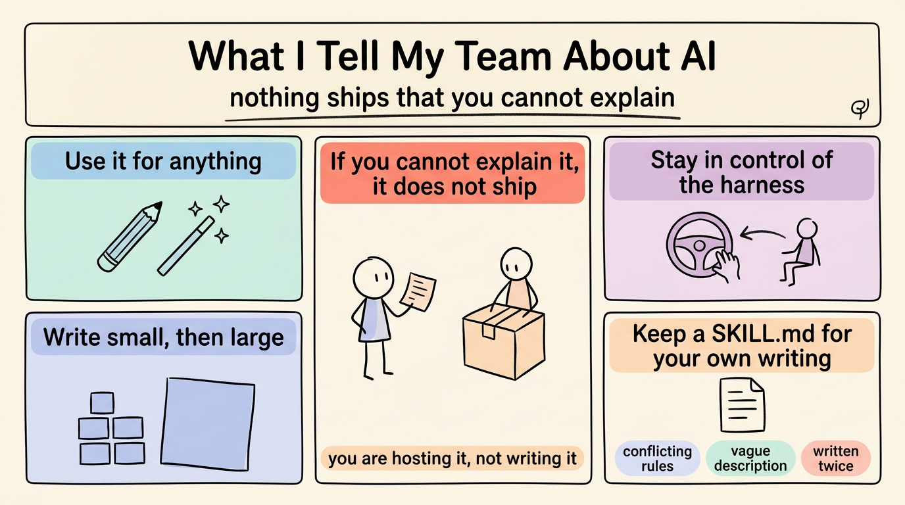

# 我告诉团队关于 AI 的那些话 (What I Tell My Team About AI)

> 繁体版：[我告诉团队关于 AI 的那些话 (What I Tell My Team About AI)](https://github.com/j3ffyang/ai-thoughts/blob/main/docs/261104-what-i-tell-my-team-about-ai-zh-hant.md)

**原文：** [261104-what-i-tell-my-team-about-ai.md](https://github.com/j3ffyang/ai-thoughts/blob/main/docs/261104-what-i-tell-my-team-about-ai.md)

*2026-11-04*

**论点：** 许可不是问题，可解释性才是。你爱用 AI 做什么都行——但解释不清的东西，不能交付。

## 随便用 (Use it for anything)

我不管制工具的使用。代码、文章、操作指南、指令文件——用就是了。问题从来不是「这是不是 AI 写的」，而是「你能不能解释它做了什么，以及为什么是这个样子」。

## 你解释不了，就不能交付 (If you cannot explain it, it does not ship)

这是我真的会执行的规则。如果你解释不清它写了什么，这份工作就搁浅了：你自己维护不了，别人也没法审阅。它不能交付。审阅只能抽查一部分，解释才是唯一覆盖整体的检验。

我不是说要逐行背诵。我说的是：它在做什么、为什么这么做而不是那样、失败时会怎样。如果答案是「模型写的」，那这份工作还没开始。

具体一点：这个重试跑三次，每次之间退避，二十秒后放弃。为什么是三次？为什么是二十秒？三次都失败了会怎么样？这些问题你答得出来，这段代码就是你的；如果答案得去一个你没读过的文件里翻，那你只是在托管它，不是在写它。

## 掌控运行框架 (Stay in control of the harness)

运行框架 (harness) 是围着模型跑循环的那个程序。你才是决定放什么进去、拿什么回来、什么能交付的人。这个位置只有在你能解释产出时才成立。否则就是运行框架在开车，你在副驾点头。

## 先小后大 (Write small, then large)

从一个段落、一个函数、一节开始，让它在小片段里先看到你的模式和逻辑，再交给它一千行。小的部分是解释得清的；一大块交过来时，已经过了你能检查的那个点了。

## 为自己的写作留一个 `SKILL.md` (Keep a `SKILL.md` for your own writing)

你一再重复的规则，就是值得写下来的规则：你如何组织论证、你绝不做什么、哪些检查能证明它做对了。把它们放进一个 `SKILL.md`——技能本来就是这样：把流程写下来。我会写进自己那份的是：开头先给结论、不要硬换行、一段一个观点、检查方框是否方正。然后随着经验增长不断修订它。

最后这一步正是人们会跳过的。一个月后重读，找三种失效：两条规则互相冲突、描述含糊到无法执行、同一条指令写了两遍。这三种都会让智能体自己挑一种读法，而你要到后来才知道它挑了哪一种。

## 结语 (Closing)

这些都不是在提防工具。而是关于让自己始终是那个理解这项工作的人。智能体写字比你读得快，这恰恰就是为什么「读」才是那份工作。

为什么循环比模型更重要，是[另一个论证](https://github.com/j3ffyang/ai-thoughts/blob/main/docs/261022-agent-not-model.md)。这一页只讲我对人的要求。

btw, i use arch
