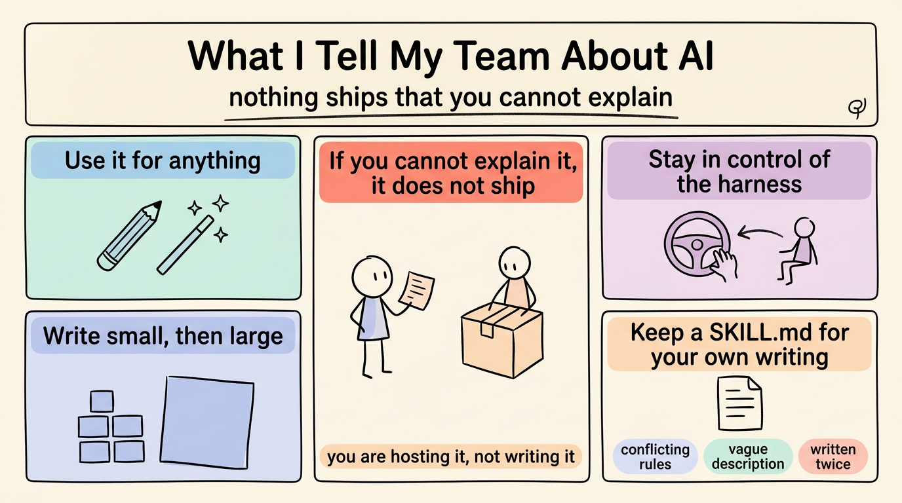

# 我告訴團隊關於 AI 的那些話 (What I Tell My Team About AI)

> 簡體版：[我告訴團隊關於 AI 的那些話 (What I Tell My Team About AI)](https://github.com/j3ffyang/ai-thoughts/blob/main/docs/261104-what-i-tell-my-team-about-ai-zh-hans.md)

**原文：** [261104-what-i-tell-my-team-about-ai.md](https://github.com/j3ffyang/ai-thoughts/blob/main/docs/261104-what-i-tell-my-team-about-ai.md)

*2026-11-04*

**論點：** 許可不是問題，可解釋性才是。你愛用 AI 做什麼都行——但解釋不清的東西，不能交付。

## 隨便用 (Use it for anything)

我不管制工具的使用。程式碼、文章、操作指南、指令檔案——用就是了。問題從來不是「這是不是 AI 寫的」，而是「你能不能解釋它做了什麼，以及為什麼是這個樣子」。

## 你解釋不了，就不能交付 (If you cannot explain it, it does not ship)

這是我真的會執行的規則。如果你解釋不清它寫了什麼，這份工作就擱淺了：你自己維護不了，別人也沒法審閱。它不能交付。審閱只能抽查一部分，解釋才是唯一覆蓋整體的檢驗。

我不是說要逐行背誦。我說的是：它在做什麼、為什麼這麼做而不是那樣、失敗時會怎樣。如果答案是「模型寫的」，那這份工作還沒開始。

具體一點：這個重試跑三次，每次之間退避，二十秒後放棄。為什麼是三次？為什麼是二十秒？三次都失敗了會怎麼樣？這些問題你答得出來，這段程式碼就是你的；如果答案得去一個你沒讀過的檔案裡翻，那你只是在託管它，不是在寫它。

## 掌控執行框架 (Stay in control of the harness)

執行框架 (harness) 是圍著模型跑迴圈的那個程式。你才是決定放什麼進去、拿什麼回來、什麼能交付的人。這個位置只有在你能解釋產出時才成立。否則就是執行框架在開車，你在副駕點頭。

## 先小後大 (Write small, then large)

從一個段落、一個函式、一節開始，讓它在小片段裡先看到你的模式和邏輯，再交給它一千行。小的部分是解釋得清的；一大塊交過來時，已經過了你能檢查的那個點了。

## 為自己的寫作留一個 `SKILL.md` (Keep a `SKILL.md` for your own writing)

你一再重複的規則，就是值得寫下來的規則：你如何組織論證、你絕不做什麼、哪些檢查能證明它做對了。把它們放進一個 `SKILL.md`——技能本來就是這樣：把流程寫下來。我會寫進自己那份的是：開頭先給結論、不要硬換行、一段一個觀點、檢查方框是否方正。然後隨著經驗增長不斷修訂它。

最後這一步正是人們會跳過的。一個月後重讀，找三種失效：兩條規則互相沖突、描述含糊到無法執行、同一條指令寫了兩遍。這三種都會讓智慧體自己挑一種讀法，而你要到後來才知道它挑了哪一種。

## 結語 (Closing)

這些都不是在提防工具。而是關於讓自己始終是那個理解這項工作的人。智慧體寫字比你讀得快，這恰恰就是為什麼「讀」才是那份工作。

為什麼迴圈比模型更重要，是[另一個論證](https://github.com/j3ffyang/ai-thoughts/blob/main/docs/261022-agent-not-model.md)。這一頁只講我對人的要求。

btw, i use arch
