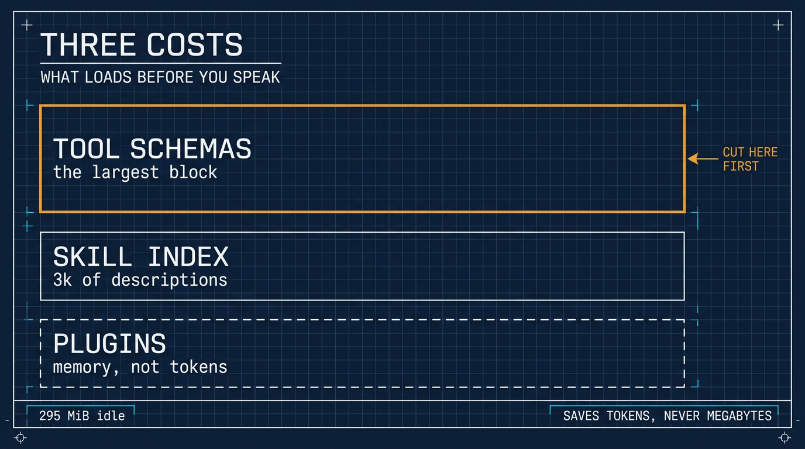

# 在 ⚕ Hermes 里关掉你永远不会用的技能

> 繁体版：[在 ⚕ Hermes 里关掉你永远不会用的技能](https://github.com/j3ffyang/ai-thoughts/blob/main/docs/261105-hermes-skill-index-zh-hant.md)

**原文：** [261105-hermes-skill-index.md](https://github.com/j3ffyang/ai-thoughts/blob/main/docs/261105-hermes-skill-index.md)

*2026-11-05*

**论点：** 一份全新的 Hermes 安装会播种 (seed) 一整份没人要的技能目录，而它们的描述在你开口之前就已经加载了。关掉你永远不会碰的分类，其余的按需加载。

## 一台 4 GB 的 VPS、两个核，和一份目录

我又在一台小 VPS 上装了 Hermes：4 GB 内存、2 个核、没有 GPU，跑 Debian。安装本身平淡无奇。我注意到的东西在后面才出现，在技能列表里。

小机器是注意到这件事的合适地方，因为它排除了常见的借口。如果有什么会紧张，4 GB 会第一个暴露出来——而什么都没发生。问题不在机器。

留个记录，那台机器上跑了几小时后的 `top`，无关的 `sshd` 行已裁掉：

```
top - 09:15:22 up  2:33,  1 user,  load average: 0.08, 0.02, 0.01
Tasks: 116 total,   2 running, 114 sleeping,   0 stopped,   0 zombie
%Cpu(s):  0.5 us,  0.0 sy,  0.0 ni, 99.2 id,  0.0 wa,  0.0 hi,  0.3 si,  0.0 st
MiB Mem :   3817.6 total,   1085.3 free,    601.0 used,   2320.4 buff/cache
MiB Swap:      0.0 total,      0.0 free,      0.0 used.   3216.5 avail Mem

    PID USER      PR  NI    VIRT    RES    SHR S  %CPU  %MEM     TIME+
   3197 jeff      20   0  756044 302472  41080 S   0.7   7.7   1:20.99 hermes
```

直白地读：这是**空闲** (idle) 状态的 hermes——0.7% CPU，没有任务在跑——它已经占住 295 MiB 常驻内存 (resident)（302,472 KiB），占 3.8 GB 的 7.7%，可用 3.2 GB，没有用到 swap。两个核上负载均值 0.08，所以这里没有任何东西在吃力。要记住的是这个空闲基线：295 MiB 内存是**占着**，不是释放——扣掉 40 MiB 共享页 (shared pages) 后，其中 255 MiB 是私有内存 (private)——以及我动手之前那份 3k 词元 (token) 的目录索引。两者都在你问第一个问题之前就付掉了。

## 索引要花什么

Hermes 按渐进披露 (progressive disclosure) 加载技能：没有任何东西是整份到达的。第一层是索引 (index)——每个技能的名字、描述和分类——只有代理真的要用某个技能时，全文才加载。Hermes 自己的文档把全量目录的索引估在约 3k 词元。

三千词元不算危机。它也不是免费的，而且在我问任何问题之前就花掉了，花在我永远不会调用的技能描述上。索引就是上下文 (context)：它和我真正写下的指令竞争，还会把代理推向任何看起来相邻的东西。

在 4 GB 的机器上，这从不会表现为内存压力。它表现为：代理在开口之前，已经被告知了它并不需要的大半个目录。

**停用技能省的是词元，从来不是兆字节。**

## 我关掉了什么

安装过程会播种一整份目录。我打开配置，选了 **Toggle by category**，关掉四个：

```
hermes skills config
# then: Toggle by category → emails, productivity, social-media, software-development
```

那份名单是我的，不是建议。我不会在代理会话里跑邮件工作流，不搭社交媒体流水线，我做的软件开发属于 OpenCode——项目自己的 `AGENTS.md` 和技能已经描述得很清楚。四个里 productivity 最模糊，而模糊是我最不希望代理去猜的东西。

每周都在用的就留着。重点不是为极简而极简；重点是：一个你从没打开过的技能，就是披着工具外衣的噪音。

顺带说，停用 (disable) 是正确的动词。文件留在原地，一个开关就能把分类拿回来——什么都没删，所以之后也不用重装。

## 为什么是停用，而不是忽略

因为忽略不管用。索引每个会话都会被读，所以一个你从不碰的分类，仍然在替「代理在这个平台上认为什么是可用的」投票，也仍然在那个平台上每次对话开始时被付费。

我偏好的默认反过来：需要的时候再加载。下个月如果我要用邮件技能，一个开关就能把分类拿回来——比为了以防万一背着一百个会话便宜，也比清空之后重装便宜。

## 如果你的构建不一样

分类开关是我的安装版本提供的东西，而且只能停用。文档里的命令覆盖同一个想法的另外两种形态：

```
hermes skills opt-out            # stop future seeding, touch nothing on disk
hermes skills opt-in --sync      # undo, and re-seed now
hermes skills opt-out --remove   # the destructive one: delete unmodified bundled skills
hermes profile create research --no-skills   # start a profile with no catalog
```

如果某个命令挪了位置，我会从[技能文档](https://hermes-agent.nousresearch.com/docs/user-guide/features/skills)开始找。

这些都不碰工具本身。停用一个目录条目只是藏起一个技能；从平台上移除 `skills` 工具集 (toolset) 则把 `skills_list`、`skill_view` 和 `skill_manage` 一起藏起来；而写入闸门 (write gate) 又是第三件事——工具留着，安装先暂存。如果你想让机器人彻底不再提供技能，那是工具集的决定，不是目录的决定。[加固指南](https://github.com/j3ffyang/ai-thoughts/blob/main/docs/261108-hermes-guest-hardening.md)讲的是另外两件。

## 索引是三种成本里最小的那一种

一个安装的重量分三种，其中只有两种以词元计价：

| 成本 | 何时支付 | 怎么减 |
|---|---|---|
| 技能索引 | 每个会话，以词元计 | 停用技能，如上 |
| 工具 schema | 每个会话，以词元计——通常是最大的一块 | 移除工具集 |
| 插件 | 启动与内存，不是上下文 | 停用插件 |



工具 schema 是安静的那一个。每个启用的工具集都会在你开口之前运来一份 JSON schema，完整的 `hermes-cli` 平台带着几十份；关掉你从不调用的六个，提示词 (prompt) 缩小的幅度就超过技能索引曾经的全部成本。插件是另一种货币——一个 Telegram 的平台插件花的是进程内存和启动时间，不是提示词空间，而在这台 4 GB 的机器上，第一节那个空闲数字已经说明很宽裕。

```
hermes tools                     # per platform; interactive, needs a real terminal
hermes plugins list              # what is installed, and what is switched on
hermes plugins disable <name>    # switch one off without removing it
```

`/context all` 会在会话里打印按技能、按工具集的成本明细，这是唯一能看出某次移除是否真的有用的办法。在这里靠猜会猜反方向：插件列表看起来最肥，通常却最便宜。

## 收尾

小 VPS 适合注意到这件事，因为它去掉了常见的借口：不是硬件的问题，从来都不是。代理在你开口之前就读了技能索引。里面的每一条，都该挣得它自己的位置。

btw, i use arch
