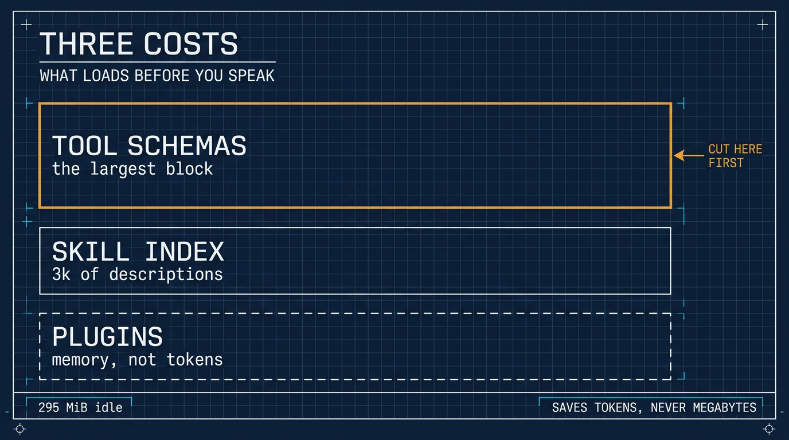

# 在 ⚕ Hermes 裡關掉你永遠不會用的技能

> 簡體版：[在 ⚕ Hermes 裡關掉你永遠不會用的技能](https://github.com/j3ffyang/ai-thoughts/blob/main/docs/261105-hermes-skill-index-zh-hans.md)

**原文：** [261105-hermes-skill-index.md](https://github.com/j3ffyang/ai-thoughts/blob/main/docs/261105-hermes-skill-index.md)

*2026-11-05*

**論點：** 一份全新的 Hermes 安裝會播種 (seed) 一整份沒人要的技能目錄，而它們的描述在你開口之前就已經載入了。關掉你永遠不會碰的分類，其餘的按需載入。

## 一臺 4 GB 的 VPS、兩個核，和一份目錄

我又在一臺小 VPS 上裝了 Hermes：4 GB 記憶體、2 個核、沒有 GPU，跑 Debian。安裝本身平淡無奇。我注意到的東西在後面才出現，在技能列表裡。

小機器是注意到這件事的合適地方，因為它排除了常見的藉口。如果有什麼會緊張，4 GB 會第一個暴露出來——而什麼都沒發生。問題不在機器。

留個記錄，那臺機器上跑了幾小時後的 `top`，無關的 `sshd` 行已裁掉：

```
top - 09:15:22 up  2:33,  1 user,  load average: 0.08, 0.02, 0.01
Tasks: 116 total,   2 running, 114 sleeping,   0 stopped,   0 zombie
%Cpu(s):  0.5 us,  0.0 sy,  0.0 ni, 99.2 id,  0.0 wa,  0.0 hi,  0.3 si,  0.0 st
MiB Mem :   3817.6 total,   1085.3 free,    601.0 used,   2320.4 buff/cache
MiB Swap:      0.0 total,      0.0 free,      0.0 used.   3216.5 avail Mem

    PID USER      PR  NI    VIRT    RES    SHR S  %CPU  %MEM     TIME+
   3197 jeff      20   0  756044 302472  41080 S   0.7   7.7   1:20.99 hermes
```

直白地讀：這是**空閒** (idle) 狀態的 hermes——0.7% CPU，沒有任務在跑——它已經佔住 295 MiB 常駐記憶體 (resident)（302,472 KiB），佔 3.8 GB 的 7.7%，可用 3.2 GB，沒有用到 swap。兩個核上負載均值 0.08，所以這裡沒有任何東西在吃力。要記住的是這個空閒基線：295 MiB 記憶體是**佔著**，不是釋放——扣掉 40 MiB 共享頁 (shared pages) 後，其中 255 MiB 是私有記憶體 (private)——以及我動手之前那份 3k 詞元 (token) 的目錄索引。兩者都在你問第一個問題之前就付掉了。

## 索引要花什麼

Hermes 按漸進披露 (progressive disclosure) 載入技能：沒有任何東西是整份到達的。第一層是索引 (index)——每個技能的名字、描述和分類——只有代理真的要用某個技能時，全文才載入。Hermes 自己的文件把全量目錄的索引估在約 3k 詞元。

三千詞元不算危機。它也不是免費的，而且在我問任何問題之前就花掉了，花在我永遠不會呼叫的技能描述上。索引就是上下文 (context)：它和我真正寫下的指令競爭，還會把代理推向任何看起來相鄰的東西。

在 4 GB 的機器上，這從不會表現為記憶體壓力。它表現為：代理在開口之前，已經被告知了它並不需要的大半個目錄。

**停用技能省的是詞元，從來不是兆位元組。**

## 我關掉了什麼

安裝過程會播種一整份目錄。我開啟配置，選了 **Toggle by category**，關掉四個：

```
hermes skills config
# then: Toggle by category → emails, productivity, social-media, software-development
```

那份名單是我的，不是建議。我不會在代理會話裡跑郵件工作流，不搭社交媒體流水線，我做的軟體開發屬於 OpenCode——專案自己的 `AGENTS.md` 和技能已經描述得很清楚。四個裡 productivity 最模糊，而模糊是我最不希望代理去猜的東西。

每週都在用的就留著。重點不是為極簡而極簡；重點是：一個你從沒開啟過的技能，就是披著工具外衣的噪音。

順帶說，停用 (disable) 是正確的動詞。檔案留在原地，一個開關就能把分類拿回來——什麼都沒刪，所以之後也不用重灌。

## 為什麼是停用，而不是忽略

因為忽略不管用。索引每個會話都會被讀，所以一個你從不碰的分類，仍然在替「代理在這個平臺上認為什麼是可用的」投票，也仍然在那個平臺上每次對話開始時被付費。

我偏好的預設反過來：需要的時候再載入。下個月如果我要用郵件技能，一個開關就能把分類拿回來——比為了以防萬一背著一百個會話便宜，也比清空之後重灌便宜。

## 如果你的構建不一樣

分類開關是我的安裝版本提供的東西，而且只能停用。文件裡的命令覆蓋同一個想法的另外兩種形態：

```
hermes skills opt-out            # stop future seeding, touch nothing on disk
hermes skills opt-in --sync      # undo, and re-seed now
hermes skills opt-out --remove   # the destructive one: delete unmodified bundled skills
hermes profile create research --no-skills   # start a profile with no catalog
```

如果某個命令挪了位置，我會從[技能文件](https://hermes-agent.nousresearch.com/docs/user-guide/features/skills)開始找。

這些都不碰工具本身。停用一個目錄條目只是藏起一個技能；從平臺上移除 `skills` 工具集 (toolset) 則把 `skills_list`、`skill_view` 和 `skill_manage` 一起藏起來；而寫入閘門 (write gate) 又是第三件事——工具留著，安裝先暫存。如果你想讓機器人徹底不再提供技能，那是工具集的決定，不是目錄的決定。[加固指南](https://github.com/j3ffyang/ai-thoughts/blob/main/docs/261108-hermes-guest-hardening.md)講的是另外兩件。

## 索引是三種成本里最小的那一種

一個安裝的重量分三種，其中只有兩種以詞元計價：

| 成本 | 何時支付 | 怎麼減 |
|---|---|---|
| 技能索引 | 每個會話，以詞元計 | 停用技能，如上 |
| 工具 schema | 每個會話，以詞元計——通常是最大的一塊 | 移除工具集 |
| 外掛 | 啟動與記憶體，不是上下文 | 停用外掛 |



工具 schema 是安靜的那一個。每個啟用的工具集都會在你開口之前運來一份 JSON schema，完整的 `hermes-cli` 平臺帶著幾十份；關掉你從不呼叫的六個，提示詞 (prompt) 縮小的幅度就超過技能索引曾經的全部成本。外掛是另一種貨幣——一個 Telegram 的平臺外掛花的是程序記憶體和啟動時間，不是提示詞空間，而在這臺 4 GB 的機器上，第一節那個空閒數字已經說明很寬裕。

```
hermes tools                     # per platform; interactive, needs a real terminal
hermes plugins list              # what is installed, and what is switched on
hermes plugins disable <name>    # switch one off without removing it
```

`/context all` 會在會話裡列印按技能、按工具集的成本明細，這是唯一能看出某次移除是否真的有用的辦法。在這裡靠猜會猜反方向：外掛列表看起來最肥，通常卻最便宜。

## 收尾

小 VPS 適合注意到這件事，因為它去掉了常見的藉口：不是硬體的問題，從來都不是。代理在你開口之前就讀了技能索引。裡面的每一條，都該掙得它自己的位置。

btw, i use arch
