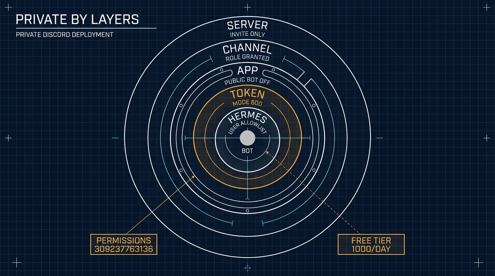

# 在 VPS 上运行一个私有的 ⚕ Hermes Agent，接入 Discord

> 繁体版：[在 VPS 上运行一个私有的 ⚕ Hermes Agent，接入 Discord](https://github.com/j3ffyang/ai-thoughts/blob/main/docs/261107-hermes-discord-integration-zh-hant.md)

**原文：** [261107-hermes-discord-integration.md](https://github.com/j3ffyang/ai-thoughts/blob/main/docs/261107-hermes-discord-integration.md)

*2026-11-07*

**目标：** 全部私有 (private)。一个私有服务器、一个私有频道、一个只有你能安装的私有应用 (app)。没有你发出的邀请 (invite)，也没有你添加的允许名单 (allowlist) 条目，任何人都碰不到这个机器人。

**状态：** 可用——一位朋友加入了服务器，并和机器人完成了一次可用的对话。机器人会在自己的频道里就地回复 @ 提及，也会回复允许名单上任何人的私信 (DM)。本文记录的就是这个私有变体：只有所有者能安装应用、私有频道、允许名单。

上游参考：<https://github.com/NousResearch/hermes-agent/blob/main/website/docs/user-guide/messaging/discord.md>

## 为什么不是 Google Chat

Discord 是第二次尝试。第一次是 Google Chat，它吞掉了我两三天。

Hermes 自带 Google Chat 适配器 (adapter)，所以这份工作看起来平平无奇：一个 Google Cloud 项目、启用 Chat API、一个服务账号 (service account)、一个端点 (endpoint)。墙在底下。Chat 应用需要 Business 或 Enterprise 级别的 Google Workspace 账号——Google 自己的快速上手文档就把这条列在前提条件里。免费的 Gmail 账号根本没法启用 Google Chat API，而整个流程里没有一句话说明这一点。API 就那么停用着，停在一个你拥有的项目里，没有任何开关能把它打开。

然后 Google Cloud 控制台又补了一刀。Chat API 面板看起来像微软 Windows 的产物：不同设计年代的嵌板拼在一起、到处都是方框控件、该放控件的地方是一片空白，而且看不出有谁曾经把整个屏幕当作一个整体看过。它是我用过最难看的界面之一，如果是微软团队做的，那一切就解释得通了。

我放弃了 Google Chat。Discord 只花了零头的时间，下面就是跑通的那套配置。

**留下的尾巴。** 放弃并不会移除适配器。它仍然处于配置状态，并在每次健康检查时报一个已经死掉的 Pub/Sub 订阅 (subscription)，所以要关掉它：

```bash
hermes config set platforms.google_chat.enabled false
hermes gateway restart
```

顺手把 `GOOGLE_CHAT_*` 那些行从 `~/.hermes/.env` 里删掉。如果重启后警告还在，那不是活的故障：`gateway status` 打印的是 `~/.hermes/gateway_state.json` 里上一次保存的快照 (snapshot)。停掉网关，把那个文件挪开，再启动。

## 各个部件是什么

| 部件 (piece) | 它是什么 | 放在哪里 |
|---|---|---|
| Hermes Agent | Agent 运行时 (runtime) + 网关进程 (gateway) | VPS，一个普通用户账号下 |
| Discord 应用 (application) | 机器人的身份（名字、头像、令牌、意图） | Discord 开发者门户 |
| Discord 服务器 (server) | 你自己拥有的私有服务器 | Discord |
| 服务器里的机器人 | 带着一组权限安装进该服务器的那个应用 | Discord |
| 允许的用户 | Hermes 实际会答复的 Discord 用户 ID | VPS 上的 `~/.hermes/.env` |
| 模型 (model) | 机器人背后的 LLM——这里是 OpenRouter 的免费变体 | `~/.hermes/config.yaml` |

机器人令牌 (token) 是唯一一个 Discord 秘密。它住在 VPS 上，永远不进服务器、不进仓库、不进聊天消息。OpenRouter 的密钥 (key) 是另一个，住在同一个地方。

## 第 1 部分 — VPS 上的 Hermes

一切都在**普通用户**下运行，不要用 root。安装器会写入 `~/.hermes/` 和 `~/.local/bin/`。

```bash
# prerequisites + install
curl -fsSL https://hermes-agent.nousresearch.com/install.sh | bash
source ~/.bashrc
hermes doctor
```

### 模型：Nemotron 3 Ultra，免费

Discord 上的一切都要等 Agent 自己能回答才成立。这套安装跑的是 OpenRouter 的免费变体，所以一次对话的唯一成本就是每日请求上限 (cap)。

| 字段 | 值 |
|---|---|
| 提供方 (provider) | `openrouter`, `https://openrouter.ai/api/v1` |
| 模型 | `nvidia/nemotron-3-ultra-550b-a55b:free` — Nemotron 3 Ultra，总参数 550B / 激活 55B，1M 上下文 (context)，支持工具调用 (tool calling) |
| 价格 | \$0 输入，\$0 输出（免费变体） |
| 上限 (ceiling) | 每个 UTC 日 1000 次请求，00:00 UTC 重置——从未买过额度的账号是 50 次 |

```bash
hermes config set OPENROUTER_API_KEY sk-or-v1-...
hermes config set model.provider openrouter
hermes config set model "nvidia/nemotron-3-ultra-550b-a55b:free"
hermes config show
```

查看当天还剩多少预算。`hermes config set` 会把密钥写进 `~/.hermes/.env`，而你的 shell 不会读那个文件，所以先加载它：

```bash
set -a; . ~/.hermes/.env; set +a
curl -s https://openrouter.ai/api/v1/key \
  -H "Authorization: Bearer $OPENROUTER_API_KEY" \
  | jq '.data.free_model_daily_requests'
# {"used": 12, "limit": 1000, "remaining": 988}
```

这个上限是账号下所有 `:free` 模型共用的一个计数器 (counter)，所以换一个免费模型并不会恢复服务。额度用光后，回复会停到重置为止。

机器人看起来坏掉时，有两件事值得分开看：429 是限流 (rate limit)——可能是每日上限，也可能是免费档每分钟 20 次的突发限制；而回复变慢或拒绝服务，是免费档在高峰时段的优先级问题。两者都不是 Discord 的问题。

把网关放进 systemd，这样登出和重启都不会丢掉它：

```bash
hermes gateway install     # user unit: hermes-gateway
hermes gateway start
hermes gateway status

sudo loginctl enable-linger $USER   # keep it running after SSH disconnects
```

用 `journalctl --user -u hermes-gateway -f` 跟踪日志。

在无头 (headless) 的 VPS 上，你也可以改用开机启动的系统级单元 (system unit)：`sudo hermes gateway install --system`，之后 `start`/`status` 都带上 `--system`，`journalctl -u hermes-gateway -f` 不带 `--user`。它也让每一次重启都需要 root，包括 `hermes update` 结尾那次——用户单元加 linger 就避开了这一点。

**不要**添加 `ExecStopPost=/bin/kill -9` 这类 drop-in。装好的单元本来就会干净停止，并设置了 `Restart=always`；一个硬杀 (hard-kill) 的 drop-in 会把每次重启变成无限重生循环。

从这里开始，任何配置或 `.env` 的改动都靠 `hermes gateway restart` 生效。

## 第 2 部分 — Discord 应用 (application)

打开 <https://discord.com/developers/applications> → **New Application**。

**Bot 页面：**

- **Public Bot → OFF。** 这套安装是私有的：关掉 Public Bot 后，**只有你能把这个应用加进服务器 (guild)**。别人拿着任何 URL 都无法授权它。先到下面的安装页把安装链接设成 **None**——Discord 会拒绝一个还带着默认安装链接的私有应用。
- **Require OAuth2 Code Grant → OFF。**
- **特权网关意图 (Privileged Gateway Intents)：** 启用 **Server Members Intent** 和 **Message Content Intent**。Message Content 是硬性的那个：关掉它，Discord 会拒绝连接，机器人永远不上线——这是第一大故障。Server Members 则让 Hermes 能解析用户名和角色。改完保存。
- **Token → Reset Token**，只复制一次。它不会再次显示；丢了就只能重置。

如果应用早先是开着 Public Bot 建的，那么任何拿到 URL 的人现在仍能安装它——见本部分末尾的**事后加固**。

**安装页 (Installation)**（邀请链接）：

- **Installation Contexts：** Guild Install。
- **Install Link → None。** 没有 "Add App" 按钮、没有 App Directory 列表、没有可泄露的 URL。手动授权 URL 对你这个所有者仍然有效。
- **Scopes：** `bot` + `applications.commands`。
- **Permissions：** `309237763136`（推荐）——View Channels、Send Messages、Embed Links、Attach Files、Read Message History、Create Public Threads、Send Messages in Threads、Add Reactions。`117760` 是最小集；`309240908864` 增加了语音。

手动 URL——自己留着：

```
https://discord.com/oauth2/authorize?client_id=YOUR_APP_ID&scope=bot+applications.commands&permissions=309237763136
```

**装进你的服务器：** 由你**自己**打开那个 URL，选中私有服务器，Continue → Authorize。从那一刻起应用就在服务器里了——**Server Settings → Integrations** 会列出它。频道的成员列表是另一回事：它只显示能看见该频道的成员，所以机器人要等第 4 部分那次授权之后才会出现在那里，而在线则要等网关启动。这是唯一一次安装应用；朋友永远不装。安装时授予的权限之后不会自动增长——要加权限就重新打开 URL。

**事后加固。** 用默认设置创建的应用是公开的：Public Bot 开着、带一个 Discord 提供的安装链接，任何拿到 URL 的人都能把它加进自己的服务器。要变成私有有顺序，因为第一步没做完时 Discord 会拒绝第二步：

1. **Installation** → **Install Link** → **None**，Save Changes。
2. **Bot** → **Public Bot** → OFF，Save Changes。

只做一半，应用就仍然可被安装——Discord 给的报错是 *Private application cannot have a default authorization link*。这两个开关都不会把应用从已安装它的服务器里移除；它们只阻止新的授权。之后就用上面的手动 URL 安装。如果 Discord 回你 *Verified apps must be public*，说明这个应用带着 Verified 徽章，而验证只存在于 100 个以上服务器的机器人——这里不该适用。

## 第 3 部分 — 把 Hermes 接到机器人

快路径，它会校验令牌、检查意图、打印一个授权 URL，并把你加进允许名单：

```bash
hermes gateway setup     # choose Discord, paste the token
```

手动路径——`~/.hermes/.env`：

```bash
DISCORD_BOT_TOKEN=your-bot-token
DISCORD_ALLOWED_USERS=284102345871466496
```

`DISCORD_ALLOWED_USERS` 是一个逗号分隔的**用户 ID** 列表（Discord 设置 → 高级 → 打开开发者模式 → 右键某个用户 → Copy User ID）。没有它——或者没有 `DISCORD_ALLOWED_ROLES`，也没有用 `DISCORD_ALLOWED_CHANNELS` 把机器人限制在特定频道——网关会拒绝所有人。

然后：

```bash
hermes gateway restart
```

## 第 4 部分 — 给机器人一个专属频道 (channel)

Discord 没有提供创建频道的 CLI，所以这一部分是一次图形界面操作、一次权限授予，外加一个配置键。

**创建它。** 右键分类——顶层频道则右键服务器名——然后 **Create Channel** → **Text**，用机器人的名字命名，比如 `hermes`。

**私有还是公开。** 这套搭建把频道做成私有：`@everyone`——服务器里每个成员都持有的默认角色——什么都拿不到，可见性按角色单独授予。Server Settings → Roles → `@everyone`：把 View Channels 关掉，同时把服务器级 (guild-level) 权限也全部关掉。**Create Invite** 最要紧：一个能发邀请的成员，就能把你从未批准的人带进来，你的允许名单说什么都没用。Manage Server、Manage Roles、Manage Channels 留给你自己。公开频道也能用，但那样每个成员都能看到机器人的对话，私有服务器的意义就没了。

**让机器人进入私有频道。** **Edit Channel → Permissions → Add members or roles**，选中应用的角色（以应用命名，比如 `Hermes`，应用装好后会出现在角色列表里），然后授予：

| 权限 | 为什么 |
|---|---|
| View Channel | 没有它，机器人永远收不到消息，也不会出现在该频道的成员列表里。频道是安静，不是坏了，`gateway.log` 什么都不显示 |
| Send Messages | 回复 |
| Read Message History | 上下文，以及每次被提及时的历史回填 (backfill) |
| Embed Links, Attach Files | 富文本回答和文件输出 |
| Create Public Threads, Send Messages in Threads | 只有你想要自动开线程 (thread) 时才需要 |

安装时的权限只是设定了上限；在私有频道里，真正让机器人进来的是这条覆盖 (override)。朋友需要从成员角色那里获得同一个频道的 View Channel，与机器人无关。

**选择频道的行为方式。** 先复制频道 ID（开发者模式 → 右键频道 → **Copy Channel ID**），然后三选一：

| 模式 | 配置 | 行为 |
|---|---|---|
| 提及、就地回复——这套安装用的 | `no_thread_channels` | 在频道里直接回复 @ 提及，不开线程 |
| 免提及 (mention-free) | `free_response_channels` | 回复每条消息，就地回复 |
| 每段对话一个线程（默认） | 都不设 | 在新的线程里回复 @ 提及 |

```yaml
# ~/.hermes/config.yaml — the mode this install runs
discord:
  no_thread_channels:
    - 123456789012345678   # <channel id> — reply inline instead of opening a thread
```

免提及频道本来就地回复，所以不需要 `no_thread_channels`。如果想让它在免提及的同时，每条顶层消息仍开一个线程，加上 `free_response_auto_thread: true`（它需要 `discord.auto_thread`，后者默认开着）。

```bash
hermes gateway restart
hermes gateway status
```

同样的开关在 `.env` 里写作 `DISCORD_NO_THREAD_CHANNELS` 和 `DISCORD_FREE_RESPONSE_CHANNELS`；两者都设置时，环境变量优先。

**用 API 创建**——REST 调用需要 **Manage Channels**，而 `permissions=309237763136` 里没有它，所以机器人会拿到 403。用你自己的客户端创建频道，或者先带着 Manage Channels 重新邀请应用（`309237763136` + `16`）。

## 第 5 部分 — 让朋友进来

应用始终是你的。朋友从不打开开发者门户、不安装任何东西，也拿不到机器人 URL。四道独立的关卡 (gate) 决定他们能不能和它说话，每一道都必须开着。频道范围是唯一一道一开始就开着的。

| 关卡 | 在哪里设置 | 它控制什么 |
|---|---|---|
| 服务器邀请 | Discord | 他们能不能看到这个服务器 |
| 频道可见性 | 频道权限 | 他们能不能看到 `#hermes` |
| Hermes 频道范围 | `~/.hermes/.env` | 机器人在哪些频道里回答 |
| Hermes 允许名单 | `~/.hermes/.env` | 机器人会不会回答他们 |

一个上了允许名单的朋友，摸到的是这台 VPS 上 Agent 的工具面 (tool surface)，不只是一个聊天窗口——把允许名单当成一个 shell 账号来对待，它到底意味着什么见下面的*保持私有*。

**斜杠命令 (slash command) 是第二个面。** 没配置管理员划分 (admin split) 时，每个上了允许名单的用户还会拿到整套斜杠命令——包括 `/learn`，它会把一个技能 (skill) 写进 `~/.hermes/skills`，还有 `/save`、`/rollback` 和 `/update`。工具和命令是分开把关的：`platform_toolsets` 根本看不到斜杠命令。把 `allow_admin_from` 和 `group_allow_admin_from` 设成你的 ID，再给访客一份很短的 `user_allowed_commands`。确切的配置块——以及它为什么该放在 `platforms.discord` 而不是 `gateway.platforms.discord`——在[加固指南](https://github.com/j3ffyang/ai-thoughts/blob/main/docs/261108-hermes-guest-hardening.md)里。

第一次邀请之前，把 **Community** 关掉——没有发现 (discovery)，没有虚荣链接 (vanity link)。访问权来自你授予的角色。

1. 创建邀请：右键服务器名 → **Invite People** → **Edit invite link** → 设置有效期和最大使用次数。把链接发出去，他们进来后就撤销。Server Settings → Invites 会列出并一键干掉所有未撤销的链接。
2. 他们接受邀请，进入服务器。他们只看得到自己角色允许的频道——如果你授予了，就是 `#hermes`。
3. 收集他们的**用户 ID**（开发者模式 → 右键他们的名字 → Copy User ID），追加进去：

```bash
# ~/.hermes/.env
DISCORD_ALLOWED_USERS=284102345871466496,198765432109876543
```

```bash
hermes gateway restart
hermes gateway status
```

4. 他们在 `#hermes` 里发消息。第一次回复说明四道关卡都开着；一片沉默说明还有一道关着，故障排查表会指出是哪一道。

**用角色代替列表。** 建一个类似 `hermes-user` 的角色，给它 `#hermes` 的 View Channel，然后设置 `DISCORD_ALLOWED_ROLES=<role-id>`。授予或收回这一个角色，就加上或撤掉访问权，不用推配置、不用重启。

**把机器人留在一个频道里。** 频道范围这道关卡，与用户允许名单分开设置：

```bash
# ~/.hermes/.env
DISCORD_ALLOWED_CHANNELS=123456789012345678
DISCORD_IGNORED_CHANNELS=987654321098765432   # optional hard deny
```

设置了 `DISCORD_ALLOWED_CHANNELS` 后，机器人只在这些频道和私信里回答，别处一律不答。私信不遵守那张列表——用户允许名单是它们唯一的关卡。

## 保持私有 (private)

| 层 (layer) | 设置 | 效果 |
|---|---|---|
| 服务器 | 不开 Community、不开 Discovery、关掉 widget、一次性限时邀请、`@everyone` 没有任何服务器级权限——首要是 Create Invite | 没有你发出的链接，服务器既找不到也进不来 |
| 频道 | 私有频道、显式角色权限 | 只有被授予的成员和应用能看到 `#hermes` |
| 应用 | Public Bot OFF、Install Link None | 只有你能把应用加到任何地方；不存在公开安装面 |
| 令牌 | `~/.hermes/.env`，权限 600，绝不进仓库或消息 | 令牌才是真正的凭据——攻击者要的是它，不是应用的隐私开关 |
| Hermes | `DISCORD_ALLOWED_USERS` + `DISCORD_ALLOWED_CHANNELS` | 被邀请进来但不在允许名单上的成员得不到回复 |



这套配置**做不到**什么，直说：

- Discord 不是端到端加密的。频道消息、附件和私信都躺在 Discord 的服务器上，而副本躺在 VPS 上的 `~/.hermes/state.db` 里。
- 每个提示词 (prompt) 都会离开 VPS，去往模型提供方（这里是 OpenRouter 的免费档），并受那家提供方留存政策的约束。
- 把一个人加进允许名单，就是把这台 VPS 上 Agent 的工具面交给他——终端、文件、浏览器——**默认如此**。Discord 的隐私设置控制的是*谁能摸到机器人*；`platform_toolsets` 和 `approvals` 控制的是*它被摸到之后能做什么*。[加固指南](https://github.com/j3ffyang/ai-thoughts/blob/main/docs/261108-hermes-guest-hardening.md)是本文的后半篇：它把写工具从 Discord 上拿掉，只留在 CLI 里。

## 机器人的行为

| 场景 | 行为 |
|---|---|
| 私信 | 回复每条消息，不需要提及，每个私信一个会话 (session)。只有允许名单上的用户能走到这一步 |
| 服务器频道 | 只有在被 @ 提及时才回答，除非该频道在 `discord.free_response_channels` 里。频道在 `discord.no_thread_channels` 里时就地回复，否则开线程。设置了 `DISCORD_ALLOWED_CHANNELS` 时，只在那些频道里回答 |
| 线程 | 就地回复；一旦它进了线程，就不再需要提及 |
| 共享频道、多个人 | 默认按用户分会话（`group_sessions_per_user: true`） |
| 只 @ 了其他用户的消息 | 忽略（避免插进别人的对话） |

`~/.hermes/config.yaml` 里好用的旋钮：`discord.free_response_channels`、`discord.no_thread_channels`、`discord.auto_thread`、`discord.reactions`、`display.tool_progress`。

有三个块共用同一个名字。`discord:` 存行为——就是上面那些旋钮。`platforms.discord:` 存连接和 `extra`，管理员划分放在那里。`gateway.platforms.discord:` 是网关仍会读取的另一种嵌套，在共享键上会被顶层块遮蔽 (shadow)。行为类的键永远不属于 `extra`。

## 故障排查 (troubleshooting)

| 现象 | 原因 | 修复 |
|---|---|---|
| 机器人一直离线，日志说 privileged Gateway Intents | Message Content Intent 没开 | 打开它，Save Changes，重启网关 |
| 在线，但在某个频道里沉默 | `require_mention` 默认开着，或者机器人在那里没有 View Channel | @ 它，把频道加进 `free_response_channels`，或在私有频道上授予 View Channel |
| 在线、View Channel 也给了，仍然沉默 | 那条消息里没有真正的提及——手打的名字只是纯文本，除非从弹窗里选 | 用 `@` 重新输入并从列表里选机器人，或者发 `<@BOT_ID> hello` |
| 每条消息都开一个线程 | `auto_thread` 默认开着 | 把频道加进 `no_thread_channels` |
| 在线，但忽略某一个特定的人 | 他的 ID 不在 `DISCORD_ALLOWED_USERS` 里 | 加上它并 `hermes gateway restart` |
| 朋友能看到服务器但看不到 `#hermes` | 频道是私有的，他的角色缺 View Channel | 把他的角色加进频道权限 |
| 私信能答，`#hermes` 里不答 | 设置了 `DISCORD_ALLOWED_CHANNELS`，而该频道不在其中 | 加上频道 ID，再重启 |
| 别人无法把应用加到另一个服务器 | Public Bot 关着，这是设计如此——它挡住的是别人，不是你 | 你自己仍然可以：打开手动 URL 并选另一个服务器 |
| 启动时报 `Invalid token` | 令牌被重置过，或粘贴时带了空白字符 | 重置令牌，更新 `.env`，重启 |
| 日志里反复重启 | 自定义的 `ExecStopPost` 硬杀 drop-in | 删掉那个 drop-in，`systemctl --user daemon-reload` |
| 修好并重启之后，平台警告还在 | `gateway status` 打印的是 `gateway_state.json` 里上一次持久化的快照，不是实时探测 | `hermes gateway stop`，把 `~/.hermes/gateway_state.json` 挪开，`hermes gateway start` |
| 命令或线程失败 | 安装权限太窄 | 用 `permissions=309237763136` 重新打开邀请链接 |
| 一天过半之后回复停了 | 免费模型的每日上限用光了 | 查 `free_model_daily_requests`；等 00:00 UTC 重置 |
| 模型报错，但机器人在线 | `:free` 变体被下架或改名了 | `hermes config set model <current-slug>`，然后重启 |

健康检查：`hermes gateway status`（在线状态、心跳、降级原因）和 `journalctl --user -u hermes-gateway -f`。

btw, i use arch
