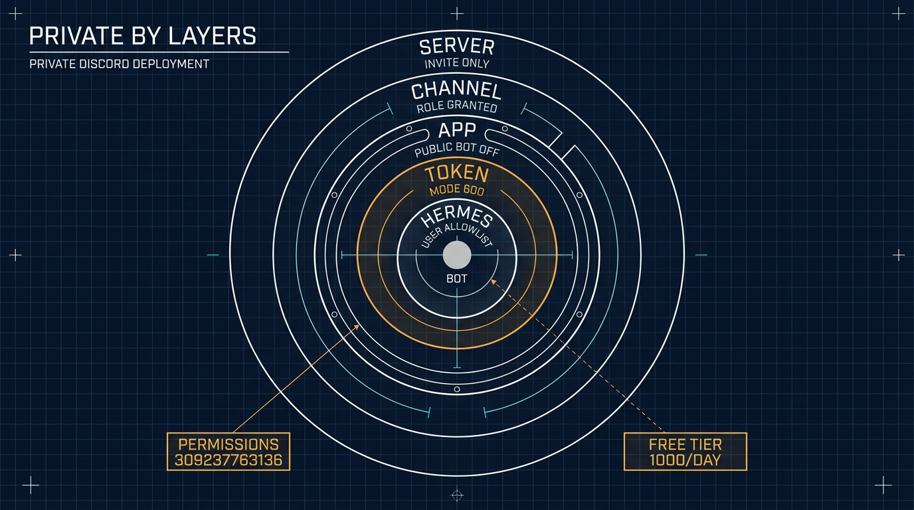

# 在 VPS 上執行一個私有的 ⚕ Hermes Agent，接入 Discord

> 簡體版：[在 VPS 上執行一個私有的 ⚕ Hermes Agent，接入 Discord](https://github.com/j3ffyang/ai-thoughts/blob/main/docs/261107-hermes-discord-integration-zh-hans.md)

**原文：** [261107-hermes-discord-integration.md](https://github.com/j3ffyang/ai-thoughts/blob/main/docs/261107-hermes-discord-integration.md)

*2026-11-07*

**目標：** 全部私有 (private)。一個私有伺服器、一個私有頻道、一個只有你能安裝的私有應用 (app)。沒有你發出的邀請 (invite)，也沒有你新增的允許名單 (allowlist) 條目，任何人都碰不到這個機器人。

**狀態：** 可用——一位朋友加入了伺服器，並和機器人完成了一次可用的對話。機器人會在自己的頻道里就地回覆 @ 提及，也會回覆允許名單上任何人的私信 (DM)。本文記錄的就是這個私有變體：只有所有者能安裝應用、私有頻道、允許名單。

上游參考：<https://github.com/NousResearch/hermes-agent/blob/main/website/docs/user-guide/messaging/discord.md>

## 為什麼不是 Google Chat

Discord 是第二次嘗試。第一次是 Google Chat，它吞掉了我兩三天。

Hermes 自帶 Google Chat 介面卡 (adapter)，所以這份工作看起來平平無奇：一個 Google Cloud 專案、啟用 Chat API、一個服務賬號 (service account)、一個端點 (endpoint)。牆在底下。Chat 應用需要 Business 或 Enterprise 級別的 Google Workspace 賬號——Google 自己的快速上手文件就把這條列在前提條件裡。免費的 Gmail 賬號根本沒法啟用 Google Chat API，而整個流程裡沒有一句話說明這一點。API 就那麼停用著，停在一個你擁有的專案裡，沒有任何開關能把它開啟。

然後 Google Cloud 控制台又補了一刀。Chat API 面板看起來像微軟 Windows 的產物：不同設計年代的嵌板拼在一起、到處都是方框控制元件、該放控制元件的地方是一片空白，而且看不出有誰曾經把整個螢幕當作一個整體看過。它是我用過最難看的介面之一，如果是微軟團隊做的，那一切就解釋得通了。

我放棄了 Google Chat。Discord 只花了零頭的時間，下面就是跑通的那套配置。

**留下的尾巴。** 放棄並不會移除介面卡。它仍然處於配置狀態，並在每次健康檢查時報一個已經死掉的 Pub/Sub 訂閱 (subscription)，所以要關掉它：

```bash
hermes config set platforms.google_chat.enabled false
hermes gateway restart
```

順手把 `GOOGLE_CHAT_*` 那些行從 `~/.hermes/.env` 裡刪掉。如果重啟後警告還在，那不是活的故障：`gateway status` 列印的是 `~/.hermes/gateway_state.json` 裡上一次儲存的快照 (snapshot)。停掉閘道器，把那個檔案挪開，再啟動。

## 各個部件是什麼

| 部件 (piece) | 它是什麼 | 放在哪裡 |
|---|---|---|
| Hermes Agent | Agent 執行時 (runtime) + 閘道器程序 (gateway) | VPS，一個普通使用者賬號下 |
| Discord 應用 (application) | 機器人的身份（名字、頭像、令牌、意圖） | Discord 開發者門戶 |
| Discord 伺服器 (server) | 你自己擁有的私有伺服器 | Discord |
| 伺服器裡的機器人 | 帶著一組許可權安裝進該伺服器的那個應用 | Discord |
| 允許的使用者 | Hermes 實際會答覆的 Discord 使用者 ID | VPS 上的 `~/.hermes/.env` |
| 模型 (model) | 機器人背後的 LLM——這裡是 OpenRouter 的免費變體 | `~/.hermes/config.yaml` |

機器人令牌 (token) 是唯一一個 Discord 秘密。它住在 VPS 上，永遠不進伺服器、不進倉庫、不進聊天訊息。OpenRouter 的金鑰 (key) 是另一個，住在同一個地方。

## 第 1 部分 — VPS 上的 Hermes

一切都在**普通使用者**下執行，不要用 root。安裝器會寫入 `~/.hermes/` 和 `~/.local/bin/`。

```bash
# prerequisites + install
curl -fsSL https://hermes-agent.nousresearch.com/install.sh | bash
source ~/.bashrc
hermes doctor
```

### 模型：Nemotron 3 Ultra，免費

Discord 上的一切都要等 Agent 自己能回答才成立。這套安裝跑的是 OpenRouter 的免費變體，所以一次對話的唯一成本就是每日請求上限 (cap)。

| 欄位 | 值 |
|---|---|
| 提供方 (provider) | `openrouter`, `https://openrouter.ai/api/v1` |
| 模型 | `nvidia/nemotron-3-ultra-550b-a55b:free` — Nemotron 3 Ultra，總引數 550B / 啟用 55B，1M 上下文 (context)，支援工具呼叫 (tool calling) |
| 價格 | \$0 輸入，\$0 輸出（免費變體） |
| 上限 (ceiling) | 每個 UTC 日 1000 次請求，00:00 UTC 重置——從未買過額度的賬號是 50 次 |

```bash
hermes config set OPENROUTER_API_KEY sk-or-v1-...
hermes config set model.provider openrouter
hermes config set model "nvidia/nemotron-3-ultra-550b-a55b:free"
hermes config show
```

檢視當天還剩多少預算。`hermes config set` 會把金鑰寫進 `~/.hermes/.env`，而你的 shell 不會讀那個檔案，所以先載入它：

```bash
set -a; . ~/.hermes/.env; set +a
curl -s https://openrouter.ai/api/v1/key \
  -H "Authorization: Bearer $OPENROUTER_API_KEY" \
  | jq '.data.free_model_daily_requests'
# {"used": 12, "limit": 1000, "remaining": 988}
```

這個上限是賬號下所有 `:free` 模型共用的一個計數器 (counter)，所以換一個免費模型並不會恢復服務。額度用光後，回覆會停到重置為止。

機器人看起來壞掉時，有兩件事值得分開看：429 是限流 (rate limit)——可能是每日上限，也可能是免費檔每分鐘 20 次的突發限制；而回復變慢或拒絕服務，是免費檔在高峰時段的優先順序問題。兩者都不是 Discord 的問題。

把閘道器放進 systemd，這樣登出和重啟都不會丟掉它：

```bash
hermes gateway install     # user unit: hermes-gateway
hermes gateway start
hermes gateway status

sudo loginctl enable-linger $USER   # keep it running after SSH disconnects
```

用 `journalctl --user -u hermes-gateway -f` 跟蹤日誌。

在無頭 (headless) 的 VPS 上，你也可以改用開機啟動的系統級單元 (system unit)：`sudo hermes gateway install --system`，之後 `start`/`status` 都帶上 `--system`，`journalctl -u hermes-gateway -f` 不帶 `--user`。它也讓每一次重啟都需要 root，包括 `hermes update` 結尾那次——使用者單元加 linger 就避開了這一點。

**不要**新增 `ExecStopPost=/bin/kill -9` 這類 drop-in。裝好的單元本來就會乾淨停止，並設定了 `Restart=always`；一個硬殺 (hard-kill) 的 drop-in 會把每次重啟變成無限重生迴圈。

從這裡開始，任何配置或 `.env` 的改動都靠 `hermes gateway restart` 生效。

## 第 2 部分 — Discord 應用 (application)

開啟 <https://discord.com/developers/applications> → **New Application**。

**Bot 頁面：**

- **Public Bot → OFF。** 這套安裝是私有的：關掉 Public Bot 後，**只有你能把這個應用加進伺服器 (guild)**。別人拿著任何 URL 都無法授權它。先到下面的安裝頁把安裝連結設成 **None**——Discord 會拒絕一個還帶著預設安裝連結的私有應用。
- **Require OAuth2 Code Grant → OFF。**
- **特權閘道器意圖 (Privileged Gateway Intents)：** 啟用 **Server Members Intent** 和 **Message Content Intent**。Message Content 是硬性的那個：關掉它，Discord 會拒絕連線，機器人永遠不上線——這是第一大故障。Server Members 則讓 Hermes 能解析使用者名稱和角色。改完儲存。
- **Token → Reset Token**，只複製一次。它不會再次顯示；丟了就只能重置。

如果應用早先是開著 Public Bot 建的，那麼任何拿到 URL 的人現在仍能安裝它——見本部分末尾的**事後加固**。

**安裝頁 (Installation)**（邀請連結）：

- **Installation Contexts：** Guild Install。
- **Install Link → None。** 沒有 "Add App" 按鈕、沒有 App Directory 列表、沒有可洩露的 URL。手動授權 URL 對你這個所有者仍然有效。
- **Scopes：** `bot` + `applications.commands`。
- **Permissions：** `309237763136`（推薦）——View Channels、Send Messages、Embed Links、Attach Files、Read Message History、Create Public Threads、Send Messages in Threads、Add Reactions。`117760` 是最小集；`309240908864` 增加了語音。

手動 URL——自己留著：

```
https://discord.com/oauth2/authorize?client_id=YOUR_APP_ID&scope=bot+applications.commands&permissions=309237763136
```

**裝進你的伺服器：** 由你**自己**開啟那個 URL，選中私有伺服器，Continue → Authorize。從那一刻起應用就在伺服器裡了——**Server Settings → Integrations** 會列出它。頻道的成員列表是另一回事：它只顯示能看見該頻道的成員，所以機器人要等第 4 部分那次授權之後才會出現在那裡，而線上則要等閘道器啟動。這是唯一一次安裝應用；朋友永遠不裝。安裝時授予的許可權之後不會自動增長——要加許可權就重新開啟 URL。

**事後加固。** 用預設設定建立的應用是公開的：Public Bot 開著、帶一個 Discord 提供的安裝連結，任何拿到 URL 的人都能把它加進自己的伺服器。要變成私有有順序，因為第一步沒做完時 Discord 會拒絕第二步：

1. **Installation** → **Install Link** → **None**，Save Changes。
2. **Bot** → **Public Bot** → OFF，Save Changes。

只做一半，應用就仍然可被安裝——Discord 給的報錯是 *Private application cannot have a default authorization link*。這兩個開關都不會把應用從已安裝它的伺服器裡移除；它們只阻止新的授權。之後就用上面的手動 URL 安裝。如果 Discord 回你 *Verified apps must be public*，說明這個應用帶著 Verified 徽章，而驗證只存在於 100 個以上伺服器的機器人——這裡不該適用。

## 第 3 部分 — 把 Hermes 接到機器人

快路徑，它會校驗令牌、檢查意圖、列印一個授權 URL，並把你加進允許名單：

```bash
hermes gateway setup     # choose Discord, paste the token
```

手動路徑——`~/.hermes/.env`：

```bash
DISCORD_BOT_TOKEN=your-bot-token
DISCORD_ALLOWED_USERS=284102345871466496
```

`DISCORD_ALLOWED_USERS` 是一個逗號分隔的**使用者 ID** 列表（Discord 設定 → 高階 → 開啟開發者模式 → 右鍵某個使用者 → Copy User ID）。沒有它——或者沒有 `DISCORD_ALLOWED_ROLES`，也沒有用 `DISCORD_ALLOWED_CHANNELS` 把機器人限制在特定頻道——閘道器會拒絕所有人。

然後：

```bash
hermes gateway restart
```

## 第 4 部分 — 給機器人一個專屬頻道 (channel)

Discord 沒有提供建立頻道的 CLI，所以這一部分是一次圖形介面操作、一次許可權授予，外加一個配置鍵。

**建立它。** 右鍵分類——頂層頻道則右鍵伺服器名——然後 **Create Channel** → **Text**，用機器人的名字命名，比如 `hermes`。

**私有還是公開。** 這套搭建把頻道做成私有：`@everyone`——伺服器裡每個成員都持有的預設角色——什麼都拿不到，可見性按角色單獨授予。Server Settings → Roles → `@everyone`：把 View Channels 關掉，同時把伺服器級 (guild-level) 許可權也全部關掉。**Create Invite** 最要緊：一個能發邀請的成員，就能把你從未批准的人帶進來，你的允許名單說什麼都沒用。Manage Server、Manage Roles、Manage Channels 留給你自己。公開頻道也能用，但那樣每個成員都能看到機器人的對話，私有伺服器的意義就沒了。

**讓機器人進入私有頻道。** **Edit Channel → Permissions → Add members or roles**，選中應用的角色（以應用命名，比如 `Hermes`，應用裝好後會出現在角色列表裡），然後授予：

| 許可權 | 為什麼 |
|---|---|
| View Channel | 沒有它，機器人永遠收不到訊息，也不會出現在該頻道的成員列表裡。頻道是安靜，不是壞了，`gateway.log` 什麼都不顯示 |
| Send Messages | 回覆 |
| Read Message History | 上下文，以及每次被提及時的歷史回填 (backfill) |
| Embed Links, Attach Files | 富文本回答和檔案輸出 |
| Create Public Threads, Send Messages in Threads | 只有你想要自動開執行緒 (thread) 時才需要 |

安裝時的許可權只是設定了上限；在私有頻道里，真正讓機器人進來的是這條覆蓋 (override)。朋友需要從成員角色那裡獲得同一個頻道的 View Channel，與機器人無關。

**選擇頻道的行為方式。** 先複製頻道 ID（開發者模式 → 右鍵頻道 → **Copy Channel ID**），然後三選一：

| 模式 | 配置 | 行為 |
|---|---|---|
| 提及、就地回覆——這套安裝用的 | `no_thread_channels` | 在頻道里直接回復 @ 提及，不開執行緒 |
| 擴音及 (mention-free) | `free_response_channels` | 回覆每條訊息，就地回覆 |
| 每段對話一個執行緒（預設） | 都不設 | 在新的執行緒裡回覆 @ 提及 |

```yaml
# ~/.hermes/config.yaml — the mode this install runs
discord:
  no_thread_channels:
    - 123456789012345678   # <channel id> — reply inline instead of opening a thread
```

擴音及頻道本來就地回覆，所以不需要 `no_thread_channels`。如果想讓它在擴音及的同時，每條頂層訊息仍開一個執行緒，加上 `free_response_auto_thread: true`（它需要 `discord.auto_thread`，後者預設開著）。

```bash
hermes gateway restart
hermes gateway status
```

同樣的開關在 `.env` 裡寫作 `DISCORD_NO_THREAD_CHANNELS` 和 `DISCORD_FREE_RESPONSE_CHANNELS`；兩者都設定時，環境變數優先。

**用 API 建立**——REST 呼叫需要 **Manage Channels**，而 `permissions=309237763136` 裡沒有它，所以機器人會拿到 403。用你自己的客戶端建立頻道，或者先帶著 Manage Channels 重新邀請應用（`309237763136` + `16`）。

## 第 5 部分 — 讓朋友進來

應用始終是你的。朋友從不開啟開發者門戶、不安裝任何東西，也拿不到機器人 URL。四道獨立的關卡 (gate) 決定他們能不能和它說話，每一道都必須開著。頻道範圍是唯一一道一開始就開著的。

| 關卡 | 在哪裡設定 | 它控制什麼 |
|---|---|---|
| 伺服器邀請 | Discord | 他們能不能看到這個伺服器 |
| 頻道可見性 | 頻道許可權 | 他們能不能看到 `#hermes` |
| Hermes 頻道範圍 | `~/.hermes/.env` | 機器人在哪些頻道里回答 |
| Hermes 允許名單 | `~/.hermes/.env` | 機器人會不會回答他們 |

一個上了允許名單的朋友，摸到的是這臺 VPS 上 Agent 的工具面 (tool surface)，不只是一個聊天視窗——把允許名單當成一個 shell 賬號來對待，它到底意味著什麼見下面的*保持私有*。

**斜槓命令 (slash command) 是第二個面。** 沒配置管理員劃分 (admin split) 時，每個上了允許名單的使用者還會拿到整套斜槓命令——包括 `/learn`，它會把一個技能 (skill) 寫進 `~/.hermes/skills`，還有 `/save`、`/rollback` 和 `/update`。工具和命令是分開把關的：`platform_toolsets` 根本看不到斜槓命令。把 `allow_admin_from` 和 `group_allow_admin_from` 設成你的 ID，再給訪客一份很短的 `user_allowed_commands`。確切的配置塊——以及它為什麼該放在 `platforms.discord` 而不是 `gateway.platforms.discord`——在[加固指南](https://github.com/j3ffyang/ai-thoughts/blob/main/docs/261108-hermes-guest-hardening.md)裡。

第一次邀請之前，把 **Community** 關掉——沒有發現 (discovery)，沒有虛榮連結 (vanity link)。訪問權來自你授予的角色。

1. 建立邀請：右鍵伺服器名 → **Invite People** → **Edit invite link** → 設定有效期和最大使用次數。把連結發出去，他們進來後就撤銷。Server Settings → Invites 會列出並一鍵幹掉所有未撤銷的連結。
2. 他們接受邀請，進入伺服器。他們只看得到自己角色允許的頻道——如果你授予了，就是 `#hermes`。
3. 收集他們的**使用者 ID**（開發者模式 → 右鍵他們的名字 → Copy User ID），追加進去：

```bash
# ~/.hermes/.env
DISCORD_ALLOWED_USERS=284102345871466496,198765432109876543
```

```bash
hermes gateway restart
hermes gateway status
```

4. 他們在 `#hermes` 裡發訊息。第一次回覆說明四道關卡都開著；一片沉默說明還有一道關著，故障排查表會指出是哪一道。

**用角色代替列表。** 建一個類似 `hermes-user` 的角色，給它 `#hermes` 的 View Channel，然後設定 `DISCORD_ALLOWED_ROLES=<role-id>`。授予或收回這一個角色，就加上或撤掉訪問權，不用推配置、不用重啟。

**把機器人留在一個頻道里。** 頻道範圍這道關卡，與使用者允許名單分開設定：

```bash
# ~/.hermes/.env
DISCORD_ALLOWED_CHANNELS=123456789012345678
DISCORD_IGNORED_CHANNELS=987654321098765432   # optional hard deny
```

設定了 `DISCORD_ALLOWED_CHANNELS` 後，機器人只在這些頻道和私信裡回答，別處一律不答。私信不遵守那張列表——使用者允許名單是它們唯一的關卡。

## 保持私有 (private)

| 層 (layer) | 設定 | 效果 |
|---|---|---|
| 伺服器 | 不開 Community、不開 Discovery、關掉 widget、一次性限時邀請、`@everyone` 沒有任何伺服器級許可權——首要是 Create Invite | 沒有你發出的連結，伺服器既找不到也進不來 |
| 頻道 | 私有頻道、顯式角色許可權 | 只有被授予的成員和應用能看到 `#hermes` |
| 應用 | Public Bot OFF、Install Link None | 只有你能把應用加到任何地方；不存在公開安裝面 |
| 令牌 | `~/.hermes/.env`，許可權 600，絕不進倉庫或訊息 | 令牌才是真正的憑據——攻擊者要的是它，不是應用的隱私開關 |
| Hermes | `DISCORD_ALLOWED_USERS` + `DISCORD_ALLOWED_CHANNELS` | 被邀請進來但不在允許名單上的成員得不到回覆 |



這套配置**做不到**什麼，直說：

- Discord 不是端到端加密的。頻道訊息、附件和私信都躺在 Discord 的伺服器上，而副本躺在 VPS 上的 `~/.hermes/state.db` 裡。
- 每個提示詞 (prompt) 都會離開 VPS，去往模型提供方（這裡是 OpenRouter 的免費檔），並受那家提供方留存政策的約束。
- 把一個人加進允許名單，就是把這臺 VPS 上 Agent 的工具面交給他——終端、檔案、瀏覽器——**預設如此**。Discord 的隱私設定控制的是*誰能摸到機器人*；`platform_toolsets` 和 `approvals` 控制的是*它被摸到之後能做什麼*。[加固指南](https://github.com/j3ffyang/ai-thoughts/blob/main/docs/261108-hermes-guest-hardening.md)是本文的後半篇：它把寫工具從 Discord 上拿掉，只留在 CLI 裡。

## 機器人的行為

| 場景 | 行為 |
|---|---|
| 私信 | 回覆每條訊息，不需要提及，每個私信一個會話 (session)。只有允許名單上的使用者能走到這一步 |
| 伺服器頻道 | 只有在被 @ 提及時才回答，除非該頻道在 `discord.free_response_channels` 裡。頻道在 `discord.no_thread_channels` 裡時就地回覆，否則開執行緒。設定了 `DISCORD_ALLOWED_CHANNELS` 時，只在那些頻道里回答 |
| 執行緒 | 就地回覆；一旦它進了執行緒，就不再需要提及 |
| 共享頻道、多個人 | 預設按使用者分會話（`group_sessions_per_user: true`） |
| 只 @ 了其他使用者的訊息 | 忽略（避免插進別人的對話） |

`~/.hermes/config.yaml` 裡好用的旋鈕：`discord.free_response_channels`、`discord.no_thread_channels`、`discord.auto_thread`、`discord.reactions`、`display.tool_progress`。

有三個塊共用同一個名字。`discord:` 存行為——就是上面那些旋鈕。`platforms.discord:` 存連線和 `extra`，管理員劃分放在那裡。`gateway.platforms.discord:` 是閘道器仍會讀取的另一種巢狀，在共享鍵上會被頂層塊遮蔽 (shadow)。行為類的鍵永遠不屬於 `extra`。

## 故障排查 (troubleshooting)

| 現象 | 原因 | 修復 |
|---|---|---|
| 機器人一直離線，日誌說 privileged Gateway Intents | Message Content Intent 沒開 | 開啟它，Save Changes，重啟閘道器 |
| 線上，但在某個頻道里沉默 | `require_mention` 預設開著，或者機器人在那裡沒有 View Channel | @ 它，把頻道加進 `free_response_channels`，或在私有頻道上授予 View Channel |
| 線上、View Channel 也給了，仍然沉默 | 那條訊息裡沒有真正的提及——手打的名字只是純文本，除非從彈窗裡選 | 用 `@` 重新輸入並從列表裡選機器人，或者發 `<@BOT_ID> hello` |
| 每條訊息都開一個執行緒 | `auto_thread` 預設開著 | 把頻道加進 `no_thread_channels` |
| 線上，但忽略某一個特定的人 | 他的 ID 不在 `DISCORD_ALLOWED_USERS` 裡 | 加上它並 `hermes gateway restart` |
| 朋友能看到伺服器但看不到 `#hermes` | 頻道是私有的，他的角色缺 View Channel | 把他的角色加進頻道許可權 |
| 私信能答，`#hermes` 裡不答 | 設定了 `DISCORD_ALLOWED_CHANNELS`，而該頻道不在其中 | 加上頻道 ID，再重啟 |
| 別人無法把應用加到另一個伺服器 | Public Bot 關著，這是設計如此——它擋住的是別人，不是你 | 你自己仍然可以：開啟手動 URL 並選另一個伺服器 |
| 啟動時報 `Invalid token` | 令牌被重置過，或貼上時帶了空白字元 | 重置令牌，更新 `.env`，重啟 |
| 日誌裡反覆重啟 | 自定義的 `ExecStopPost` 硬殺 drop-in | 刪掉那個 drop-in，`systemctl --user daemon-reload` |
| 修好並重啟之後，平臺警告還在 | `gateway status` 列印的是 `gateway_state.json` 裡上一次持久化的快照，不是即時探測 | `hermes gateway stop`，把 `~/.hermes/gateway_state.json` 挪開，`hermes gateway start` |
| 命令或執行緒失敗 | 安裝許可權太窄 | 用 `permissions=309237763136` 重新開啟邀請連結 |
| 一天過半之後回覆停了 | 免費模型的每日上限用光了 | 查 `free_model_daily_requests`；等 00:00 UTC 重置 |
| 模型報錯，但機器人線上 | `:free` 變體被下架或改名了 | `hermes config set model <current-slug>`，然後重啟 |

健康檢查：`hermes gateway status`（線上狀態、心跳、降級原因）和 `journalctl --user -u hermes-gateway -f`。

btw, i use arch
