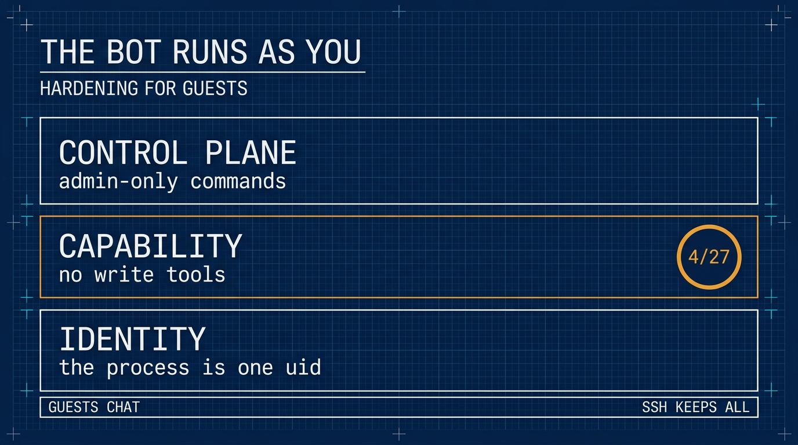

# 机器人以你的身份运作：为访客加固 ⚕ Hermes Agent

> 繁体版：[机器人以你的身份运作：为访客加固 ⚕ Hermes Agent](https://github.com/j3ffyang/ai-thoughts/blob/main/docs/261108-hermes-guest-hardening-zh-hant.md)

**原文：** [261108-hermes-guest-hardening.md](https://github.com/j3ffyang/ai-thoughts/blob/main/docs/261108-hermes-guest-hardening.md)

*2026-11-08*

**论点：** 一个消息机器人 (bot) 不是一个独立的用户。它是你的账号上挂了一个 Discord 适配器 (adapter)；把人加进去，就是把人加进你的 shell——所以边界得画在平台上，而不是画在人身上。

**目标：** 成员 (member) 在 Discord 里留得住这个机器人，同时装不进任何会运行的东西；你在 SSH 里保留完整的工具集 (toolset)。

**状态：** 纯配置。下面的 Discord 清单是五个工具集——四个只读，加上挂在写入闸门 (write gate) 后面的 `skills`——而 CLI 保留全套。

相关：[私有 Discord 部署](https://github.com/j3ffyang/ai-thoughts/blob/main/docs/261107-hermes-discord-integration.md) 讲的是邀请那一半，[技能索引](https://github.com/j3ffyang/ai-thoughts/blob/main/docs/261105-hermes-skill-index.md) 则决定了本文所管的这个库里装了什么。

## 一个技能 (skill) 出现在 ~/.hermes

昨天一位成员 (member) 向机器人要一个自定义技能 (custom skill)。机器人就写了一个，落在 `/home/jeff/.hermes/skills/` 里。什么都没坏。问题恰恰在这：它完全按设计工作，而那个设计是“agent 可以修改它能看到的任何技能”。

技能就是文件。agent 通过 `skill_manage` 创建、打补丁 (patch) 和删除它们。只要这个工具在访客说话的那个平台上开着，访客客气地开个口，就能往你的 VPS 上放一个文件。

## 为什么会这样

gateway 以 `jeff` 这个身份运作。每一次工具调用——`terminal`、`write_file`、`skill_manage`、`cronjob`——都继承那个 uid。进程内部没有权限边界，因为没有第二个身份可以切过去。

所以错在邀请，不在那句提示。把一位成员加进机器人，就是把他加进了那个攥着你 SSH 密钥 (key)、git 配置和家目录的账号。[私有 Discord 部署](https://github.com/j3ffyang/ai-thoughts/blob/main/docs/261107-hermes-discord-integration.md) 讲的是怎么发出一个不把账号交出去的邀请。

## 先要弄清的那个限制

Hermes 按**平台**配置工具，不按用户。gateway 的授权是二元的：一个用户 ID 要么被允许，要么被拒绝。在普通聊天里，没有“这个成员能跑 shell、那个不能”这回事——只有斜杠命令 (slash command) 分成管理员 (admin) 与非管理员。

所以同一个平台上的所有人共用一份工具清单：你在 Discord 上给自己开 `terminal`，每个访客都有了；关掉它，你在那儿也一起没了。shell 是唯一能让你多拿一点权力的地方。

这就把架构定下来了。信任边界只能是**平台**，或者第二个 gateway。它不可能是人。

## 三层

| 层 | 它回答的问题 | 机制 |
|---|---|---|
| 身份 (identity) | 进程是谁？ | 一个专用的 unix 用户——需要一个不在你自己名下的家目录 |
| 能力 (capability) | 访客能让它做什么？ | 按平台定义的工具集，其中的写入受闸门约束 |
| 控制面 (control plane) | 访客能把你做的这些撤销掉吗？ | 只有管理员能用的斜杠命令 |



身份是唯一能扛住一个你还没审计过的工具的那一层。能力是止住今天这起事故的那一层。控制面则让访客没法把已经关掉的东西重新打开。

本文落的是第二层和第三层。第一层需要一个不在你自己名下的家目录：一棵长在 `/home/jeff` 里的目录树，没法与 `chmod 700 /home/jeff` 共存——那会把服务用户锁在自己的家目录外面。下面走的全是纯配置这条路，工具清单就是那道墙。

## 1. 先审计已经有的东西

```bash
# pick the window yourself — the day you noticed, not a date from this article
find ~/.hermes -newermt "-7 days" -type f \
  | grep -vE 'state\.db|/logs/|gateway_state\.json' | head -40
hermes skills list
hermes cron list
```

删之前先把每个新文件读一遍。被种进来的技能 (planted skill) 在之后每次使用时都会跑，所以闭着眼 `rm` 不算审计。然后检查 `~/.hermes/config.yaml` 里有没有你没写过的键，`.env` 里有没有你没设过的值。

## 2. 把写入拿走

每一个能写东西的工具集，以及它写到哪里：

| 工具集 | 工具 | 写入位置 |
|---|---|---|
| `file` | `write_file`, `patch` | gateway uid 能触及的任何路径 |
| `terminal` | `terminal`, `process_manage` | 同上，通过任意命令 |
| `code_execution` | `execute_code` | 同上，通过 Python 和 `subprocess` |
| `skills` | `skill_manage` | `~/.hermes/skills/`——创建、打补丁或删除任何技能；写入闸门开着时暂存到 `~/.hermes/pending/skills/` |
| `memory` | `memory` | `~/.hermes/memories/`——`MEMORY.md` 和 `USER.md` |
| `cronjob` | `cronjob_manage` | `~/.hermes/cron/jobs.json`——之后会执行的写入 |
| `browser` | `browser_exec`, `browser_cdp`, `browser_*` | 浏览器配置和下载；`browser_exec` 能跑 Python |
| `delegation` | `delegate_task` | 子任务继承工具，所以上面任一行都算 |
| `image_gen`, `video_gen`, `tts` | `image_generate`, `video_generate`, `text_to_speech` | 生成的媒体文件 |
| `connections` | `manage_connections` | 配置和 MCP 服务器——而它们会带进新工具 |
| `kanban` | `kanban_*` | `~/.hermes/kanban.db`，以及 `~/.hermes/kanban/` 下的锁 (lock) 和看板元数据 |
| `computer_use` | `computer_use` | 通过桌面能摸到的文件 |
| `discord_admin` | `discord_admin` | 角色和频道——是 Discord，不是文件系统 |

`session_search` 不在这张表里，因为它什么都不写——但它会读过去的对话，光凭隐私这一条就该关掉。

这份选择是整张清单，不是一串删除项：你往 `platform_toolsets.discord` 里放什么，那个平台就恰好得到什么。闸门放前面，写入者放最后，都在同一个文件里：

```yaml
# ~/.hermes/config.yaml
skills:
  write_approval: true           # nothing installs without your approval

platform_toolsets:
  discord:
    - web        # web_search, web_extract
    - vision     # vision_analyze
    - clarify    # ask a question
    - todo       # in-session task list
    - skills     # skill_view, skills_list — writes staged, step 3
```

**不要把这个块当成新段落贴进去。** `skills:` 本来就在，`platform_toolsets:` 也在——只要 `hermes tools` 写过它。再抄一份进去，无论哪一份重复，都会让整个文件解析不了，那时里面所有设置都不生效。改用命令设这两个键：

```bash
hermes config set skills.write_approval true
hermes config set platform_toolsets.discord '["web","vision","clarify","todo","skills"]'
```

`hermes config set` 会写进已经存在的那个块，键完全不存在时会顺带把父路径建出来。如果它不得不重建 `platform_toolsets`，原本待在那个块里的 `cli:` 和 `telegram:` 清单就没了，两者都会回落到默认值。

在“不经过你就什么都装不上”这条规矩下，这就是“尽可能多”。`browser`、`image_gen`、`video_gen` 和 `tts` 看着无害，其实不是：它们会写浏览器配置、下载和媒体文件。

如果要最严的那一档，改成 `discord: []`，工具和对话辅助一起清空。

同一个选择，如果你更愿意点而不愿意打：在 `hermes tools` 里勾这五个框。闸门要设在**让工具集生效的那次重启之前**——勾框写的是文件，重启才让它生效。

```bash
hermes gateway restart
hermes tools --summary
```

**坏掉的配置不会大声失败。** 一个重复的顶层键就让文件解析不了。旧版本会回落到默认值，一个重复的 `skills:` 就这样把所有东西都还原了——工具全回来，没有闸门，没有锁。现在的版本改为继续用最后一次解析成功的配置，新进程则去读 `~/.hermes/backups/config/config.yaml.good.*`。两条路的结果一样：你新写的那块从来没被加载，你刚加的加固静静地不生效，而真正在跑的可能是它之前那份宽松配置。任何手改之后，`hermes config check` 必须不报错，`hermes tools --summary` 必须仍然显示五个。两条都是一行命令，而它们是唯一能抓到这种静默空转的检查。

无论哪种情况，CLI 都保留全套，所以 SSH 会话里你什么都有。

## 3. 技能闸门

`skills` 为什么留在这里：成员需要 `skills_list` 和 `skill_view` 才能看见并使用技能库，而这两个和 `skill_manage` 装在同一个工具集里——工具集不按工具拆分。闸门才是把作者身份留在你手里的东西。每一次 `skill_manage` 写入——创建、打补丁、删除、写文件——都暂存到 `~/.hermes/pending/skills/` 下，而不是装进去；在你动手之前，那个技能是死的。这个目录在第一次暂存写入时才出现，所以全新安装上 `ls` 回你一句 *No such file or directory*，只说明还没有人提过任何东西，不说明闸门是关的。

```
/skills pending      # staged writes, one line each
/skills diff <id>    # the full diff — read it in the CLI, chat truncates
/skills approve <id>
/skills reject <id>
/skills approval on  # the same switch as write_approval, from chat
```

成员保留 `skills_list` 和 `skill_view`；只有你的账号是管理员，所以只有你能批准。代价是每份提案一个暂存的 JSON——是写入，但不是安装——外加每个技能一次审阅。批准过的技能落到 `~/.hermes/skills/`，所以给那个目录 git init：这样每次批准都有 diff 和回退点。你依赖的东西用 `hermes curator lock <skill>` 锁住，批准过的技能会对新会话出现；`/reload-skills` 强制当前会话重新扫描。至于这个库在任何人提案之前就已经花掉多少，是这件事的另一半：[技能索引](https://github.com/j3ffyang/ai-thoughts/blob/main/docs/261105-hermes-skill-index.md) 量过它。

## 4. 关掉控制面

`allow_admin_from` 决定谁能跑**斜杠命令**。它对工具没有影响：斜杠命令是命令，不是能力。作用域很重要——`allow_admin_from` 管私信 (DM)，`group_allow_admin_from` 管服务器频道，两个都要。

`platforms.<name>` 和 `gateway.platforms.<name>` 都会被读，但共享键以顶层块为准，`extra` 也一样。所以只写一处，就写在 `enabled` 旁边：

```yaml
platforms:
  discord:
    enabled: true
    extra:
      allow_admin_from:
        - "<your-user-id>"
      group_allow_admin_from:
        - "<your-user-id>"
      user_allowed_commands:
        - whoami
        - status
      group_user_allowed_commands:
        - whoami
        - status
```

只写一次。如果两个块都带了 `extra`，顶层那个赢，而你会去调那个什么都不做的副本。

非管理员会得到 `/help`、`/whoami`，以及那份清单。他们拿不到 `/yolo`——那会把审批 (approval) 在他们自己的会话里关掉。

**斜杠命令是第二个写入面。** 它们不是工具，所以 `platform_toolsets` 永远看不到它们，而其中好几个自己就会写东西：

| 命令 | 它写什么 |
|---|---|
| `/save` | `~/.hermes/sessions/saved/` 下的会话导出 (md、json、html) |
| `/plan` | `.hermes/plans/` 下的 markdown 计划 |
| `/init` | 生成或更新 `AGENTS.md` |
| `/learn` | 把新技能蒸馏进 `~/.hermes/skills/`（闸门开着时暂存） |
| `/refine`、`/curator` | 记忆与技能维护写入 |
| `/rollback` | 恢复文件系统检查点 (checkpoint) |
| `/update` | 替换 Hermes 安装 |
| `/sethome`、`/model --global`、`/reasoning --global` | 写 `config.yaml` 或 `.env` |

管理员拆分是唯一约束它们的东西。这让它比工具清单更重要，而不是更次要。

`/tools` 不在那张表里，从来也不在：它是**只在 CLI** 的命令，所以在 Discord 里根本不存在，工具选择完全没法从聊天里重新打开。

从频道里查这次拆分，不要从 shell 里查：

```
/whoami
```

**Tier: admin** 说明那个块被读到了。其他任何人都应该看到 **Tier: user**，后面跟着一小串他能跑的命令；那一行就是拆分在生效。**Tier: unrestricted** 说明这个作用域根本没有管理员清单生效——YAML 落到了被遮蔽的那个块里，或者你只设了私信那一对、却在频道里测。那种状态下，上表里的每条命令都对访客敞开。

## 5. 验证

用一个访客账号，要它开 shell、写文件。两个都应该失败，而且是因为工具**不存在**，不是因为模型拒绝了——拒绝只说明工具还在，模型在讲礼貌。然后要一个技能：它应该暂存到 `~/.hermes/pending/skills/` 下，什么都不装。

```bash
hermes tools --summary                          # Discord: five toolsets, nothing installed
find ~/.hermes/skills -newermt '-10 minutes'    # empty
ls ~/.hermes/pending/skills                     # the staged proposal, if any
```

在一个真正的终端里跑 `hermes tools --summary`——被管道接过，或者作为非交互的 SSH 命令跑，它会拒绝，并回你一句 *"requires an interactive terminal"*。

确认你自己的私信仍然答得出话，因为这个改动在那个平台上对你同样生效。

## 最终的样子

| 面 | 聊天 | 工具 | 写入 |
|---|---|---|---|
| Discord——你 | 有 | `web`、`vision`、`clarify`、`todo`、`skills` | 只有暂存 |
| Discord——成员 | 有 | 同样五个 | 只有暂存 |
| SSH + `hermes` | 有 | 全部 | 有 |

留第五个工具集，是为了让访客能看见并使用这个库；拦住他们往里装东西的是闸门。没有你的 `/skills approve`，访客写的东西摸不到 `~/.hermes/skills/`。

在 Discord 上，你和其他成员是平等的。唯一的差别是斜杠命令，而你唯一多掌权的地方是 shell——这正是重点。

## 这套做法换不来什么

- **agent 还是会写。** 会话、日志、记忆和 `state.db` 都由 gateway 用户作为正常运转写。目标是“没有访客指挥的写入”，不是“只读的主机”。
- **提示注入 (prompt injection) 没有变化。** 只要 `web` 还开着，agent 抓回来的一页就仍然能在剩下的工具里操纵它。`web_extract` 也能从你的 VPS 去够内网地址；如果访客只需要聊天，把 `web` 也去掉。
- **审批不是边界。** 上游说得很直白：拒绝规则 (deny rule) 是 shell 层的策略，不是沙箱。`approvals.mode` 塑造的是跑什么，不是把什么关起来。
- **你自己的 Discord 访问也失去同样的工具。** 平台就是边界。管理工作属于 SSH 和 CLI，那里你自己的安装保留全套工具集。
- **按人拆分需要第二个 gateway。** 独立的机器人、独立的 home、独立的工具集。面翻倍，所以只有真需要“在 Discord 里做管理”时才这么做。
- **这里没有第二个身份。** 机器人仍然以你的身份运作，所以工具清单是访客和你的文件之间唯一的屏障。身份那层需要一个不在你自己名下的 home，而长在 `/home/jeff` 下的一棵树不是。
- **`state.db` 有第二道门。** 上面所有东西管的是 Discord 里的访客；它管不到你自己跑的一个客户端。`hermes mcp-serve` 给 MCP 客户端十个工具——读 `~/.hermes/state.db` 里的每条消息、以机器人的身份发言、回应待批的审批——而 `--tools` 在之上再加模型开销。那是你在 shell 里做的决定，不是这套配置的漏洞，[MCP 那篇](https://github.com/j3ffyang/ai-thoughts/blob/main/docs/261109-opencode-remote-hermes-mcp.md) 量过它到底交出了什么。

## 回退

在 `hermes tools` 里把工具集重新打开再重启；`/skills approval off` 用同样的方式解开技能写入。

教训比这套装置小：一次邀请就是一次授权。机器人没有用户表。它只有一个 uid。

这套东西我会先让它跑一阵，再判断算不算定了。真正要紧的问题不是配置在纸上对不对，而是这个机器人在一个人多嘴杂的群里是否还健康：五个工具集、写入暂存、什么都装不进去。实践教给我、而这套配置没覆盖到的东西，会补在这里。

btw, i use arch
