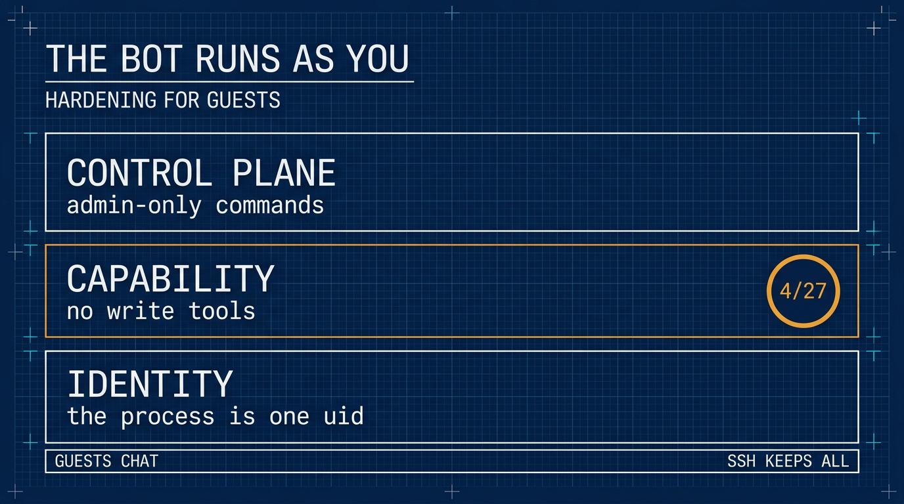

# 機器人以你的身份運作：為訪客加固 ⚕ Hermes Agent

> 簡體版：[機器人以你的身份運作：為訪客加固 ⚕ Hermes Agent](https://github.com/j3ffyang/ai-thoughts/blob/main/docs/261108-hermes-guest-hardening-zh-hans.md)

**原文：** [261108-hermes-guest-hardening.md](https://github.com/j3ffyang/ai-thoughts/blob/main/docs/261108-hermes-guest-hardening.md)

*2026-11-08*

**論點：** 一個訊息機器人 (bot) 不是一個獨立的使用者。它是你的賬號上掛了一個 Discord 介面卡 (adapter)；把人加進去，就是把人加進你的 shell——所以邊界得畫在平臺上，而不是畫在人身上。

**目標：** 成員 (member) 在 Discord 裡留得住這個機器人，同時裝不進任何會執行的東西；你在 SSH 裡保留完整的工具集 (toolset)。

**狀態：** 純配置。下面的 Discord 清單是五個工具集——四個只讀，加上掛在寫入閘門 (write gate) 後面的 `skills`——而 CLI 保留全套。

相關：[私有 Discord 部署](https://github.com/j3ffyang/ai-thoughts/blob/main/docs/261107-hermes-discord-integration.md) 講的是邀請那一半，[技能索引](https://github.com/j3ffyang/ai-thoughts/blob/main/docs/261105-hermes-skill-index.md) 則決定了本文所管的這個庫裡裝了什麼。

## 一個技能 (skill) 出現在 ~/.hermes

昨天一位成員 (member) 向機器人要一個自定義技能 (custom skill)。機器人就寫了一個，落在 `/home/jeff/.hermes/skills/` 裡。什麼都沒壞。問題恰恰在這：它完全按設計工作，而那個設計是“agent 可以修改它能看到的任何技能”。

技能就是檔案。agent 通過 `skill_manage` 建立、打補丁 (patch) 和刪除它們。只要這個工具在訪客說話的那個平臺上開著，訪客客氣地開個口，就能往你的 VPS 上放一個檔案。

## 為什麼會這樣

gateway 以 `jeff` 這個身份運作。每一次工具呼叫——`terminal`、`write_file`、`skill_manage`、`cronjob`——都繼承那個 uid。程序內部沒有許可權邊界，因為沒有第二個身份可以切過去。

所以錯在邀請，不在那句提示。把一位成員加進機器人，就是把他加進了那個攥著你 SSH 金鑰 (key)、git 配置和家目錄的賬號。[私有 Discord 部署](https://github.com/j3ffyang/ai-thoughts/blob/main/docs/261107-hermes-discord-integration.md) 講的是怎麼發出一個不把賬號交出去的邀請。

## 先要弄清的那個限制

Hermes 按**平臺**配置工具，不按使用者。gateway 的授權是二元的：一個使用者 ID 要麼被允許，要麼被拒絕。在普通聊天裡，沒有“這個成員能跑 shell、那個不能”這回事——只有斜槓命令 (slash command) 分成管理員 (admin) 與非管理員。

所以同一個平臺上的所有人共用一份工具清單：你在 Discord 上給自己開 `terminal`，每個訪客都有了；關掉它，你在那兒也一起沒了。shell 是唯一能讓你多拿一點權力的地方。

這就把架構定下來了。信任邊界只能是**平臺**，或者第二個 gateway。它不可能是人。

## 三層

| 層 | 它回答的問題 | 機制 |
|---|---|---|
| 身份 (identity) | 程序是誰？ | 一個專用的 unix 使用者——需要一個不在你自己名下的家目錄 |
| 能力 (capability) | 訪客能讓它做什麼？ | 按平臺定義的工具集，其中的寫入受閘門約束 |
| 控制面 (control plane) | 訪客能把你做的這些撤銷掉嗎？ | 只有管理員能用的斜槓命令 |



身份是唯一能扛住一個你還沒審計過的工具的那一層。能力是止住今天這起事故的那一層。控制面則讓訪客沒法把已經關掉的東西重新開啟。

本文落的是第二層和第三層。第一層需要一個不在你自己名下的家目錄：一棵長在 `/home/jeff` 裡的目錄樹，沒法與 `chmod 700 /home/jeff` 共存——那會把服務使用者鎖在自己的家目錄外面。下面走的全是純配置這條路，工具清單就是那道牆。

## 1. 先審計已經有的東西

```bash
# pick the window yourself — the day you noticed, not a date from this article
find ~/.hermes -newermt "-7 days" -type f \
  | grep -vE 'state\.db|/logs/|gateway_state\.json' | head -40
hermes skills list
hermes cron list
```

刪之前先把每個新檔案讀一遍。被種進來的技能 (planted skill) 在之後每次使用時都會跑，所以閉著眼 `rm` 不算審計。然後檢查 `~/.hermes/config.yaml` 裡有沒有你沒寫過的鍵，`.env` 裡有沒有你沒設過的值。

## 2. 把寫入拿走

每一個能寫東西的工具集，以及它寫到哪裡：

| 工具集 | 工具 | 寫入位置 |
|---|---|---|
| `file` | `write_file`, `patch` | gateway uid 能觸及的任何路徑 |
| `terminal` | `terminal`, `process_manage` | 同上，通過任意命令 |
| `code_execution` | `execute_code` | 同上，通過 Python 和 `subprocess` |
| `skills` | `skill_manage` | `~/.hermes/skills/`——建立、打補丁或刪除任何技能；寫入閘門開著時暫存到 `~/.hermes/pending/skills/` |
| `memory` | `memory` | `~/.hermes/memories/`——`MEMORY.md` 和 `USER.md` |
| `cronjob` | `cronjob_manage` | `~/.hermes/cron/jobs.json`——之後會執行的寫入 |
| `browser` | `browser_exec`, `browser_cdp`, `browser_*` | 瀏覽器配置和下載；`browser_exec` 能跑 Python |
| `delegation` | `delegate_task` | 子任務繼承工具，所以上面任一行都算 |
| `image_gen`, `video_gen`, `tts` | `image_generate`, `video_generate`, `text_to_speech` | 生成的媒體檔案 |
| `connections` | `manage_connections` | 配置和 MCP 伺服器——而它們會帶進新工具 |
| `kanban` | `kanban_*` | `~/.hermes/kanban.db`，以及 `~/.hermes/kanban/` 下的鎖 (lock) 和看板後設資料 |
| `computer_use` | `computer_use` | 通過桌面能摸到的檔案 |
| `discord_admin` | `discord_admin` | 角色和頻道——是 Discord，不是檔案系統 |

`session_search` 不在這張表裡，因為它什麼都不寫——但它會讀過去的對話，光憑隱私這一條就該關掉。

這份選擇是整張清單，不是一串刪除項：你往 `platform_toolsets.discord` 裡放什麼，那個平臺就恰好得到什麼。閘門放前面，寫入者放最後，都在同一個檔案裡：

```yaml
# ~/.hermes/config.yaml
skills:
  write_approval: true           # nothing installs without your approval

platform_toolsets:
  discord:
    - web        # web_search, web_extract
    - vision     # vision_analyze
    - clarify    # ask a question
    - todo       # in-session task list
    - skills     # skill_view, skills_list — writes staged, step 3
```

**不要把這個塊當成新段落貼進去。** `skills:` 本來就在，`platform_toolsets:` 也在——只要 `hermes tools` 寫過它。再抄一份進去，無論哪一份重複，都會讓整個檔案解析不了，那時裡面所有設定都不生效。改用命令設這兩個鍵：

```bash
hermes config set skills.write_approval true
hermes config set platform_toolsets.discord '["web","vision","clarify","todo","skills"]'
```

`hermes config set` 會寫進已經存在的那個塊，鍵完全不存在時會順帶把父路徑建出來。如果它不得不重建 `platform_toolsets`，原本待在那個塊裡的 `cli:` 和 `telegram:` 清單就沒了，兩者都會回落到預設值。

在“不經過你就什麼都裝不上”這條規矩下，這就是“儘可能多”。`browser`、`image_gen`、`video_gen` 和 `tts` 看著無害，其實不是：它們會寫瀏覽器配置、下載和媒體檔案。

如果要最嚴的那一檔，改成 `discord: []`，工具和對話輔助一起清空。

同一個選擇，如果你更願意點而不願意打：在 `hermes tools` 裡勾這五個框。閘門要設在**讓工具集生效的那次重啟之前**——勾框寫的是檔案，重啟才讓它生效。

```bash
hermes gateway restart
hermes tools --summary
```

**壞掉的配置不會大聲失敗。** 一個重複的頂層鍵就讓檔案解析不了。舊版本會回落到預設值，一個重複的 `skills:` 就這樣把所有東西都還原了——工具全回來，沒有閘門，沒有鎖。現在的版本改為繼續用最後一次解析成功的配置，新程序則去讀 `~/.hermes/backups/config/config.yaml.good.*`。兩條路的結果一樣：你新寫的那塊從來沒被載入，你剛加的加固靜靜地不生效，而真正在跑的可能是它之前那份寬鬆配置。任何手改之後，`hermes config check` 必須不報錯，`hermes tools --summary` 必須仍然顯示五個。兩條都是一行命令，而它們是唯一能抓到這種靜默空轉的檢查。

無論哪種情況，CLI 都保留全套，所以 SSH 會話裡你什麼都有。

## 3. 技能閘門

`skills` 為什麼留在這裡：成員需要 `skills_list` 和 `skill_view` 才能看見並使用技能庫，而這兩個和 `skill_manage` 裝在同一個工具集裡——工具集不按工具拆分。閘門才是把作者身份留在你手裡的東西。每一次 `skill_manage` 寫入——建立、打補丁、刪除、寫檔案——都暫存到 `~/.hermes/pending/skills/` 下，而不是裝進去；在你動手之前，那個技能是死的。這個目錄在第一次暫存寫入時才出現，所以全新安裝上 `ls` 回你一句 *No such file or directory*，只說明還沒有人提過任何東西，不說明閘門是關的。

```
/skills pending      # staged writes, one line each
/skills diff <id>    # the full diff — read it in the CLI, chat truncates
/skills approve <id>
/skills reject <id>
/skills approval on  # the same switch as write_approval, from chat
```

成員保留 `skills_list` 和 `skill_view`；只有你的賬號是管理員，所以只有你能批准。代價是每份提案一個暫存的 JSON——是寫入，但不是安裝——外加每個技能一次審閱。批准過的技能落到 `~/.hermes/skills/`，所以給那個目錄 git init：這樣每次批准都有 diff 和回退點。你依賴的東西用 `hermes curator lock <skill>` 鎖住，批准過的技能會對新會話出現；`/reload-skills` 強制當前會話重新掃描。至於這個庫在任何人提案之前就已經花掉多少，是這件事的另一半：[技能索引](https://github.com/j3ffyang/ai-thoughts/blob/main/docs/261105-hermes-skill-index.md) 量過它。

## 4. 關掉控制面

`allow_admin_from` 決定誰能跑**斜槓命令**。它對工具沒有影響：斜槓命令是命令，不是能力。作用域很重要——`allow_admin_from` 管私信 (DM)，`group_allow_admin_from` 管伺服器頻道，兩個都要。

`platforms.<name>` 和 `gateway.platforms.<name>` 都會被讀，但共享鍵以頂層塊為準，`extra` 也一樣。所以只寫一處，就寫在 `enabled` 旁邊：

```yaml
platforms:
  discord:
    enabled: true
    extra:
      allow_admin_from:
        - "<your-user-id>"
      group_allow_admin_from:
        - "<your-user-id>"
      user_allowed_commands:
        - whoami
        - status
      group_user_allowed_commands:
        - whoami
        - status
```

只寫一次。如果兩個塊都帶了 `extra`，頂層那個贏，而你會去調那個什麼都不做的副本。

非管理員會得到 `/help`、`/whoami`，以及那份清單。他們拿不到 `/yolo`——那會把審批 (approval) 在他們自己的會話裡關掉。

**斜槓命令是第二個寫入面。** 它們不是工具，所以 `platform_toolsets` 永遠看不到它們，而其中好幾個自己就會寫東西：

| 命令 | 它寫什麼 |
|---|---|
| `/save` | `~/.hermes/sessions/saved/` 下的會話匯出 (md、json、html) |
| `/plan` | `.hermes/plans/` 下的 markdown 計劃 |
| `/init` | 生成或更新 `AGENTS.md` |
| `/learn` | 把新技能蒸餾進 `~/.hermes/skills/`（閘門開著時暫存） |
| `/refine`、`/curator` | 記憶與技能維護寫入 |
| `/rollback` | 恢復檔案系統檢查點 (checkpoint) |
| `/update` | 替換 Hermes 安裝 |
| `/sethome`、`/model --global`、`/reasoning --global` | 寫 `config.yaml` 或 `.env` |

管理員拆分是唯一約束它們的東西。這讓它比工具清單更重要，而不是更次要。

`/tools` 不在那張表裡，從來也不在：它是**只在 CLI** 的命令，所以在 Discord 里根本不存在，工具選擇完全沒法從聊天裡重新開啟。

從頻道里查這次拆分，不要從 shell 裡查：

```
/whoami
```

**Tier: admin** 說明那個塊被讀到了。其他任何人都應該看到 **Tier: user**，後面跟著一小串他能跑的命令；那一行就是拆分在生效。**Tier: unrestricted** 說明這個作用域根本沒有管理員清單生效——YAML 落到了被遮蔽的那個塊裡，或者你只設了私信那一對、卻在頻道里測。那種狀態下，上表裡的每條命令都對訪客敞開。

## 5. 驗證

用一個訪客賬號，要它開 shell、寫檔案。兩個都應該失敗，而且是因為工具**不存在**，不是因為模型拒絕了——拒絕只說明工具還在，模型在講禮貌。然後要一個技能：它應該暫存到 `~/.hermes/pending/skills/` 下，什麼都不裝。

```bash
hermes tools --summary                          # Discord: five toolsets, nothing installed
find ~/.hermes/skills -newermt '-10 minutes'    # empty
ls ~/.hermes/pending/skills                     # the staged proposal, if any
```

在一個真正的終端裡跑 `hermes tools --summary`——被管道接過，或者作為非互動的 SSH 命令跑，它會拒絕，並回你一句 *"requires an interactive terminal"*。

確認你自己的私信仍然答得出話，因為這個改動在那個平臺上對你同樣生效。

## 最終的樣子

| 面 | 聊天 | 工具 | 寫入 |
|---|---|---|---|
| Discord——你 | 有 | `web`、`vision`、`clarify`、`todo`、`skills` | 只有暫存 |
| Discord——成員 | 有 | 同樣五個 | 只有暫存 |
| SSH + `hermes` | 有 | 全部 | 有 |

留第五個工具集，是為了讓訪客能看見並使用這個庫；攔住他們往裡裝東西的是閘門。沒有你的 `/skills approve`，訪客寫的東西摸不到 `~/.hermes/skills/`。

在 Discord 上，你和其他成員是平等的。唯一的差別是斜槓命令，而你唯一多掌權的地方是 shell——這正是重點。

## 這套做法換不來什麼

- **agent 還是會寫。** 會話、日誌、記憶和 `state.db` 都由 gateway 使用者作為正常運轉寫。目標是“沒有訪客指揮的寫入”，不是“只讀的主機”。
- **提示注入 (prompt injection) 沒有變化。** 只要 `web` 還開著，agent 抓回來的一頁就仍然能在剩下的工具裡操縱它。`web_extract` 也能從你的 VPS 去夠內網地址；如果訪客只需要聊天，把 `web` 也去掉。
- **審批不是邊界。** 上游說得很直白：拒絕規則 (deny rule) 是 shell 層的策略，不是沙箱。`approvals.mode` 塑造的是跑什麼，不是把什麼關起來。
- **你自己的 Discord 訪問也失去同樣的工具。** 平臺就是邊界。管理工作屬於 SSH 和 CLI，那裡你自己的安裝保留全套工具集。
- **按人拆分需要第二個 gateway。** 獨立的機器人、獨立的 home、獨立的工具集。面翻倍，所以只有真需要“在 Discord 裡做管理”時才這麼做。
- **這裡沒有第二個身份。** 機器人仍然以你的身份運作，所以工具清單是訪客和你的檔案之間唯一的屏障。身份那層需要一個不在你自己名下的 home，而長在 `/home/jeff` 下的一棵樹不是。
- **`state.db` 有第二道門。** 上面所有東西管的是 Discord 裡的訪客；它管不到你自己跑的一個客戶端。`hermes mcp-serve` 給 MCP 客戶端十個工具——讀 `~/.hermes/state.db` 裡的每條訊息、以機器人的身份發言、回應待批的審批——而 `--tools` 在之上再加模型開銷。那是你在 shell 裡做的決定，不是這套配置的漏洞，[MCP 那篇](https://github.com/j3ffyang/ai-thoughts/blob/main/docs/261109-opencode-remote-hermes-mcp.md) 量過它到底交出了什麼。

## 回退

在 `hermes tools` 裡把工具集重新開啟再重啟；`/skills approval off` 用同樣的方式解開技能寫入。

教訓比這套裝置小：一次邀請就是一次授權。機器人沒有使用者表。它只有一個 uid。

這套東西我會先讓它跑一陣，再判斷算不算定了。真正要緊的問題不是配置在紙上對不對，而是這個機器人在一個人多嘴雜的群裡是否還健康：五個工具集、寫入暫存、什麼都裝不進去。實踐教給我、而這套配置沒覆蓋到的東西，會補在這裡。

btw, i use arch
