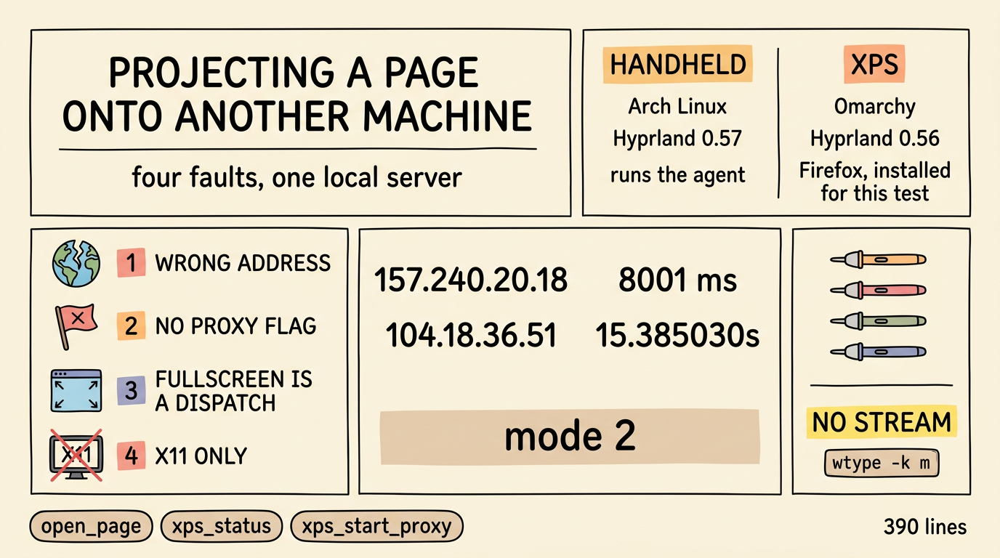
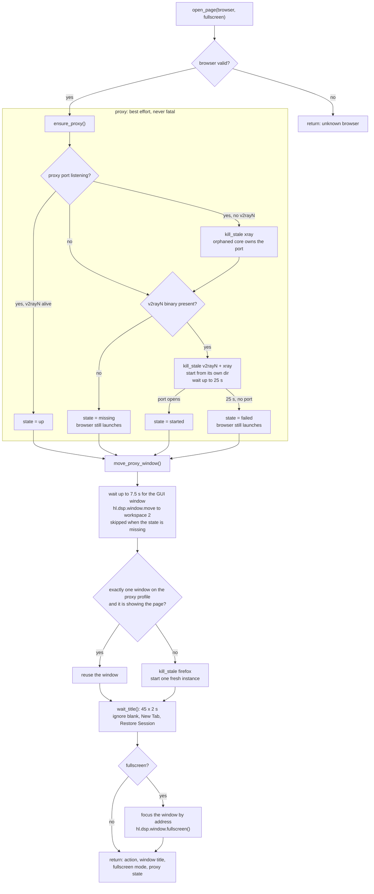

# 把页面投射到另一台机器：一个走 SSH 的本地 MCP (Projecting a Page Onto Another Machine: a Local MCP Over SSH)

> 繁体版：[把页面投射到另一台机器：一个走 SSH 的本地 MCP (Projecting a Page Onto Another Machine: a Local MCP Over SSH)](https://github.com/j3ffyang/ai-thoughts/blob/main/docs/261110-projecting-a-page-onto-another-machine-zh-hant.md)

**原文：** [261110-projecting-a-page-onto-another-machine.md](https://github.com/j3ffyang/ai-thoughts/blob/main/docs/261110-projecting-a-page-onto-another-machine.md)

*2026-11-10，更新于 2026-11-17*

**论点：**「在另一台笔记本上打开这个页面」是一句话的目标，却变成了四个各自独立的故障，没有一个是关于 SSH 的。一个把这些都藏起来的本地 MCP 服务器是 390 行；找出它们则需要在每一步做一次差分测量 (differential measurement)，而每个答案都推翻了上一次的猜测。

**状态：** 在两台机器上端到端验证过；代理冷启动 (cold start)、浏览器启动、全屏派发 (dispatch)，以及代理二进制缺失时的兜底路径，都是在机器处于失败状态下实际跑过的，而不只是看着它工作。



## 目标

两台机器在同一个局域网里。掌机跑智能体 (agent)；笔记本 `xps` 提供屏幕。任务：把 `watch.plex.tv/live-tv` 放到那块屏幕上，用浏览器，全屏，按需。

| | 掌机 | `xps` |
|---|---|---|
| 系统 | Arch Linux | Omarchy（基于 Arch） |
| 桌面 | Hyprland 0.57 | Hyprland 0.56 |
| 浏览器 | — | Firefox，为这次测试专门安装 |
| 角色 | 运行智能体 | 运行代理、浏览器、合成器 (compositor) |

页面不是重点；网络路径才是。`xps` 上跑着一个代理 (proxy)，从指定的 VPN 出口出去，而通过那条路径启动一个应用，就是这次测试的内容。Plex 直播电视只是那个让需求变得可见的应用。

把掌机的会话 (session) 搬过去，这个方案最先被否掉：Chromium 系浏览器在 Linux 上用系统钥匙串 (keyring) 里的密钥加密 cookie，复制过去的配置文件只会是一堆无法解密的字节，除非密钥也一起搬过去——而那样第二台机器就握有第一台的全部 Google 会话。为省一次登录，不值得。于是笔记本启动自己的浏览器，登录只发生一次，就在那台机器上。

## 四个故障

每一个都像是在它之前被测量的那个故障。

### 1. 域名解析到错误的地址

第一次启动产生了一个永远加载不完的窗口。防火墙、DNS、路由——都不是。

`watch.plex.tv` 并不解析到 Plex。测量当天它返回 `157.240.20.18`，一周后变成 `199.59.149.230`；而真实答案，用公共解析器查，是 `104.18.36.51`。错误答案会变，这就是线索：有别的什么东西在应答这个域名，所以在流量走隧道出去之前，页面加载不了。

这就是整个任务重述一遍：不是「打开一个 URL」，而是「通过代理打开一个 URL」。

确认性的测量是一次对照组 (control group)——同一个请求，两台机器，在代理存在之前和之后各一次：

```
direct:            curl: (28) Connection timed out after 8001 milliseconds
through the proxy: 200 in 15.385030s
```

### 2. Firefox 没有 `--proxy-server`

没有这样的命令行开关；代理设置存在 `prefs.js` 里。两个后果，都会咬人：

- 这个设置必须被*写进去*，而不是传进去。服务器每次调用都会写一个专用配置文件的 `user.js`，这让配置是幂等的 (idempotent)，也让代理只作用于一个配置文件，而不是让整个浏览器都走代理。
- 已经在跑的浏览器无法追加设置。第二次调用只会把 URL 转发给已有进程，所以服务器会重启一个缺少该设置的浏览器，在恰好只有一个窗口显示着页面时复用那个窗口，在窗口数量漂移时清掉残留。

代理还顺手解决了 DNS 问题：用 HTTP 代理时，CONNECT 请求携带的是主机名，域名在远端解析，那个被污染的本地答案根本不会被查询。

### 3. 全屏在这里不是浏览器开关

`--start-fullscreen` 看起来是对的，但什么也没做。在平铺合成器 (tiling compositor) 下，尤其是启动被转发给一个已在运行的实例时，这个开关不会作用到新窗口上。

Hyprland 0.56 还改了派发器 (dispatcher) 的语言。旧写法被直接拒绝：

```
$ hyprctl dispatch fullscreen 1
error: [string "return hl.dispatch(fullscreen 1)"]:1: ')' expected near '0'
```

派发器现在是 Lua 表达式，`hl.dsp.*`，而编号并不是看上去那样：**mode 2 才是全屏，mode 1 只是最大化。** 派发 `1` 会把窗口最大化并报告 `fullscreen = 1`，很容易被读成成功。

可用的顺序是先按地址聚焦某个窗口，再把它全屏：

```sh
hyprctl dispatch "hl.dsp.focus({ window = \"address:$addr\" })"
hyprctl dispatch 'hl.dsp.window.fullscreen()'
```

按地址聚焦很重要：目标页面有时会自己开第二个窗口——一个登录步骤——这时全屏「当前活动窗口」就会落到错的窗口上。

### 4. v2rayN 只支持 X11

按需启动代理看起来很简单，却立刻失败：

```
Unhandled exception. System.Exception: XOpenDisplay failed
   at Avalonia.X11.AvaloniaX11Platform.Initialize(X11PlatformOptions options)
```

v2rayN 的 Avalonia 构建只有 X11 后端，没有别的，所以它需要 `DISPLAY`。SSH 会话没有。Hyprland 也不会把 `DISPLAY` 导出到自己的环境里，所以从合成器里读只会读到空。而兜底的 `:0` 比没有显示还糟，因为那里确实存在另一个 X 服务器，而且它会应答：

```
Authorization required, but no authorization protocol specified
```

XWayland 在 `:1`。这个编号每次开机都会变，所以它从 Xwayland 的命令行里读，而不是假设。

还有一个细节：v2rayN 会相对于自己的工作目录解析 `bin/` 和 `guiConfigs/`，所以必须从它自己的目录启动，而不是用 `$HOME` 下的绝对路径。

## 第五个症状：一个没声音的页面

四个故障解决了，投射还是没有完成。页面出来了，在播放，全屏，但是静音：视频角上有一个打叉的喇叭。最直接的理解是笔记本被静音了，而这是错的——错得花了三轮排查。

一个打叉的喇叭可能来自四个地方，每个地方有自己的命令：

| 层 | 命令 | 读数 | 判定 |
|---|---|---|---|
| 音频输出静音 | `pactl get-sink-mute @DEFAULT_SINK@` | `Mute: no` | 未静音 |
| 音频输出音量 | `pactl get-sink-volume @DEFAULT_SINK@` | `9830 / 15% / -49.44 dB`，两个声道 | 很轻，未静音 |
| 硬件混音器 | `amixer -c0 sget Master` | `Playback 22 [25%] [-48.75dB] [on]` | 未静音 |
| **应用级音频流** | `pactl list sink-inputs`、`wpctl status` → `Streams:` | **空——没有流** | **页面从未送出音频** |

最后一行才是决定性的。`Streams:` 是空的，意味着从来没有东西被交给音频输出 (sink)，所以在混音器或 ALSA 层的任何改动都不可能让它发声。调大音量是本能，但那是错的：一个没在播放的页面，音量多大都是静音。那个静音是播放器内部的一个控件——`grim` 截图显示它在视频画面里，左下角，在 1920×1080 屏幕上大约 `(141, 551)` 的位置，那是播放器控件，不是桌面控件。

解决办法就是那个控件，而这台机器上没有指针可以点它：

| 工具 | 在那台机器上的结果 |
|---|---|
| `ydotool` / `dotool` / `xdotool` | 未安装 |
| `wtype` | 已安装——只能键盘，走 Wayland 虚拟键盘协议 |
| `/dev/uinput` | `crw------- root root`——`ydotool` 需要 root |

所以杠杆是站点自己的键盘快捷键。Plex 网页把 `m` 绑定为静音切换，三个步骤和全屏派发形状一样——先发现会话，再对指定窗口动手：

```sh
# an SSH login carries no session env: without this, hyprctl and wtype fail silently
RUNDIR="/run/user/$(id -u)"
WD=$(ls "$RUNDIR" | grep -m1 '^wayland-[0-9]*$')
HIS=$(ls "$RUNDIR/hypr" | head -1)
export XDG_RUNTIME_DIR="$RUNDIR" WAYLAND_DISPLAY="$WD" HYPRLAND_INSTANCE_SIGNATURE="$HIS"

# focus by address, never by title — titles change with the page
hyprctl dispatch "hl.dsp.focus({ window = \"address:0x55b4d64a01d0\" })"

wtype -k m
```

先聚焦不是礼貌。不聚焦，按键会落到当前持有焦点的东西上——这里是停在它自己工作区的 `v2rayN` 窗口——而且失败得完全无声。

所以检查要看效果，不看退出码：

```sh
pactl list sink-inputs | grep -E 'Sink Input|Mute:|application.name'
#   Sink Input #99 · Mute: no · Volume: 100% · application.name = "Firefox"
wpctl status | sed -n '/Audio/,/Video/p'
#   68. Firefox → output_FL / output_FR  [active]
```

`wtype` 无论页面有没有听，都返回 0。**流出现才是证据。** 按键之前根本没有任何 sink-input；按键之后，硬件路径活了。

静音在每次加载时都会被重新置上，而解除只在当前页面有效。实测：在刚解除静音的页面上按 `Ctrl+R`，打叉的喇叭回来了，sink-input 又归零。有两种机制都能产生这个现象，而它们没有被分开——Plex 自己的默认静音，和 Firefox 的默认自动播放 (autoplay) 策略：它在用户手势之前阻止音频，并且只授予一个*临时*权限，导航后就重置。那个配置文件没有自动播放的覆盖设置，`permissions.sqlite` 里也没有 `watch.plex.tv` 的自动播放授权，这与第二种一致，但不能排除第一种。已经确立的结论更窄，也够用：静音会自己回来，而一次按键就能为本次会话解除它。

另一个待办是音频输出的音量——当天是 15%，两天后复查是 25%——解除静音之后，它轻得像是又一个故障。那是另一个决定，所以只做了报告，没有动它。

测量于 2026-11-15，页面在几分钟前刚被投射过去。

## 设计

服务器只暴露三件工具，并且刻意没有通用的「在远端主机上执行命令」工具——那等于把远程代码执行 (remote code execution) 摆在智能体面前。

| 工具 | 做什么 |
|---|---|
| `open_page(browser, fullscreen)` | 确保代理、在配置的 URL 上启动浏览器、把窗口全屏 |
| `xps_start_proxy()` | 如果端口没在监听，就启动代理 |
| `xps_status()` | 代理状态、浏览器进程数、窗口标题 |

所有跟机器相关的值都是环境变量，带一个合理的默认值：ssh 目标、URL、代理地址，以及放着代理二进制的目录。因此提交的文件里没有地址、没有用户名；唯一一个相对 home 的默认值是代理目录，用 `XPS_V2RAY_DIR` 覆盖。

ssh 目标默认是一个别名，不是一个地址。在局域网里，地址通常是 DHCP 租约，所以把它放进别名，把变动留在 `~/.ssh/config` 里——改一行就行——而不是留在 Python 里。

代理启动是**尽力而为 (best effort)**，不是前置条件。端口不通就启动二进制并等待；二进制根本不在，就照常启动浏览器并说明这一点。一个因为一个无关守护进程缺失就拒绝开窗口的投射助手，比一个照常开窗、并如实报告的工具更没用。

### 一次调用，端到端

下面每个分支的存在，都是因为四个故障之一破坏了朴素的顺序：代理先走且永不阻塞，代理 GUI 被停到自己的工作区，浏览器只在已经正确时才复用，全屏是派发出来的而不是传进去的。



## 安装与配置

**这里的代码是参考，不是作业。** 不要照着敲：把服务器或技能交给你的智能体，让它在你的机器上完成。代码片段放在这里，是让你检查它做了什么。

在远端主机上：Hyprland 加上 `hyprctl`、`jq`、来自 iproute2 的 `ss`，以及 Firefox——为这次测试安装，这样代理可以待在自己的配置文件里，不动机器默认的 Chromium。可选 v2rayN，如果网络需要的话。

在运行智能体的机器上：`uv` 和 `ssh`，以及一把已经能用的密钥。在 `~/.ssh/config` 里：

```
Host xps
    HostName 10.0.0.42
    User you
    IdentityFile ~/.ssh/your_key
```

服务器本身就是一个目录：

```
.opencode/mcp/xps-plex/
├── README.md
└── server.py
```

在 `opencode.jsonc` 里注册。SDK 是运行时拉取的，不是安装的，所以系统 Python 不会有任何变化：

```jsonc
"mcp": {
  "servers": {
    "xps-plex": {
      "type": "local",
      "command": [
        "uv", "run", "--with", "mcp",
        "/path/to/xps-plex/server.py"
      ],
      "environment": {
        "XPS_SSH_HOST": "xps",
        "XPS_PROXY_WORKSPACE": "2"
      }
    }
  }
}
```

V2 只从 `mcp.servers` 下读取服务器名；旧文档展示的是裸的 `mcp.xps-plex` 形状，这个 schema 并不定义它。用来「配置了但不连接」的字段是 `disabled`，不是 `enabled`——不写它，服务器就会连接。

MCP 服务器在启动时加载，所以客户端需要重启一次，工具才会出现。

每一个机器相关的值都是那个块里的环境变量，默认值在什么都不设时也能用：

| 变量 | 默认值 | 改变什么 |
|---|---|---|
| `XPS_SSH_HOST` | `xps` | ssh 目标——`~/.ssh/config` 里的别名，不是地址 |
| `XPS_URL` | `https://watch.plex.tv/live-tv` | 要打开的页面 |
| `XPS_PROXY_ADDR` | `127.0.0.1:10808` | 就绪检查轮询的地址；必须和配置文件里的一致，浏览器用的是那个 |
| `XPS_V2RAY_DIR` | `$HOME/pool/Downloads/rog_drive/v2rayN-linux-64` | 代理二进制所在位置 |
| `XPS_PROXY_WORKSPACE` | `2` | 代理 GUI 停放的那个 Hyprland 工作区 |

## 使用

三件工具，没有第四件。每个都是一次调用，最多两个参数，没有一个接受要执行的命令。

| 调用 | 参数 | 返回 |
|---|---|---|
| `open_page(browser, fullscreen)` | `browser`——`"firefox"`（默认）；`fullscreen`——`true`（默认） | 每步一行：浏览器发生了什么、窗口标题、全屏模式、代理状态、代理 GUI 停放的工作区 |
| `xps_start_proxy()` | 无 | 单独的代理状态：`up`、`started`、`missing` 或 `failed` |
| `xps_status()` | 无 | 主机、代理状态、浏览器进程数、窗口标题 |

两个参数都是可选的，所以最普通的调用就是裸的那个：

```
open_page()
```

一次冷启动会报告每一部分，包括顺利的部分：

```
Firefox was not running; started on the proxy profile
window: Live TV Guide - Plex — Mozilla Firefox
fullscreen: mode 2
proxy: was down, v2rayN started
proxy window: workspace 2
```

代理的兜底也会报告自己，而不是失败：

```
window: Live TV Guide - Plex — Mozilla Firefox
fullscreen: mode 2
proxy: v2rayN not found, launched without it
```

在你第二次调用之前，有三件事值得知道。

**它是幂等的 (idempotent)，并且会自己清理。** 如果同一个配置文件已经用恰好一个窗口显示着页面，窗口就被复用，什么都不重启。如果它漂移了——早先调用留下的两个窗口、一个空白标签页、被杀死浏览器留下的崩溃恢复对话框——浏览器会被清掉，然后启动一次。循环调用不会堆出窗口。

**全屏是 mode 2，而且是派发的，不是请求的。** 窗口先按地址聚焦，所以站点有时自己开的登录弹窗抢不走你要的那个页面的全屏。

**代理 GUI 被停到一边。** `v2rayN` 被静默地移到 `XPS_PROXY_WORKSPACE` 指定的工作区（默认 2），于是浏览器独占可见的工作区，而不是跟一个代理窗口共享。

用你对人说话的方式提要求——工具 schema 负责路由：

| 你说 | 会用到 |
|---|---|
| 「在笔记本上打开 Plex 页面，全屏」 | `open_page` |
| 「代理起来了吗，还有什么开着？」 | `xps_status` |
| 「先把代理启动，我自己开页面」 | `xps_start_proxy` |

一个跳过状态检查、直接调 `open_page` 的智能体没有做错什么：服务器自己会检查代理，并报告它发现了什么。

## 排查轨迹

每一行都是一次推翻了上一个假设的测量。

| 观察到的 | 假设 | 实际 |
|---|---|---|
| 页面永远加载不完 | 防火墙挡了 443 | 域名解析到别人的地址；只有代理路径能走 |
| 从目标机访问 `1.1.1.1:443` 失败 | 那台主机出站被过滤 | 从对照机访问同样失败；目标机只是不可达 |
| `--start-fullscreen` 被忽略 | 合成器的怪癖 | 转发式启动从不应用它；全屏属于合成器 |
| `hyprctl dispatch fullscreen 1` | 合法的派发器 | Hyprland 0.56 用 Lua 派发器，而 `1` 是最大化 |
| `XOpenDisplay failed` | 缺少 X 服务器 | v2rayN 只支持 X11，而 `DISPLAY` 从未设置 |
| `DISPLAY` 探测为空 | Hyprland 会导出它 | 它不会；XWayland 的编号必须从命令行读 |
| 页面上的打叉喇叭 | 混音器被静音了 | 混音器没静音，音量 15%；根本不存在 sink-input |
| 页面在播，但没有声音 | Firefox 自动播放策略挡住了 | 静音每次加载都会被重新置上，且熬不过一次导航；一次按键（`m`）为本次会话解除它。播放器静音与自动播放闸门从未被分开 |

`DISPLAY` 的发现过程藏在一个 Python 字符串里：一个写在非原始字符串里的 `sed` 反向引用 (backreference) `\1` 变成了八进制转义 (octal escape) `U+0001`，于是正则静默地匹配不到任何东西，`:0` 兜底就返回了。编译器早就警告过它，两次，而警告被忽略了。`SyntaxWarning` 是一条阅读指令。

## 它不做什么

它不搬运浏览器会话：登录存在远端机器的专用配置文件里，服务器永远看不到凭据。

二进制缺失时它不启动代理，也不验证页面是否渲染出来。它等待一个标题不是占位符的窗口——空白标签页、`New Tab`、崩溃恢复对话框——然后报告它发现了什么。标题背后是不是正确的内容，是调用者的判断。

它不检查页面是否出声。一次投射可以完整——一个窗口、全屏 mode 2、正确的 URL——却仍然在播放器内部静音，这是任何状态报告都揭示不了的。那只能从屏幕上看出来，用页面自己的控件修。

它假设一块显示器、一个合成器。多输出需要派发时指定显示器。

## 文件

服务器和它的 README：[`ai-thoughts/.opencode/mcp/xps-plex`](https://github.com/j3ffyang/ai-thoughts/tree/main/.opencode/mcp/xps-plex)。

做同一件事的技能，同样的脚本逻辑，但没有进程：[`ai-thoughts/.opencode/skills/xps-plex`](https://github.com/j3ffyang/ai-thoughts/tree/main/.opencode/skills/xps-plex)。

该选哪一个、为什么两个都存在：[技能还是 MCP 服务器？](https://github.com/j3ffyang/ai-thoughts/blob/main/docs/261111-skill-vs-mcp.md)。

btw, i use arch
