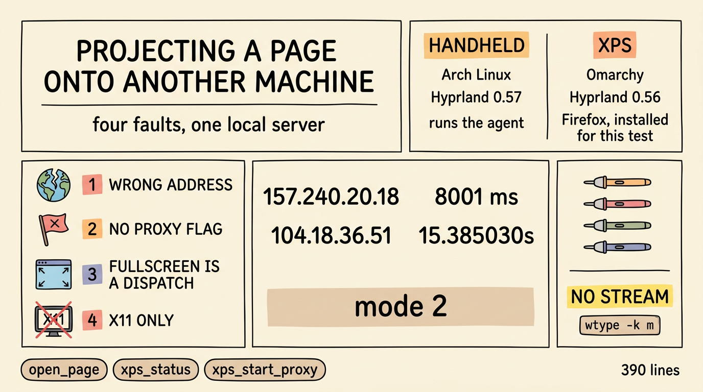
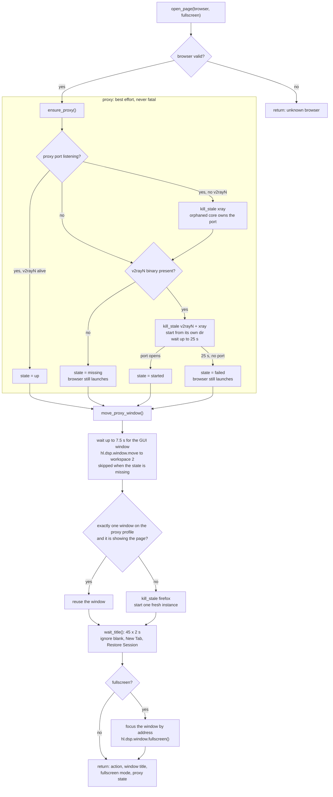

# 把頁面投射到另一臺機器：一個走 SSH 的本地 MCP (Projecting a Page Onto Another Machine: a Local MCP Over SSH)

> 簡體版：[把頁面投射到另一臺機器：一個走 SSH 的本地 MCP (Projecting a Page Onto Another Machine: a Local MCP Over SSH)](https://github.com/j3ffyang/ai-thoughts/blob/main/docs/261110-projecting-a-page-onto-another-machine-zh-hans.md)

**原文：** [261110-projecting-a-page-onto-another-machine.md](https://github.com/j3ffyang/ai-thoughts/blob/main/docs/261110-projecting-a-page-onto-another-machine.md)

*2026-11-10，更新於 2026-11-17*

**論點：**「在另一臺筆記本上開啟這個頁面」是一句話的目標，卻變成了四個各自獨立的故障，沒有一個是關於 SSH 的。一個把這些都藏起來的本地 MCP 伺服器是 390 行；找出它們則需要在每一步做一次差分測量 (differential measurement)，而每個答案都推翻了上一次的猜測。

**狀態：** 在兩臺機器上端到端驗證過；代理冷啟動 (cold start)、瀏覽器啟動、全屏派發 (dispatch)，以及代理二進位制缺失時的兜底路徑，都是在機器處於失敗狀態下實際跑過的，而不只是看著它工作。



## 目標

兩臺機器在同一個區域網裡。掌機跑智慧體 (agent)；筆記本 `xps` 提供螢幕。任務：把 `watch.plex.tv/live-tv` 放到那塊螢幕上，用瀏覽器，全屏，按需。

| | 掌機 | `xps` |
|---|---|---|
| 系統 | Arch Linux | Omarchy（基於 Arch） |
| 桌面 | Hyprland 0.57 | Hyprland 0.56 |
| 瀏覽器 | — | Firefox，為這次測試專門安裝 |
| 角色 | 執行智慧體 | 執行代理、瀏覽器、合成器 (compositor) |

頁面不是重點；網路路徑才是。`xps` 上跑著一個代理 (proxy)，從指定的 VPN 出口出去，而通過那條路徑啟動一個應用，就是這次測試的內容。Plex 直播電視只是那個讓需求變得可見的應用。

把掌機的會話 (session) 搬過去，這個方案最先被否掉：Chromium 系瀏覽器在 Linux 上用系統鑰匙串 (keyring) 裡的金鑰加密 cookie，複製過去的配置檔案只會是一堆無法解密的位元組，除非金鑰也一起搬過去——而那樣第二臺機器就握有第一臺的全部 Google 會話。為省一次登入，不值得。於是筆記本啟動自己的瀏覽器，登入只發生一次，就在那臺機器上。

## 四個故障

每一個都像是在它之前被測量的那個故障。

### 1. 域名解析到錯誤的地址

第一次啟動產生了一個永遠載入不完的視窗。防火牆、DNS、路由——都不是。

`watch.plex.tv` 並不解析到 Plex。測量當天它返回 `157.240.20.18`，一週後變成 `199.59.149.230`；而真實答案，用公共解析器查，是 `104.18.36.51`。錯誤答案會變，這就是線索：有別的什麼東西在應答這個域名，所以在流量走隧道出去之前，頁面載入不了。

這就是整個任務重述一遍：不是「開啟一個 URL」，而是「通過代理開啟一個 URL」。

確認性的測量是一次對照組 (control group)——同一個請求，兩臺機器，在代理存在之前和之後各一次：

```
direct:            curl: (28) Connection timed out after 8001 milliseconds
through the proxy: 200 in 15.385030s
```

### 2. Firefox 沒有 `--proxy-server`

沒有這樣的命令列開關；代理設定存在 `prefs.js` 裡。兩個後果，都會咬人：

- 這個設定必須被*寫進去*，而不是傳進去。伺服器每次呼叫都會寫一個專用配置檔案的 `user.js`，這讓配置是冪等的 (idempotent)，也讓代理只作用於一個配置檔案，而不是讓整個瀏覽器都走代理。
- 已經在跑的瀏覽器無法追加設定。第二次呼叫只會把 URL 轉發給已有程序，所以伺服器會重啟一個缺少該設定的瀏覽器，在恰好只有一個視窗顯示著頁面時複用那個視窗，在視窗數量漂移時清掉殘留。

代理還順手解決了 DNS 問題：用 HTTP 代理時，CONNECT 請求攜帶的是主機名，域名在遠端解析，那個被汙染的本地答案根本不會被查詢。

### 3. 全屏在這裡不是瀏覽器開關

`--start-fullscreen` 看起來是對的，但什麼也沒做。在平鋪合成器 (tiling compositor) 下，尤其是啟動被轉發給一個已在執行的例項時，這個開關不會作用到新視窗上。

Hyprland 0.56 還改了派發器 (dispatcher) 的語言。舊寫法被直接拒絕：

```
$ hyprctl dispatch fullscreen 1
error: [string "return hl.dispatch(fullscreen 1)"]:1: ')' expected near '0'
```

派發器現在是 Lua 表示式，`hl.dsp.*`，而編號並不是看上去那樣：**mode 2 才是全屏，mode 1 只是最大化。** 派發 `1` 會把視窗最大化並報告 `fullscreen = 1`，很容易被讀成成功。

可用的順序是先按地址聚焦某個視窗，再把它全屏：

```sh
hyprctl dispatch "hl.dsp.focus({ window = \"address:$addr\" })"
hyprctl dispatch 'hl.dsp.window.fullscreen()'
```

按地址聚焦很重要：目標頁面有時會自己開第二個視窗——一個登入步驟——這時全屏「當前活動視窗」就會落到錯的視窗上。

### 4. v2rayN 只支援 X11

按需啟動代理看起來很簡單，卻立刻失敗：

```
Unhandled exception. System.Exception: XOpenDisplay failed
   at Avalonia.X11.AvaloniaX11Platform.Initialize(X11PlatformOptions options)
```

v2rayN 的 Avalonia 構建只有 X11 後端，沒有別的，所以它需要 `DISPLAY`。SSH 會話沒有。Hyprland 也不會把 `DISPLAY` 匯出到自己的環境裡，所以從合成器裡讀只會讀到空。而兜底的 `:0` 比沒有顯示還糟，因為那裡確實存在另一個 X 伺服器，而且它會應答：

```
Authorization required, but no authorization protocol specified
```

XWayland 在 `:1`。這個編號每次開機都會變，所以它從 Xwayland 的命令列裡讀，而不是假設。

還有一個細節：v2rayN 會相對於自己的工作目錄解析 `bin/` 和 `guiConfigs/`，所以必須從它自己的目錄啟動，而不是用 `$HOME` 下的絕對路徑。

## 第五個症狀：一個沒聲音的頁面

四個故障解決了，投射還是沒有完成。頁面出來了，在播放，全屏，但是靜音：影片角上有一個打叉的喇叭。最直接的理解是筆記本被靜音了，而這是錯的——錯得花了三輪排查。

一個打叉的喇叭可能來自四個地方，每個地方有自己的命令：

| 層 | 命令 | 讀數 | 判定 |
|---|---|---|---|
| 音訊輸出靜音 | `pactl get-sink-mute @DEFAULT_SINK@` | `Mute: no` | 未靜音 |
| 音訊輸出音量 | `pactl get-sink-volume @DEFAULT_SINK@` | `9830 / 15% / -49.44 dB`，兩個聲道 | 很輕，未靜音 |
| 硬體混音器 | `amixer -c0 sget Master` | `Playback 22 [25%] [-48.75dB] [on]` | 未靜音 |
| **應用級音訊流** | `pactl list sink-inputs`、`wpctl status` → `Streams:` | **空——沒有流** | **頁面從未送出音訊** |

最後一行才是決定性的。`Streams:` 是空的，意味著從來沒有東西被交給音訊輸出 (sink)，所以在混音器或 ALSA 層的任何改動都不可能讓它發聲。調大音量是本能，但那是錯的：一個沒在播放的頁面，音量多大都是靜音。那個靜音是播放器內部的一個控制元件——`grim` 截圖顯示它在影片畫面裡，左下角，在 1920×1080 螢幕上大約 `(141, 551)` 的位置，那是播放器控制元件，不是桌面控制元件。

解決辦法就是那個控制元件，而這臺機器上沒有指標可以點它：

| 工具 | 在那臺機器上的結果 |
|---|---|
| `ydotool` / `dotool` / `xdotool` | 未安裝 |
| `wtype` | 已安裝——只能鍵盤，走 Wayland 虛擬鍵盤協議 |
| `/dev/uinput` | `crw------- root root`——`ydotool` 需要 root |

所以槓桿是站點自己的鍵盤快捷鍵。Plex 網頁把 `m` 繫結為靜音切換，三個步驟和全屏派發形狀一樣——先發現會話，再對指定視窗動手：

```sh
# an SSH login carries no session env: without this, hyprctl and wtype fail silently
RUNDIR="/run/user/$(id -u)"
WD=$(ls "$RUNDIR" | grep -m1 '^wayland-[0-9]*$')
HIS=$(ls "$RUNDIR/hypr" | head -1)
export XDG_RUNTIME_DIR="$RUNDIR" WAYLAND_DISPLAY="$WD" HYPRLAND_INSTANCE_SIGNATURE="$HIS"

# focus by address, never by title — titles change with the page
hyprctl dispatch "hl.dsp.focus({ window = \"address:0x55b4d64a01d0\" })"

wtype -k m
```

先聚焦不是禮貌。不聚焦，按鍵會落到當前持有焦點的東西上——這裡是停在它自己工作區的 `v2rayN` 視窗——而且失敗得完全無聲。

所以檢查要看效果，不看退出碼：

```sh
pactl list sink-inputs | grep -E 'Sink Input|Mute:|application.name'
#   Sink Input #99 · Mute: no · Volume: 100% · application.name = "Firefox"
wpctl status | sed -n '/Audio/,/Video/p'
#   68. Firefox → output_FL / output_FR  [active]
```

`wtype` 無論頁面有沒有聽，都返回 0。**流出現才是證據。** 按鍵之前根本沒有任何 sink-input；按鍵之後，硬體路徑活了。

靜音在每次載入時都會被重新置上，而解除只在當前頁面有效。實測：在剛解除靜音的頁面上按 `Ctrl+R`，打叉的喇叭回來了，sink-input 又歸零。有兩種機制都能產生這個現象，而它們沒有被分開——Plex 自己的預設靜音，和 Firefox 的預設自動播放 (autoplay) 策略：它在使用者手勢之前阻止音訊，並且只授予一個*臨時*許可權，導航後就重置。那個配置檔案沒有自動播放的覆蓋設定，`permissions.sqlite` 裡也沒有 `watch.plex.tv` 的自動播放授權，這與第二種一致，但不能排除第一種。已經確立的結論更窄，也夠用：靜音會自己回來，而一次按鍵就能為本次會話解除它。

另一個待辦是音訊輸出的音量——當天是 15%，兩天後複查是 25%——解除靜音之後，它輕得像是又一個故障。那是另一個決定，所以只做了報告，沒有動它。

測量於 2026-11-15，頁面在幾分鐘前剛被投射過去。

## 設計

伺服器只暴露三件工具，並且刻意沒有通用的「在遠端主機上執行命令」工具——那等於把遠端程式碼執行 (remote code execution) 擺在智慧體面前。

| 工具 | 做什麼 |
|---|---|
| `open_page(browser, fullscreen)` | 確保代理、在配置的 URL 上啟動瀏覽器、把視窗全屏 |
| `xps_start_proxy()` | 如果埠沒在監聽，就啟動代理 |
| `xps_status()` | 代理狀態、瀏覽器程序數、視窗標題 |

所有跟機器相關的值都是環境變數，帶一個合理的預設值：ssh 目標、URL、代理地址，以及放著代理二進位制的目錄。因此提交的檔案裡沒有地址、沒有使用者名稱；唯一一個相對 home 的預設值是代理目錄，用 `XPS_V2RAY_DIR` 覆蓋。

ssh 目標預設是一個別名，不是一個地址。在區域網裡，地址通常是 DHCP 租約，所以把它放進別名，把變動留在 `~/.ssh/config` 裡——改一行就行——而不是留在 Python 裡。

代理啟動是**盡力而為 (best effort)**，不是前置條件。埠不通就啟動二進位制並等待；二進位制根本不在，就照常啟動瀏覽器並說明這一點。一個因為一個無關守護程序缺失就拒絕開視窗的投射助手，比一個照常開窗、並如實報告的工具更沒用。

### 一次呼叫，端到端

下面每個分支的存在，都是因為四個故障之一破壞了樸素的順序：代理先走且永不阻塞，代理 GUI 被停到自己的工作區，瀏覽器只在已經正確時才複用，全屏是派發出來的而不是傳進去的。



## 安裝與配置

**這裡的程式碼是參考，不是作業。** 不要照著敲：把伺服器或技能交給你的智慧體，讓它在你的機器上完成。程式碼片段放在這裡，是讓你檢查它做了什麼。

在遠端主機上：Hyprland 加上 `hyprctl`、`jq`、來自 iproute2 的 `ss`，以及 Firefox——為這次測試安裝，這樣代理可以待在自己的配置檔案裡，不動機器預設的 Chromium。可選 v2rayN，如果網路需要的話。

在執行智慧體的機器上：`uv` 和 `ssh`，以及一把已經能用的金鑰。在 `~/.ssh/config` 裡：

```
Host xps
    HostName 10.0.0.42
    User you
    IdentityFile ~/.ssh/your_key
```

伺服器本身就是一個目錄：

```
.opencode/mcp/xps-plex/
├── README.md
└── server.py
```

在 `opencode.jsonc` 裡註冊。SDK 是執行時拉取的，不是安裝的，所以系統 Python 不會有任何變化：

```jsonc
"mcp": {
  "servers": {
    "xps-plex": {
      "type": "local",
      "command": [
        "uv", "run", "--with", "mcp",
        "/path/to/xps-plex/server.py"
      ],
      "environment": {
        "XPS_SSH_HOST": "xps",
        "XPS_PROXY_WORKSPACE": "2"
      }
    }
  }
}
```

V2 只從 `mcp.servers` 下讀取伺服器名；舊文件展示的是裸的 `mcp.xps-plex` 形狀，這個 schema 並不定義它。用來「配置了但不連線」的欄位是 `disabled`，不是 `enabled`——不寫它，伺服器就會連線。

MCP 伺服器在啟動時載入，所以客戶端需要重啟一次，工具才會出現。

每一個機器相關的值都是那個塊裡的環境變數，預設值在什麼都不設時也能用：

| 變數 | 預設值 | 改變什麼 |
|---|---|---|
| `XPS_SSH_HOST` | `xps` | ssh 目標——`~/.ssh/config` 裡的別名，不是地址 |
| `XPS_URL` | `https://watch.plex.tv/live-tv` | 要開啟的頁面 |
| `XPS_PROXY_ADDR` | `127.0.0.1:10808` | 就緒檢查輪詢的地址；必須和配置檔案裡的一致，瀏覽器用的是那個 |
| `XPS_V2RAY_DIR` | `$HOME/pool/Downloads/rog_drive/v2rayN-linux-64` | 代理二進位制所在位置 |
| `XPS_PROXY_WORKSPACE` | `2` | 代理 GUI 停放的那個 Hyprland 工作區 |

## 使用

三件工具，沒有第四件。每個都是一次呼叫，最多兩個引數，沒有一個接受要執行的命令。

| 呼叫 | 引數 | 返回 |
|---|---|---|
| `open_page(browser, fullscreen)` | `browser`——`"firefox"`（預設）；`fullscreen`——`true`（預設） | 每步一行：瀏覽器發生了什麼、視窗標題、全屏模式、代理狀態、代理 GUI 停放的工作區 |
| `xps_start_proxy()` | 無 | 單獨的代理狀態：`up`、`started`、`missing` 或 `failed` |
| `xps_status()` | 無 | 主機、代理狀態、瀏覽器程序數、視窗標題 |

兩個引數都是可選的，所以最普通的呼叫就是裸的那個：

```
open_page()
```

一次冷啟動會報告每一部分，包括順利的部分：

```
Firefox was not running; started on the proxy profile
window: Live TV Guide - Plex — Mozilla Firefox
fullscreen: mode 2
proxy: was down, v2rayN started
proxy window: workspace 2
```

代理的兜底也會報告自己，而不是失敗：

```
window: Live TV Guide - Plex — Mozilla Firefox
fullscreen: mode 2
proxy: v2rayN not found, launched without it
```

在你第二次呼叫之前，有三件事值得知道。

**它是冪等的 (idempotent)，並且會自己清理。** 如果同一個配置檔案已經用恰好一個視窗顯示著頁面，視窗就被複用，什麼都不重啟。如果它漂移了——早先呼叫留下的兩個視窗、一個空白標籤頁、被殺死瀏覽器留下的崩潰恢復對話方塊——瀏覽器會被清掉，然後啟動一次。迴圈呼叫不會堆出視窗。

**全屏是 mode 2，而且是派發的，不是請求的。** 視窗先按地址聚焦，所以站點有時自己開的登入彈窗搶不走你要的那個頁面的全屏。

**代理 GUI 被停到一邊。** `v2rayN` 被靜默地移到 `XPS_PROXY_WORKSPACE` 指定的工作區（預設 2），於是瀏覽器獨佔可見的工作區，而不是跟一個代理視窗共享。

用你對人說話的方式提要求——工具 schema 負責路由：

| 你說 | 會用到 |
|---|---|
| 「在筆記本上開啟 Plex 頁面，全屏」 | `open_page` |
| 「代理起來了嗎，還有什麼開著？」 | `xps_status` |
| 「先把代理啟動，我自己開頁面」 | `xps_start_proxy` |

一個跳過狀態檢查、直接調 `open_page` 的智慧體沒有做錯什麼：伺服器自己會檢查代理，並報告它發現了什麼。

## 排查軌跡

每一行都是一次推翻了上一個假設的測量。

| 觀察到的 | 假設 | 實際 |
|---|---|---|
| 頁面永遠載入不完 | 防火牆擋了 443 | 域名解析到別人的地址；只有代理路徑能走 |
| 從目標機訪問 `1.1.1.1:443` 失敗 | 那臺主機出站被過濾 | 從對照機訪問同樣失敗；目標機只是不可達 |
| `--start-fullscreen` 被忽略 | 合成器的怪癖 | 轉發式啟動從不應用它；全屏屬於合成器 |
| `hyprctl dispatch fullscreen 1` | 合法的派發器 | Hyprland 0.56 用 Lua 派發器，而 `1` 是最大化 |
| `XOpenDisplay failed` | 缺少 X 伺服器 | v2rayN 只支援 X11，而 `DISPLAY` 從未設定 |
| `DISPLAY` 探測為空 | Hyprland 會匯出它 | 它不會；XWayland 的編號必須從命令列讀 |
| 頁面上的打叉喇叭 | 混音器被靜音了 | 混音器沒靜音，音量 15%；根本不存在 sink-input |
| 頁面在播，但沒有聲音 | Firefox 自動播放策略擋住了 | 靜音每次載入都會被重新置上，且熬不過一次導航；一次按鍵（`m`）為本次會話解除它。播放器靜音與自動播放閘門從未被分開 |

`DISPLAY` 的發現過程藏在一個 Python 字串裡：一個寫在非原始字串裡的 `sed` 反向引用 (backreference) `\1` 變成了八進位制轉義 (octal escape) `U+0001`，於是正則靜默地匹配不到任何東西，`:0` 兜底就返回了。編譯器早就警告過它，兩次，而警告被忽略了。`SyntaxWarning` 是一條閱讀指令。

## 它不做什麼

它不搬運瀏覽器會話：登入存在遠端機器的專用配置檔案裡，伺服器永遠看不到憑據。

二進位制缺失時它不啟動代理，也不驗證頁面是否渲染出來。它等待一個標題不是佔位符的視窗——空白標籤頁、`New Tab`、崩潰恢復對話方塊——然後報告它發現了什麼。標題背後是不是正確的內容，是呼叫者的判斷。

它不檢查頁面是否出聲。一次投射可以完整——一個視窗、全屏 mode 2、正確的 URL——卻仍然在播放器內部靜音，這是任何狀態報告都揭示不了的。那只能從螢幕上看出來，用頁面自己的控制元件修。

它假設一塊顯示器、一個合成器。多輸出需要派發時指定顯示器。

## 檔案

伺服器和它的 README：[`ai-thoughts/.opencode/mcp/xps-plex`](https://github.com/j3ffyang/ai-thoughts/tree/main/.opencode/mcp/xps-plex)。

做同一件事的技能，同樣的指令碼邏輯，但沒有程序：[`ai-thoughts/.opencode/skills/xps-plex`](https://github.com/j3ffyang/ai-thoughts/tree/main/.opencode/skills/xps-plex)。

該選哪一個、為什麼兩個都存在：[技能還是 MCP 伺服器？](https://github.com/j3ffyang/ai-thoughts/blob/main/docs/261111-skill-vs-mcp.md)。

btw, i use arch
