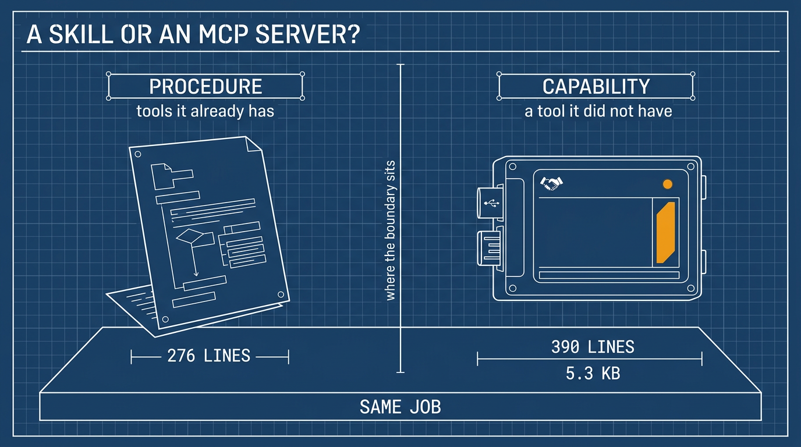

# 技能 (skill) 还是 MCP 服务器？给 agent 一项本事的两种方式

> 繁体版：[技能 (skill) 还是 MCP 服务器？给 agent 一项本事的两种方式](https://github.com/j3ffyang/ai-thoughts/blob/main/docs/261111-skill-vs-mcp-zh-hant.md)

**原文：** [261111-skill-vs-mcp.md](https://github.com/j3ffyang/ai-thoughts/blob/main/docs/261111-skill-vs-mcp.md)

*2026-11-11*

**论点：** 它们不是一个问题的两种答案。**技能 (skill) 教给 agent 一套流程 (procedure)，让它用手里已有的工具跑起来；MCP 服务器则给它一个它原本没有的工具 (capability)。** 把两者混为一谈，会让两边都显得随意——于是你会在一段话就够用的地方写一个服务器，或者在需要一个工具的地方写一段话。

**状态：** 两边都建好了。同一件事——通过 SSH 把 Plex 页面全屏投到第二台笔记本上——现在既有 MCP 服务器版本，也有技能版本；下面每一条论断都以这一对实现为依据，而不是空谈。服务器在[那篇投屏文章](https://github.com/j3ffyang/ai-thoughts/blob/main/docs/261110-projecting-a-page-onto-another-machine.md)里有描述。



## 这件事是为了什么

第二台机器（`xps`）跑的是 Omarchy——一套有主见的 Arch，上面叠着 Hyprland——所以两个版本里的全屏调用都是 Hyprland 的 dispatch（窗口管理器指令），模式编号也是 Hyprland 自己的。

Omarchy 的默认浏览器是 Chromium，也就是 Chrome 所基于的开源项目，所以 Firefox 是特意装的。服务器和技能都只驱动 Firefox 或 Brave，别的都不碰；Firefox 是默认，因为它的代理配置放在一个专用 profile（配置档）的 `user.js` 里，而不是启动参数：一个文件，每次调用都重写，作用域只限那个 profile，别的都不碰。默认浏览器永远不动。

那台机器还跑着一个代理，从选定的某条 VPN 出去。这不是为演示临时加的绕行，它就是被测的东西本身。这项练习的内容是：让一个应用走某条特定网络路径启动，看它在上面怎么表现；而 Plex 直播电视正是让这个要求变得可见的案例：在这个网络里，那个域名解析出来的地址并不是 Plex，所以不开代理打开页面，什么也加载不出来。

所以这件事又窄又具体：从这台笔记本出发，通过 SSH，把 Plex 页面全屏投到那一台上，然后看清到底是 MCP 服务器还是技能更适合做这件事。在这件事上，两者几乎是同一个东西——同样三个动作，同样的脚本逻辑，同样的字段——而这恰恰是这场比较值得做的原因。不同的不是做了什么，而是边界画在哪里。

## 困惑，直白地说

两者都让 agent「能够做一件新事」。从外面看，这像是同一个功能的两种实现之间的选择，而诚实的第一反应是：既然一个 markdown 文件做同样的事，为什么有人要写 390 行 Python？

答案是：它们不在同一层。

|  | SKILL.md | MCP 服务器 |
|---|---|---|
| 增加了什么 | 一套**流程 (procedure)**——工具已有，怎么用 | 一项**能力 (capability)**——客户端原本没有的新工具 |
| 运行的是什么 | agent 自己的工具：`bash`、`ssh`、你随附的脚本 | 一个由客户端启动的进程，说 JSON-RPC |
| 前提是什么 | 调用方有一个 shell | 调用方是一个 MCP 客户端 |

一张食谱告诉厨师，厨房里的锅该怎么用。一台新电器则给出一种厨房原本没有的烹饪方式。两者都能把晚饭端上桌，但只有一个需要电源插座。

## 同一件事，两种形状

服务器版：

```
.opencode/mcp/xps-plex/
├── server.py           15.5 KB, three tools
└── README.md           5.3 KB
```

每个客户端实例一个服务器，启动时由 OpenCode 的配置拉起：

```jsonc
"mcp": {
  "servers": {
    "xps-plex": {
      "type": "local",
      "command": ["uv", "run", "--with", "mcp", "/path/to/server.py"],
      "enabled": true
    }
  }
}
```

技能版是一个散文目录加一个脚本：

```
.opencode/skills/xps-plex/
├── SKILL.md              when to use it, the arguments, the four faults it dodges
└── scripts/xps-plex.sh   the same logic, callable by hand
```

没有进程。没有注册。除了 agent 本来就有的 shell，不需要任何运行时。

## 模型实际看到的东西

这一节决定了其余一切。

**用技能时**，模型看到名字和描述——在它判定这个技能相关之前，别的什么也看不到。那段描述不是一行字；它就是这个技能的价钱，每一轮都要付：

```
name: xps-plex
description: >
  Project a web page fullscreen onto the second laptop (ssh host `xps`) over
  SSH: start the v2rayN proxy if it is down, launch Firefox or Brave on a
  dedicated proxy profile, park the proxy GUI on its own workspace, fullscreen
  the page. … Use when the user asks to put a page, a stream, or Plex live TV
  on the other machine's screen, …
```

这一个 121 个词。本仓库大约二十个技能，永远在线的描述加起来略多于 1,400 个词，大约两千个 token（词元），还没加载任何正文。这很便宜；一旦每段描述都膨胀成一段话，它就不便宜了。

然后它加载正文，读你的流程，用已经有的工具干活。`ssh`、`bash`、`magick`——流程要什么就用什么。如果正文写着「运行 `scripts/xps-plex.sh open --browser firefox`」，结果是确定的。如果正文只有散文、没有脚本，模型每次都自己拼 shell，行为漂移正是从这里开始。

**用 MCP 服务器时**，模型看到带类型参数的工列表：

```
xps_status()
open_page(browser: string = "firefox", fullscreen: boolean = true)
xps_start_proxy()
```

模型这一侧不涉及 shell。客户端启动进程，问 `tools/list`，然后按名字调用。`browser: "chrome"` 是被拒绝的，而不是被猜出来的——但不是 MCP 拒绝，MCP 对浏览器一无所知；也不是 schema（参数结构）拒绝，schema 仍然把这个参数标成普通字符串。同样的 `case` 检查也在技能的脚本里，对同样的输入以 2 退出：Firefox 在这里是标准，拒绝就是在执行这条标准。Chrome 是被政策排除的，不是做不到——把它接到同样的纪律上，也没问题。

所以带类型的接口真正买到的，是*拒绝发生的时机*。`Literal["firefox", "brave"]` 让客户端在真正运行之前就拒绝这次调用；脚本只能在被问过之后才拒绝。

这个接口有一份看得见的代价。所谓「调用服务器」，底下长这样：

```json
{"jsonrpc":"2.0","id":1,"method":"initialize","params":{…}}
{"jsonrpc":"2.0","method":"notifications/initialized"}
{"jsonrpc":"2.0","id":2,"method":"tools/list"}
```

第一次工具调用之前有五条消息——三请求加夹在中间的两响应——外加一次握手，工具不出现时就得调试它。

## 各自在哪里赢

| | SKILL.md | MCP 服务器 |
|---|---|---|
| **创建** | 一个文件，几分钟。`resize-for-banner` 是 4.8 KB，坐下来就写完了 | 一个程序、一个传输层、一份 README 和一条配置——数小时 |
| **简单** | 可编辑的散文；逻辑谁都能读懂 | 代码可读，但接口是协议；调试意味着手工拼帧 |
| **有效性** | 只有在随附脚本时才确定——纯散文只是建议，模型每次重新解释一遍 | 每次都是同一个调用，参数在边界处校验——不过在这一对上两边逻辑都是 shell，所以可靠性并没有变 |
| **运行** | 没有要启动的东西，没有会崩的东西，没有进程，没有端口 | 每个客户端实例一个服务器，启动时拉起，每次修改后重启 |
| **管理** | 放在 `skills.paths` 下的文件；能当一个文件发布；本仓库里大约有二十个 | 每台机器上每个客户端配置里的一条，形态还可能是那个客户端文档已经弃用的；今天为了它写了一次全局配置，而本来想写的是项目配置 |
| **维护** | 改完保存；下一个会话就读到 | 改完重启客户端——服务器改了六次，运行中的会话没有一次看到，直到重启 |
| **上下文成本** | 名字和描述永远在，正文只在用到时加载——只要描述短，能撑到几十个 | 客户端连上时，每个工具 schema 都在工具列表里——这三个序列化成 1.4 KB JSON，大约四百个 token |
| **安全面** | 需要 `bash` 或 `terminal`；一旦有了 shell，技能就约束不了命令——只有 harness（运行框架）能，而且只靠模式匹配 | 三个窄工具没法被说服去 `rm -rf` |
| **团队使用** | 好共享，但每个队友的 agent 都会重新读、重新解释 | 一份经过评审的产物，从中心副本部署——所有人行为一致，一次信任决定而不是 N 次 |

## 决定它的四个问题

1. **调用方有 shell 吗？** 有，技能就能驱动任何东西——`ssh`、`git`、ImageMagick。没有，就只有带类型的接口能动手，这不是偏好问题：那是唯一的门。
2. **一个客户端还是很多？** 技能是一个文件，任何实现了这项约定的 agent 都能读——而约定因客户端而异。MCP 服务器要按客户端、按机器注册，换台机器再注册一次。
3. **下一个改它的是谁？** 散文可以在思路中途改。带接口的代码一改，会把调用方一起拖着走。
4. **能力必须多窄？** 对一个你不完全信任的 agent，三个工具的服务器比 `bash` 是小得多的承诺。

## 这次构建量出了什么

服务器的逻辑几乎全是 shell。`ensure_proxy`、被孤立的 `xray` 核心、窗口计数测试、工作区移动——全都是 `ssh … bash -s`，Python 只负责携带那个字符串。用 MCP 把它包起来，增加了每客户端一个进程——这次构建里是两个，因为启动行是 `uv run`，它会把自己生成的解释器再包一层——一个协议、一条配置和六次重启；它并没有让工作更可靠。

它真正使之可能的，是一个没有 shell 的客户端调用 `open_page()`。这就是这笔投入的全部回报，而且只有那个客户端存在时才值得。

它还不存在。我面前的客户端——OpenCode——有 shell，所以这三个工具每一个都能用技能做到，而我伸手去拿的也是技能。服务器值得建一次，为了弄清协议到底要付多少代价，也为了拿到这场比较的另一半。为了同样的理由再建第二个，就不值了。

技能形态承载着同样的逻辑，276 行 bash 脚本，没有那些仪式，而且能手工运行，这一点比听起来更重要：今天最快的调试窗口逻辑的方式是直接跑命令，而不是对着子进程说 JSON-RPC。前面的散文大约 140 行。服务器需要 390 行 Python、5.3 KB README、一个运行时和六次重启；技能只需要那个脚本，和一次不用重启的保存。

而这里正是这一对打破了自己定的规矩。服务器没有调用技能的脚本；它把同一份 bash 自己抄进了 heredoc。下面的规矩说要包住那个脚本。我实际建的是它的两个副本，让它们保持同步，是这一对我最不愿意重复的部分——下一个服务器应该从 `scripts/xps-plex.sh` 外面套一层薄薄的 `subprocess.run` 开始，前面加一个 schema。

## 规矩

> 先把逻辑写成**脚本**——能手工运行、可测试、没有运行时。在它前面放一个 **SKILL.md**，说明什么时候调用它、带什么参数。只有当没有 shell 的客户端需要它，或者多个客户端必须共享一个带类型的接口时，才把同一个脚本包进 **MCP 服务器**。

本仓库的比例大约是二十个技能对两个服务器，这大致就是这条规矩预测的结果：技能是默认，服务器是有理由的例外。

## 什么不会变

技能是一条指令边界 (instruction boundary)。一个聪明的页面可以说服模型换一套流程，而不是你写的那套，因为解释器是模型自己。

MCP 服务器是一条能力边界 (capability boundary)。没有散文可以掰弯：工具做它做的事，参数会被检查。如果工具本身太宽，它仍然没法让一个坏决定变安全——这就是为什么投屏服务器暴露的是 `open_page`，而不是「在主机上跑一条命令」。

## 「更安全」是什么意思，又不是什么意思

直觉认为 MCP 服务器在两者中更安全，这是对的；但通常给出的理由不对。把所有东西打成一个服务器，是一种部署上的方便——一条配置、一个进程、一份 README——不是安全上的收益。那个进程持有它所有工具所需东西的并集：环境、文件、网络。它暴露的每个工具，agent 都够得着。一个服务器里的三个窄工具仍然是三个窄工具；二十个放在一个里，是更大的信任决定，不是更小的。

控制只来自两件事：每个工具保持窄，以及客户端能够逐个允许或拒绝工具。一旦某个工具接受自由形式的命令，控制就消失了——那一刻你把 `bash` 重新盖了一遍，前面加了个协议，安全声明也跟着没了。

对一个团队来说，MCP 的理由是真实的，但这是一条关于契约 (contract) 而不是关于协议的理由。一份经过评审、带版本、带类型接口的产物，从中心副本部署，让每个队友得到同样的行为和同样窄的选项，而且它没法在某个周二被重新解释成另一套流程。安全是副产品：一个固定的接口评审一次，然后所有人信任它。代价记在账的另一边——每个队友都在本地用自己的权限跑那份代码，这是一条 markdown 文件没有的供应链面。所以当工具保持窄、服务器有人负责时，MCP 是更好的团队默认。当团队已经有 shell，要共享的是一套流程时，一个技能加一个经过评审的脚本更便宜地共享它，而 shell 是本来就已经接受的风险。

两者都不是沙箱 (sandbox)。两者都假设你在把能力交出去之前，已经决定了 agent 可以做什么。

btw, i use arch
