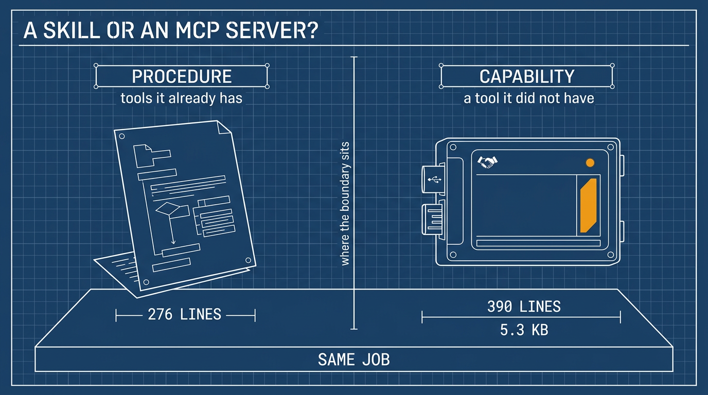

# 技能 (skill) 還是 MCP 伺服器？給 agent 一項本事的兩種方式

> 簡體版：[技能 (skill) 還是 MCP 伺服器？給 agent 一項本事的兩種方式](https://github.com/j3ffyang/ai-thoughts/blob/main/docs/261111-skill-vs-mcp-zh-hans.md)

**原文：** [261111-skill-vs-mcp.md](https://github.com/j3ffyang/ai-thoughts/blob/main/docs/261111-skill-vs-mcp.md)

*2026-11-11*

**論點：** 它們不是一個問題的兩種答案。**技能 (skill) 教給 agent 一套流程 (procedure)，讓它用手裡已有的工具跑起來；MCP 伺服器則給它一個它原本沒有的工具 (capability)。** 把兩者混為一談，會讓兩邊都顯得隨意——於是你會在一段話就夠用的地方寫一個伺服器，或者在需要一個工具的地方寫一段話。

**狀態：** 兩邊都建好了。同一件事——通過 SSH 把 Plex 頁面全屏投到第二臺筆記本上——現在既有 MCP 伺服器版本，也有技能版本；下面每一條論斷都以這一對實現為依據，而不是空談。伺服器在[那篇投屏文章](https://github.com/j3ffyang/ai-thoughts/blob/main/docs/261110-projecting-a-page-onto-another-machine.md)裡有描述。



## 這件事是為了什麼

第二臺機器（`xps`）跑的是 Omarchy——一套有主見的 Arch，上面疊著 Hyprland——所以兩個版本里的全屏呼叫都是 Hyprland 的 dispatch（視窗管理器指令），模式編號也是 Hyprland 自己的。

Omarchy 的預設瀏覽器是 Chromium，也就是 Chrome 所基於的開源專案，所以 Firefox 是特意裝的。伺服器和技能都只驅動 Firefox 或 Brave，別的都不碰；Firefox 是預設，因為它的代理配置放在一個專用 profile（配置檔）的 `user.js` 裡，而不是啟動引數：一個檔案，每次呼叫都重寫，作用域只限那個 profile，別的都不碰。預設瀏覽器永遠不動。

那臺機器還跑著一個代理，從選定的某條 VPN 出去。這不是為演示臨時加的繞行，它就是被測的東西本身。這項練習的內容是：讓一個應用走某條特定網路路徑啟動，看它在上面怎麼表現；而 Plex 直播電視正是讓這個要求變得可見的案例：在這個網路裡，那個域名解析出來的地址並不是 Plex，所以不開代理開啟頁面，什麼也載入不出來。

所以這件事又窄又具體：從這檯筆記本出發，通過 SSH，把 Plex 頁面全屏投到那一臺上，然後看清到底是 MCP 伺服器還是技能更適合做這件事。在這件事上，兩者幾乎是同一個東西——同樣三個動作，同樣的指令碼邏輯，同樣的欄位——而這恰恰是這場比較值得做的原因。不同的不是做了什麼，而是邊界畫在哪裡。

## 困惑，直白地說

兩者都讓 agent「能夠做一件新事」。從外面看，這像是同一個功能的兩種實現之間的選擇，而誠實的第一反應是：既然一個 markdown 檔案做同樣的事，為什麼有人要寫 390 行 Python？

答案是：它們不在同一層。

|  | SKILL.md | MCP 伺服器 |
|---|---|---|
| 增加了什麼 | 一套**流程 (procedure)**——工具已有，怎麼用 | 一項**能力 (capability)**——客戶端原本沒有的新工具 |
| 執行的是什麼 | agent 自己的工具：`bash`、`ssh`、你隨附的指令碼 | 一個由客戶端啟動的程序，說 JSON-RPC |
| 前提是什麼 | 呼叫方有一個 shell | 呼叫方是一個 MCP 客戶端 |

一張食譜告訴廚師，廚房裡的鍋該怎麼用。一臺新電器則給出一種廚房原本沒有的烹飪方式。兩者都能把晚飯端上桌，但只有一個需要電源插座。

## 同一件事，兩種形狀

伺服器版：

```
.opencode/mcp/xps-plex/
├── server.py           15.5 KB, three tools
└── README.md           5.3 KB
```

每個客戶端例項一個伺服器，啟動時由 OpenCode 的配置拉起：

```jsonc
"mcp": {
  "servers": {
    "xps-plex": {
      "type": "local",
      "command": ["uv", "run", "--with", "mcp", "/path/to/server.py"],
      "enabled": true
    }
  }
}
```

技能版是一個散文目錄加一個指令碼：

```
.opencode/skills/xps-plex/
├── SKILL.md              when to use it, the arguments, the four faults it dodges
└── scripts/xps-plex.sh   the same logic, callable by hand
```

沒有程序。沒有註冊。除了 agent 本來就有的 shell，不需要任何執行時。

## 模型實際看到的東西

這一節決定了其餘一切。

**用技能時**，模型看到名字和描述——在它判定這個技能相關之前，別的什麼也看不到。那段描述不是一行字；它就是這個技能的價錢，每一輪都要付：

```
name: xps-plex
description: >
  Project a web page fullscreen onto the second laptop (ssh host `xps`) over
  SSH: start the v2rayN proxy if it is down, launch Firefox or Brave on a
  dedicated proxy profile, park the proxy GUI on its own workspace, fullscreen
  the page. … Use when the user asks to put a page, a stream, or Plex live TV
  on the other machine's screen, …
```

這一個 121 個詞。本倉庫大約二十個技能，永遠線上的描述加起來略多於 1,400 個詞，大約兩千個 token（詞元），還沒載入任何正文。這很便宜；一旦每段描述都膨脹成一段話，它就不便宜了。

然後它載入正文，讀你的流程，用已經有的工具幹活。`ssh`、`bash`、`magick`——流程要什麼就用什麼。如果正文寫著「執行 `scripts/xps-plex.sh open --browser firefox`」，結果是確定的。如果正文只有散文、沒有指令碼，模型每次都自己拼 shell，行為漂移正是從這裡開始。

**用 MCP 伺服器時**，模型看到帶型別引數的工列表：

```
xps_status()
open_page(browser: string = "firefox", fullscreen: boolean = true)
xps_start_proxy()
```

模型這一側不涉及 shell。客戶端啟動程序，問 `tools/list`，然後按名字呼叫。`browser: "chrome"` 是被拒絕的，而不是被猜出來的——但不是 MCP 拒絕，MCP 對瀏覽器一無所知；也不是 schema（引數結構）拒絕，schema 仍然把這個引數標成普通字串。同樣的 `case` 檢查也在技能的腳本里，對同樣的輸入以 2 退出：Firefox 在這裡是標準，拒絕就是在執行這條標準。Chrome 是被政策排除的，不是做不到——把它接到同樣的紀律上，也沒問題。

所以帶型別的介面真正買到的，是*拒絕發生的時機*。`Literal["firefox", "brave"]` 讓客戶端在真正執行之前就拒絕這次呼叫；指令碼只能在被問過之後才拒絕。

這個介面有一份看得見的代價。所謂「呼叫伺服器」，底下長這樣：

```json
{"jsonrpc":"2.0","id":1,"method":"initialize","params":{…}}
{"jsonrpc":"2.0","method":"notifications/initialized"}
{"jsonrpc":"2.0","id":2,"method":"tools/list"}
```

第一次工具呼叫之前有五條訊息——三請求加夾在中間的兩響應——外加一次握手，工具不出現時就得除錯它。

## 各自在哪裡贏

| | SKILL.md | MCP 伺服器 |
|---|---|---|
| **建立** | 一個檔案，幾分鐘。`resize-for-banner` 是 4.8 KB，坐下來就寫完了 | 一個程式、一個傳輸層、一份 README 和一條配置——數小時 |
| **簡單** | 可編輯的散文；邏輯誰都能讀懂 | 程式碼可讀，但介面是協議；除錯意味著手工拼幀 |
| **有效性** | 只有在隨附指令碼時才確定——純散文只是建議，模型每次重新解釋一遍 | 每次都是同一個呼叫，引數在邊界處校驗——不過在這一對上兩邊邏輯都是 shell，所以可靠性並沒有變 |
| **執行** | 沒有要啟動的東西，沒有會崩的東西，沒有程序，沒有埠 | 每個客戶端例項一個伺服器，啟動時拉起，每次修改後重啟 |
| **管理** | 放在 `skills.paths` 下的檔案；能當一個檔案釋出；本倉庫裡大約有二十個 | 每臺機器上每個客戶端配置裡的一條，形態還可能是那個客戶端文件已經棄用的；今天為了它寫了一次全域性配置，而本來想寫的是專案配置 |
| **維護** | 改完儲存；下一個會話就讀到 | 改完重啟客戶端——伺服器改了六次，執行中的會話沒有一次看到，直到重啟 |
| **上下文成本** | 名字和描述永遠在，正文只在用到時載入——只要描述短，能撐到幾十個 | 客戶端連上時，每個工具 schema 都在工具列表裡——這三個序列化成 1.4 KB JSON，大約四百個 token |
| **安全面** | 需要 `bash` 或 `terminal`；一旦有了 shell，技能就約束不了命令——只有 harness（執行框架）能，而且只靠模式匹配 | 三個窄工具沒法被說服去 `rm -rf` |
| **團隊使用** | 好共享，但每個隊友的 agent 都會重新讀、重新解釋 | 一份經過評審的產物，從中心副本部署——所有人行為一致，一次信任決定而不是 N 次 |

## 決定它的四個問題

1. **呼叫方有 shell 嗎？** 有，技能就能驅動任何東西——`ssh`、`git`、ImageMagick。沒有，就只有帶型別的介面能動手，這不是偏好問題：那是唯一的門。
2. **一個客戶端還是很多？** 技能是一個檔案，任何實現了這項約定的 agent 都能讀——而約定因客戶端而異。MCP 伺服器要按客戶端、按機器註冊，換臺機器再註冊一次。
3. **下一個改它的是誰？** 散文可以在思路中途改。帶介面的程式碼一改，會把呼叫方一起拖著走。
4. **能力必須多窄？** 對一個你不完全信任的 agent，三個工具的伺服器比 `bash` 是小得多的承諾。

## 這次構建量出了什麼

伺服器的邏輯幾乎全是 shell。`ensure_proxy`、被孤立的 `xray` 核心、視窗計數測試、工作區移動——全都是 `ssh … bash -s`，Python 只負責攜帶那個字串。用 MCP 把它包起來，增加了每客戶端一個程序——這次構建裡是兩個，因為啟動行是 `uv run`，它會把自己生成的直譯器再包一層——一個協議、一條配置和六次重啟；它並沒有讓工作更可靠。

它真正使之可能的，是一個沒有 shell 的客戶端呼叫 `open_page()`。這就是這筆投入的全部回報，而且只有那個客戶端存在時才值得。

它還不存在。我面前的客戶端——OpenCode——有 shell，所以這三個工具每一個都能用技能做到，而我伸手去拿的也是技能。伺服器值得建一次，為了弄清協議到底要付多少代價，也為了拿到這場比較的另一半。為了同樣的理由再建第二個，就不值了。

技能形態承載著同樣的邏輯，276 行 bash 指令碼，沒有那些儀式，而且能手工執行，這一點比聽起來更重要：今天最快的除錯視窗邏輯的方式是直接跑命令，而不是對著子程序說 JSON-RPC。前面的散文大約 140 行。伺服器需要 390 行 Python、5.3 KB README、一個執行時和六次重啟；技能只需要那個指令碼，和一次不用重啟的儲存。

而這裡正是這一對打破了自己定的規矩。伺服器沒有呼叫技能的指令碼；它把同一份 bash 自己抄進了 heredoc。下面的規矩說要包住那個指令碼。我實際建的是它的兩個副本，讓它們保持同步，是這一對我最不願意重複的部分——下一個伺服器應該從 `scripts/xps-plex.sh` 外面套一層薄薄的 `subprocess.run` 開始，前面加一個 schema。

## 規矩

> 先把邏輯寫成**指令碼**——能手工執行、可測試、沒有執行時。在它前面放一個 **SKILL.md**，說明什麼時候呼叫它、帶什麼引數。只有當沒有 shell 的客戶端需要它，或者多個客戶端必須共享一個帶型別的介面時，才把同一個指令碼包進 **MCP 伺服器**。

本倉庫的比例大約是二十個技能對兩個伺服器，這大致就是這條規矩預測的結果：技能是預設，伺服器是有理由的例外。

## 什麼不會變

技能是一條指令邊界 (instruction boundary)。一個聰明的頁面可以說服模型換一套流程，而不是你寫的那套，因為直譯器是模型自己。

MCP 伺服器是一條能力邊界 (capability boundary)。沒有散文可以掰彎：工具做它做的事，引數會被檢查。如果工具本身太寬，它仍然沒法讓一個壞決定變安全——這就是為什麼投屏伺服器暴露的是 `open_page`，而不是「在主機上跑一條命令」。

## 「更安全」是什麼意思，又不是什麼意思

直覺認為 MCP 伺服器在兩者中更安全，這是對的；但通常給出的理由不對。把所有東西打成一個伺服器，是一種部署上的方便——一條配置、一個程序、一份 README——不是安全上的收益。那個程序持有它所有工具所需東西的並集：環境、檔案、網路。它暴露的每個工具，agent 都夠得著。一個伺服器裡的三個窄工具仍然是三個窄工具；二十個放在一個裡，是更大的信任決定，不是更小的。

控制只來自兩件事：每個工具保持窄，以及客戶端能夠逐個允許或拒絕工具。一旦某個工具接受自由形式的命令，控制就消失了——那一刻你把 `bash` 重新蓋了一遍，前面加了個協議，安全宣告也跟著沒了。

對一個團隊來說，MCP 的理由是真實的，但這是一條關於契約 (contract) 而不是關於協議的理由。一份經過評審、帶版本、帶型別介面的產物，從中心副本部署，讓每個隊友得到同樣的行為和同樣窄的選項，而且它沒法在某個週二被重新解釋成另一套流程。安全是副產品：一個固定的介面評審一次，然後所有人信任它。代價記在賬的另一邊——每個隊友都在本地用自己的許可權跑那份程式碼，這是一條 markdown 檔案沒有的供應鏈面。所以當工具保持窄、伺服器有人負責時，MCP 是更好的團隊預設。當團隊已經有 shell，要共享的是一套流程時，一個技能加一個經過評審的指令碼更便宜地共享它，而 shell 是本來就已經接受的風險。

兩者都不是沙箱 (sandbox)。兩者都假設你在把能力交出去之前，已經決定了 agent 可以做什麼。

btw, i use arch
