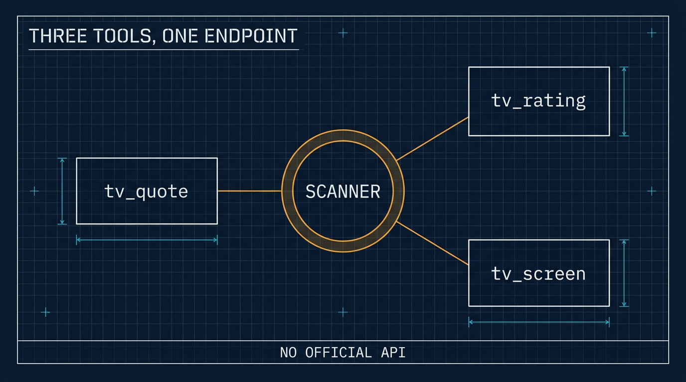

# 一个 TradingView MCP：三个工具，一条没有文档的端点

> 繁体版：[一个 TradingView MCP：三个工具，一条没有文档的端点](https://github.com/j3ffyang/ai-thoughts/blob/main/docs/261111-tradingview-mcp-zh-hant.md)

**原文：** [261111-tradingview-mcp.md](https://github.com/j3ffyang/ai-thoughts/blob/main/docs/261111-tradingview-mcp.md)

*2026-11-11*

**论点：** **TradingView** 不发布 API，所以每一个 TradingView 工具都架在它自家网页应用会调用的那些端点上。把其中一个包成 MCP 是小事；真正的工作是找出它哪些回答在悄悄出错。

**状态：** 两个面都在跑——本地的 **◧ OpenCode** 和 **⚕ Hermes** 机器人——三个只读工具，各自都对着实时数据验证过。

## 为什么要有它

我想让 agent 回答“NVDA 现在怎么样”，而不用自己开一张图。TradingView 就是那个答案所在的地方，而 TradingView 没有官方 API——没有 key、没有文档化的端点、没有开发者计划。存在的只是一组它自己网站会调用的端点，以及几个跟它们说话的库。

这些库并不等价，差别在维护：

| 库 | 最近发布 | 结论 |
|---|---|---|
| `tradingview-screener` | 2026-09 | 仍在维护；驱动 scanner 端点 |
| `tradingview-ta` | 2022 | 已停滞，而且它的评级本来就是 scanner 字段 |
| `tradingview-scraper` | 2026-09 | 抓图表数据，更脆 |
| `pyTradingView` | 2026-02 | websocket 客户端，可动部件更多 |

一个库就够了。扫描器（scanner）同时给出报价、技术评级和筛选——正是我真正想要的全部：不用画图、不用 websocket、不用 cookie。

## 三个工具

| 工具 | 参数 | 回答什么 |
|---|---|---|
| `tv_quote` | symbols、market | 价格、涨跌、成交量、市值、评级 |
| `tv_rating` | symbol、interval、market | 拆成均线与振荡指标的总评 |
| `tv_screen` | filters、market、limit、sort | “找出满足……的股票” |

```
NASDAQ:AAPL  AAPL  348.51  -0.62  29,756,060  5.06T  0.26
NASDAQ:NVDA  NVDA  168.89  -5.47  429,273,195  4.07T  -0.51
```

代码可以光写：`AAPL` 会解析成 `NASDAQ:AAPL`，`BTC` 解析成 `BINANCE:BTCUSDT`。

评级从 −1 到 +1。把它并排打出来之所以值得，是因为三列会互相打架：NVDA 有一阵读数是 `overall −0.51, moving averages −0.93, oscillators −0.09`——趋势向下，动量已经停止下跌。单一数字会把这件事藏起来。



## 第一版搞错的三件事

**串起来的过滤器会互相覆盖。** 一个要求 `RSI < 25` 的筛选返回了 RSI 55 的 AAPL。客户端的 `where()` 是替换过滤条件，不是追加，所以只有最后一个条件活了下来；用 `where(*conditions)` 传进去才是 AND。这个教训可以推广：一个悄悄只保留一个条件的查询构造器，会给出看似合理但错误的结果——没有报错，只有错误的名单。

**`type == "stock"` 并不等于普通股。** `BAC/PE`、`MS/PA` 这类优先股（preferred share）也报告 `type: stock`，而它们会占满一个超卖筛选，因为优先股交易清淡、跌得也快。真正的区分字段是 `typespecs`，所以股票筛选现在会自动加上 `typespecs has 'common'`，除非你自己在筛它；表格下面也会注明这一点。

**数字不等于呈现。** 扫描器返回的是 `-0.6216316404801981`。在边缘四舍五入、给千位加分隔、把市值写成 `5.06T`，是一个读得下去的表和一堆转储之间的差别。

## 为什么是 MCP 而不是技能

同样的问题在投影工具那次也出现过，答案写在[另一篇](https://github.com/j3ffyang/ai-thoughts/blob/main/docs/261111-skill-vs-mcp.md)里：技能教的是一套流程，MCP 加的是一项能力。这里的决定因素是过滤语法。`tv_screen` 收的是带字段、操作符、`between` 和 `has` 的 JSON——作为工具 schema (schema)，这套语法随调用一起到达，写错字段会被用模型能照着改的话拒绝。写在技能里的散文，在我第一次加字段时就会开始漂移。

代价是诚实的：三个工具定义常驻上下文，约 670 词元 (token)。对一个在大多数交易对话里都会用到的工具，这很便宜。

## 注册它

在本地，OpenCode 从它的配置里读 `mcp.servers.<name>`。两个坑，都踩过：

- 扁平的 `mcp.<name>` 写法仍然能用，但 schema 里已标为弃用 (deprecated)；在同一个文件里混用两种形状，就是你最后去调那个什么都不做的副本的原因。
- 改完配置后，`opencode mcp list` 读到的是后台服务的缓存状态，显示的还是旧服务器列表。文件一直是对的。在相信“少了某个服务器”之前，重启服务，或者用 `opencode debug config` 看。

在 Hermes 那台 VPS 上形状不同：`hermes mcp add <name> --command … --args …`，它会连接、列出工具、并问你要不要启用——非交互运行时它会在那个提示处取消，所以要么把 `y` 管进去，要么之后再补启用。

那台主机没有 `uv` 也没有 `ensurepip`，所以服务器住在 `~/.hermes/mcp/tradingview/` 下自己的虚拟环境里，pip 只引导进那一个目录。没有往系统里装任何东西。

## 在机器人上启用它到底意味着什么

Hermes 把每个 MCP 服务器暴露成一个工具集 (toolset)——`mcp-tradingview`——而一个平台得到一串工具集。把它加进 `platform_toolsets.discord`，就等于给了频道里的**每个人**，因为 Hermes 按平台配置工具，从来不按用户。没有办法只交给其中一个人。

在这里这没问题：这些工具只读扫描器，什么都不写。它确实意味着每个成员的问题都花我账号上的模型词元。在加下一个工具集之前，值得知道这一点。

## 它不做什么

没有图表数据——K 线属于另一个端点、另一个库，这里回答的是“它现在什么状态”，不是“给我画张图”。没有自选列表、没有提醒、没有观点 (ideas)：那些需要一个登录会话，而把 cookie 放进配置文件是另一个风险等级。什么都不写。

以及那条诚实的限制：这是针对 TradingView 随时可能某个早上改掉的端点的非官方工具。数据是他们的，查询供个人使用，这里的东西不该被再分发。

## 文件

- GitHub：[tradingview MCP](https://github.com/j3ffyang/ai-thoughts/tree/main/.opencode/mcp/tradingview)——`server.py` 和它的 README。

教训与 TradingView 无关。任何没有文档化 API 的服务仍然有它的形状，而工作是找出这个形状在哪里悄悄对你说谎。

btw, i use arch
