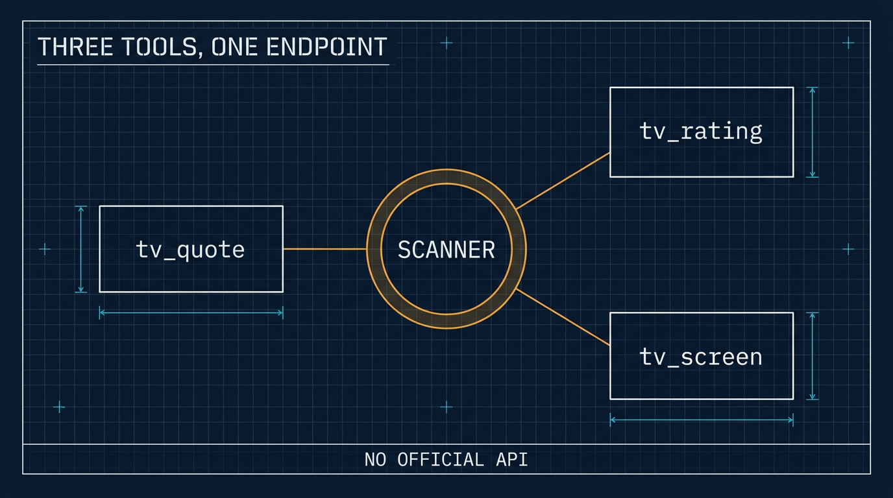

# 一個 TradingView MCP：三個工具，一條沒有文件的端點

> 簡體版：[一個 TradingView MCP：三個工具，一條沒有文件的端點](https://github.com/j3ffyang/ai-thoughts/blob/main/docs/261111-tradingview-mcp-zh-hans.md)

**原文：** [261111-tradingview-mcp.md](https://github.com/j3ffyang/ai-thoughts/blob/main/docs/261111-tradingview-mcp.md)

*2026-11-11*

**論點：** **TradingView** 不釋出 API，所以每一個 TradingView 工具都架在它自家網頁應用會呼叫的那些端點上。把其中一個包成 MCP 是小事；真正的工作是找出它哪些回答在悄悄出錯。

**狀態：** 兩個面都在跑——本地的 **◧ OpenCode** 和 **⚕ Hermes** 機器人——三個只讀工具，各自都對著即時資料驗證過。

## 為什麼要有它

我想讓 agent 回答“NVDA 現在怎麼樣”，而不用自己開一張圖。TradingView 就是那個答案所在的地方，而 TradingView 沒有官方 API——沒有 key、沒有文件化的端點、沒有開發者計劃。存在的只是一組它自己網站會呼叫的端點，以及幾個跟它們說話的庫。

這些庫並不等價，差別在維護：

| 庫 | 最近釋出 | 結論 |
|---|---|---|
| `tradingview-screener` | 2026-09 | 仍在維護；驅動 scanner 端點 |
| `tradingview-ta` | 2022 | 已停滯，而且它的評級本來就是 scanner 欄位 |
| `tradingview-scraper` | 2026-09 | 抓圖表資料，更脆 |
| `pyTradingView` | 2026-02 | websocket 客戶端，可動部件更多 |

一個庫就夠了。掃描器（scanner）同時給出報價、技術評級和篩選——正是我真正想要的全部：不用畫圖、不用 websocket、不用 cookie。

## 三個工具

| 工具 | 引數 | 回答什麼 |
|---|---|---|
| `tv_quote` | symbols、market | 價格、漲跌、成交量、市值、評級 |
| `tv_rating` | symbol、interval、market | 拆成均線與振盪指標的總評 |
| `tv_screen` | filters、market、limit、sort | “找出滿足……的股票” |

```
NASDAQ:AAPL  AAPL  348.51  -0.62  29,756,060  5.06T  0.26
NASDAQ:NVDA  NVDA  168.89  -5.47  429,273,195  4.07T  -0.51
```

程式碼可以光寫：`AAPL` 會解析成 `NASDAQ:AAPL`，`BTC` 解析成 `BINANCE:BTCUSDT`。

評級從 −1 到 +1。把它並排打出來之所以值得，是因為三列會互相打架：NVDA 有一陣讀數是 `overall −0.51, moving averages −0.93, oscillators −0.09`——趨勢向下，動量已經停止下跌。單一數字會把這件事藏起來。



## 第一版搞錯的三件事

**串起來的過濾器會互相覆蓋。** 一個要求 `RSI < 25` 的篩選返回了 RSI 55 的 AAPL。客戶端的 `where()` 是替換過濾條件，不是追加，所以只有最後一個條件活了下來；用 `where(*conditions)` 傳進去才是 AND。這個教訓可以推廣：一個悄悄只保留一個條件的查詢建構子，會給出看似合理但錯誤的結果——沒有報錯，只有錯誤的名單。

**`type == "stock"` 並不等於普通股。** `BAC/PE`、`MS/PA` 這類優先股（preferred share）也報告 `type: stock`，而它們會佔滿一個超賣篩選，因為優先股交易清淡、跌得也快。真正的區分欄位是 `typespecs`，所以股票篩選現在會自動加上 `typespecs has 'common'`，除非你自己在篩它；表格下面也會註明這一點。

**數字不等於呈現。** 掃描器返回的是 `-0.6216316404801981`。在邊緣四捨五入、給千位加分隔、把市值寫成 `5.06T`，是一個讀得下去的表和一堆轉儲之間的差別。

## 為什麼是 MCP 而不是技能

同樣的問題在投影工具那次也出現過，答案寫在[另一篇](https://github.com/j3ffyang/ai-thoughts/blob/main/docs/261111-skill-vs-mcp.md)裡：技能教的是一套流程，MCP 加的是一項能力。這裡的決定因素是過濾語法。`tv_screen` 收的是帶欄位、運算子、`between` 和 `has` 的 JSON——作為工具 schema (schema)，這套語法隨呼叫一起到達，寫錯欄位會被用模型能照著改的話拒絕。寫在技能裡的散文，在我第一次加欄位時就會開始漂移。

代價是誠實的：三個工具定義常駐上下文，約 670 詞元 (token)。對一個在大多數交易對話裡都會用到的工具，這很便宜。

## 註冊它

在本地，OpenCode 從它的配置裡讀 `mcp.servers.<name>`。兩個坑，都踩過：

- 扁平的 `mcp.<name>` 寫法仍然能用，但 schema 裡已標為棄用 (deprecated)；在同一個檔案裡混用兩種形狀，就是你最後去調那個什麼都不做的副本的原因。
- 改完配置後，`opencode mcp list` 讀到的是後臺服務的快取狀態，顯示的還是舊伺服器列表。檔案一直是對的。在相信“少了某個伺服器”之前，重啟服務，或者用 `opencode debug config` 看。

在 Hermes 那臺 VPS 上形狀不同：`hermes mcp add <name> --command … --args …`，它會連線、列出工具、並問你要不要啟用——非互動執行時它會在那個提示處取消，所以要麼把 `y` 管進去，要麼之後再補啟用。

那臺主機沒有 `uv` 也沒有 `ensurepip`，所以伺服器住在 `~/.hermes/mcp/tradingview/` 下自己的虛擬環境裡，pip 只引導進那一個目錄。沒有往系統裡裝任何東西。

## 在機器人上啟用它到底意味著什麼

Hermes 把每個 MCP 伺服器暴露成一個工具集 (toolset)——`mcp-tradingview`——而一個平臺得到一串工具集。把它加進 `platform_toolsets.discord`，就等於給了頻道里的**每個人**，因為 Hermes 按平臺配置工具，從來不按使用者。沒有辦法只交給其中一個人。

在這裡這沒問題：這些工具只讀掃描器，什麼都不寫。它確實意味著每個成員的問題都花我賬號上的模型詞元。在加下一個工具集之前，值得知道這一點。

## 它不做什麼

沒有圖表資料——K 線屬於另一個端點、另一個庫，這裡回答的是“它現在什麼狀態”，不是“給我畫張圖”。沒有自選列表、沒有提醒、沒有觀點 (ideas)：那些需要一個登入會話，而把 cookie 放進配置檔案是另一個風險等級。什麼都不寫。

以及那條誠實的限制：這是針對 TradingView 隨時可能某個早上改掉的端點的非官方工具。資料是他們的，查詢供個人使用，這裡的東西不該被再分發。

## 檔案

- GitHub：[tradingview MCP](https://github.com/j3ffyang/ai-thoughts/tree/main/.opencode/mcp/tradingview)——`server.py` 和它的 README。

教訓與 TradingView 無關。任何沒有文件化 API 的服務仍然有它的形狀，而工作是找出這個形狀在哪裡悄悄對你說謊。

btw, i use arch
